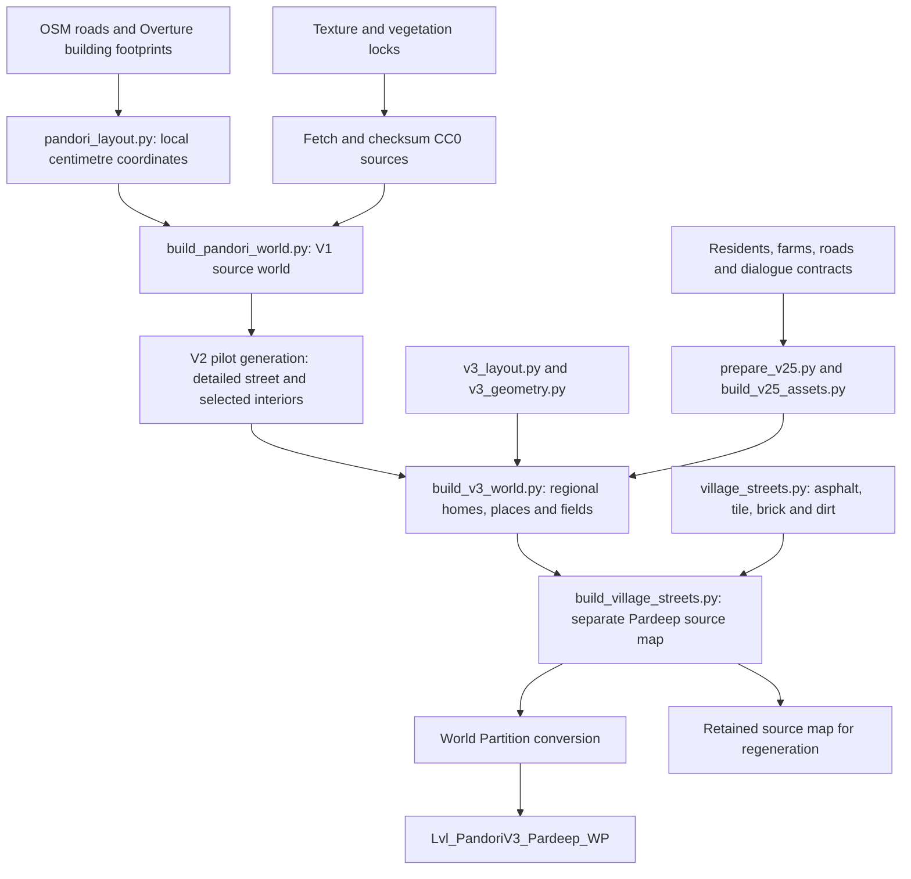
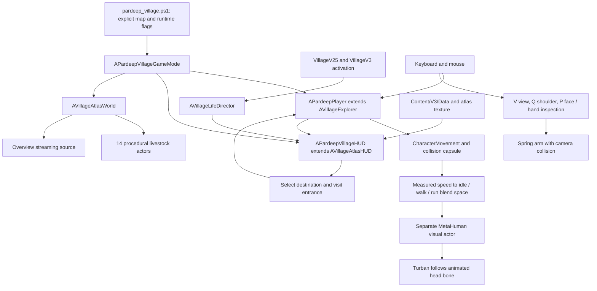
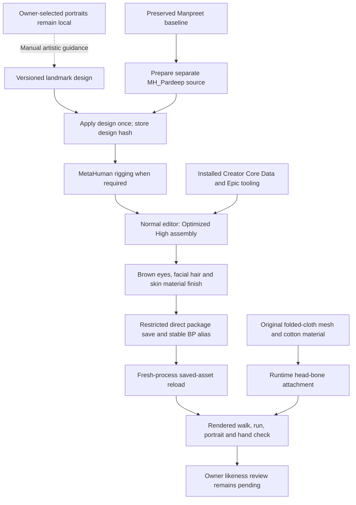
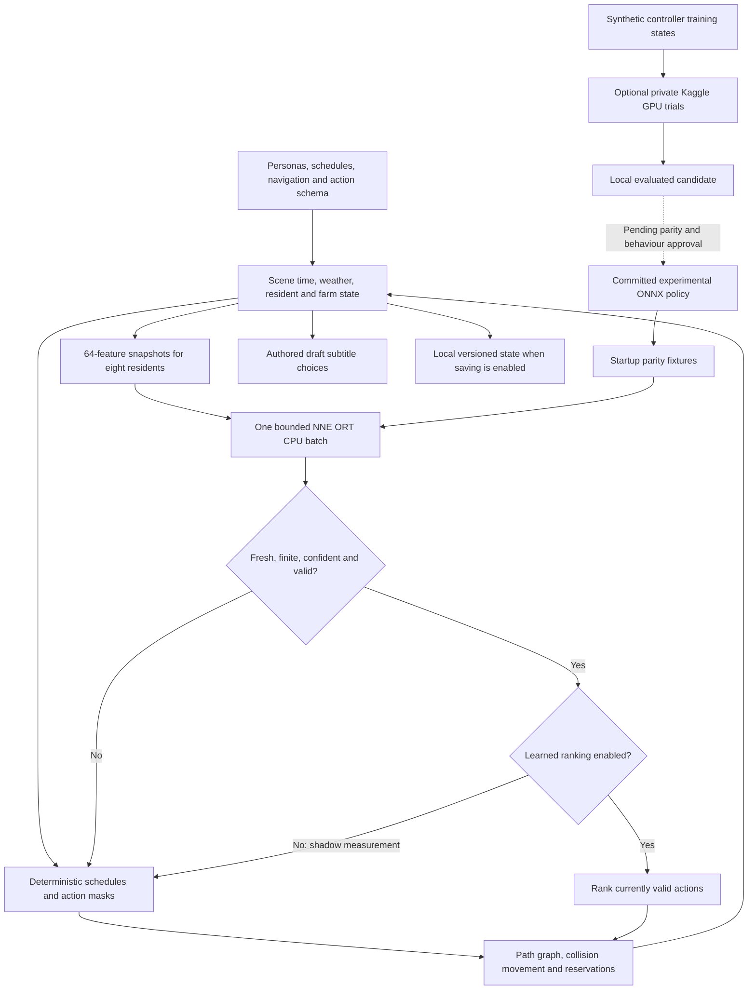
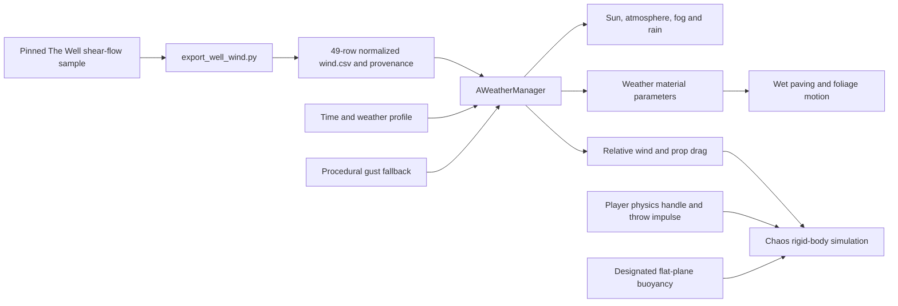
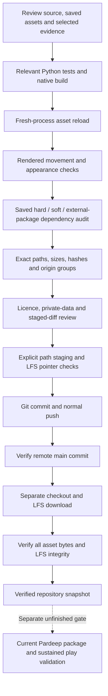

# Village Mesh system architecture

This document describes the implementation in the repository as of **24 October 2026**. The current player world is `/Game/VillageMeshV3/Lvl_PandoriV3_Pardeep_WP`. All diagrams describe implemented paths unless a node explicitly says optional, candidate or pending.

## 1. System boundaries

Village Mesh has one native Unreal runtime module, `rural_pardeep`, supported by standalone Python data tools and Unreal Python authoring scripts. The executable, renderer, physics and gameplay run locally. GitHub stores source and reviewed LFS assets; it is not a game backend. Kaggle provides an optional offline experiment. Epic's rigging service is used by character authoring when required.

| Layer | Authoritative inputs | Outputs / owner |
| --- | --- | --- |
| Geography and source art | `Assets/Geodata`, texture/model locks | Pinned source extracts and licensed art |
| Village design | `Assets/World`, V2 layouts, street recipes | Generated geometry, map art and destination contracts |
| Simulation design | `Assets/NPC`, `Dialogue`, `Farms`, `Roads`, `Routes`, `Wardrobe` | Validated runtime copies under `Content/V25` |
| Pilot destinations | V2 generated route and interior contract | Exact `Content/Validation/pilot.json` used by F10 and diagnostics |
| Character design | `Assets/MetaHumans/pardeep_face_design.json`, original turban generator | Separate Pardeep source character and High assembly |
| Saved Unreal scene | `Content/VillageMesh*`, `Content/MetaHumanPilot` and external packages | Reviewed `.umap` / `.uasset` files through LFS |
| Gameplay | Native actors, components and runtime data | Player, village life, HUD, weather and physics |
| Local state/evidence | `Saved` | Saves, logs, captures, build intermediates and packages |
| Publication | `Docs/LFS/assets.json`, source diff and selected evidence | Git commits and LFS objects |

Private portraits stay outside the publication inputs. The published face design is a manual artistic approximation. The current character build report records that source photographs were neither copied nor uploaded; generated rig data is distinct from those photographs.

## 2. World-generation flow

World regeneration is staged; the current player build is not a command to recreate every earlier stage. The reviewed LFS snapshot already contains the saved worlds. Source maps are retained alongside `_WP` playable copies. External actor/object packages must travel with their maps.

The coordinate origin is **31.4610594 N, 75.7240654 E**; local **X is east, Y is north, Z is up**, with **100 Unreal units per metre**. Terrain uses a flat datum. Stable building IDs preserve the mapped outline while recipe selection varies its facade geometry. Road widths and unspecified surfaces are inferred. Public places, field boundaries and crop choices are labelled representative.

### Scene generations

| Generation | Playable asset / workflow | Scope |
| --- | --- | --- |
| V1 | `/Game/VillageMesh/Lvl_PandoriNijjaran_WP` | Geographic foundation, vegetation, weather and Chaos yard |
| V2 | `/Game/VillageMeshV2/Lvl_PandoriV2_WP` | Detailed mapped pilot street and selected interiors |
| V2.5 | V2 map with village-life activation | Eight residents, four plots, dialogue, persistence and CPU policy |
| V3 | `/Game/VillageMeshV3/Lvl_PandoriV3_WP` | Full extract architecture, atlas, public places, farms and animals |
| Pardeep | `/Game/VillageMeshV3/Lvl_PandoriV3_Pardeep_WP` | Separate street surfaces and third-person MetaHuman player |

The editor startup map selects Pardeep. `GameDefaultMap` still selects V1 for legacy workflows. Each launch wrapper supplies its intended map explicitly, so these settings must not be treated as interchangeable.

## 3. Runtime and player flow

The collision capsule drives movement; the attached visual actor has actor collision disabled. `BS_PlayerLocomotion` follows horizontal speed and references installed MetaHuman neutral idle/walk/run clips. Those raw engine/plugin animations are not copied into the repository. The separate Pardeep Blueprint is preferred, with the earlier temporary visual and Manpreet as fallbacks. Runtime validation requires the intended reference-guided actor rather than accepting a fallback silently.

The spring arm retracts against collision. Inspection chooses the hand on the sun-facing side using the scene's directional light; it does not create a separate portrait lighting rig. `P` cycles the face, hand and ordinary camera. `V` or `Q` leaves inspection mode. Camera collision being enabled is separate from testing every obstruction in the village.

The atlas uses a generated raster map and authored destination coordinates. Opening it suspends player movement/look, while village simulation continues. An aerial streaming source expands coverage for the overview and is released on return to ground level. HLOD baking and long traversal profiling remain separate work.

### Native source map

| Component | Source | Responsibility |
| --- | --- | --- |
| Pardeep player, HUD and game mode | [PardeepPlayer.cpp](../Source/rural_pardeep/Character/PardeepPlayer.cpp) | Visual actor, camera, turban, locomotion, skin captures and runtime checks |
| Base explorer | [VillageExplorer.cpp](../Source/rural_pardeep/Character/VillageExplorer.cpp) | Movement, interaction, weather/time controls and base runtime setup |
| Atlas and livestock | [VillageAtlas.cpp](../Source/rural_pardeep/V3/VillageAtlas.cpp) | Map UI, destinations, overview streaming and bounded animal movement |
| Village-life director | [VillageLife.cpp](../Source/rural_pardeep/V25/VillageLife.cpp) | Residents, schedules, jobs, paths, reservations, dialogue and saves |
| Tiny CPU policy | [TinyNPCPolicy.cpp](../Source/rural_pardeep/V25/TinyNPCPolicy.cpp) | Model creation, parity fixtures and bounded inference worker |
| Weather | [WeatherManager.cpp](../Source/rural_pardeep/Environment/WeatherManager.cpp) | Daylight, profiles, rain, wetness and wind |
| Physics props and doors | [VillagePhysicsProp.cpp](../Source/rural_pardeep/Environment/VillagePhysicsProp.cpp), [VillageDoor.cpp](../Source/rural_pardeep/Environment/VillageDoor.cpp) | Chaos forces/buoyancy and pilot-door interaction |
| Preserved pilot | [MetaHumanPilot.cpp](../Source/rural_pardeep/MetaHumanPilot/MetaHumanPilot.cpp) | Separate Manpreet animation/grounding experiments |

Legacy character and mini-game source is retained under `Character`, `MiniGames` and `Interaction`. Its presence does not imply every legacy Blueprint or game mode is wired into the current player world.

## 4. Character and skin pipeline

Entry point: [pardeep_appearance.ps1](../Scripts/pardeep_appearance.ps1), with `Prepare`, `Character`, `Refine`, `Turban` and `Verify` actions. Assembly runs in a normal editor because its Texture Graph path is unavailable in the commandlet build. `UPardeepAssetTools` saves only the Pardeep namespace directly, avoiding the editor thumbnail allocation spike. It does not resave other project namespaces.

The High export contains **19,283 face vertices** and **25,328 body vertices** at its most detailed exported LOD. Body colour is 4K with 8K normal/surface maps; face colour is 2K with 4K normal/surface maps. These are saved texture dimensions, not a guarantee every virtual-texture page is resident at every camera distance. Runtime LOD 0 means the finest **High export** mesh, not the original cinematic source LOD 0.

The play/check wrapper uses 100% screen percentage and full-resolution subsurface scattering. Skin refinement retains generated colour variation and tunes roughness, specular response and fine normals. The turban hides scalp hair while preserving beard, moustache and brows. Clothing is still a temporary T-shirt/shorts outfit, and the hand/body textures are generated MetaHuman art, not scans of the owner.

The assembly report records the non-clean editor shutdown. Acceptance of saved output requires an independent reload; successful package saves alone do not erase the shutdown failure. [Player evidence and known issues](PardeepPlayer/README.md) record the separate rendered check and limitations.

## 5. Village life and TinyAI

The deployed MLP is **64 → 256 → 256 → 128 → 48**, with **121,520 learned values**, fixed FP32 tensors and ONNX opset 17. One worker owns a model instance and copies numeric buffers; it does not manipulate UObjects. The game thread validates result age, generation, finite values and current action validity. Missing models, parity failures, stale results, low margins and unavailable targets preserve rules-based behaviour.

The executor uses an explicit authored graph, passage/job reservations and native collision movement. It is not a completed StateTree/NavMesh/Smart Object integration. The tractor is a kinematic reserved-route prototype, not a calibrated Chaos vehicle. Dialogue is authored, subtitle-only and draft; the other audited language-model designs are not deployed.

Normal V2.5/V3 play stores compatible state in `Saved/VillageMeshV25/save_v1.json`. Persistent identities and events are validated; transient reservations and actor references are rebuilt. **The Pardeep wrapper supplies `-V25NoSave` even for Play**, so this preview does not modify the normal village-life save. This is local single-player state, with no multiplayer replication or online database.

The Kaggle source bundle contains only numeric training code; it does not include portraits, MetaHuman assets, animations or geography. Its candidate remains separate from the deployed model. See [V2.5 contracts](V25/README.md) and [Kaggle evidence](Kaggle/README.md).

## 6. Weather, rendering and physics

The Well submodule and a derived CSV are research inputs; no Well model runs in the game loop. The trace is peak-normalized, mapped horizontally and retimed into a 120-second loop. The source revision, sampled point and transformations are recorded in [wind.source.json](../Content/Well/wind.source.json).

Chaos handles rigid bodies, friction, gravity and collision. Selected small props use CCD; configured substeps target at most 1/120 second with an eight-step cap. The buoyancy example applies forces against a flat water plane. Neither that demo nor enabled Niagara/Water plugins establishes a coupled fluid simulation.

Software Lumen, virtual shadow maps, atmospheric effects and Substrate form the rendering setup. PCG provides seeded foliage with exclusion areas. Skin detail and rendering settings improve presentation; measured terrain, surveyed facades, final art and sustained performance are separate requirements.

## 7. Validation and publication flow

The [publication script](../Scripts/lfs_publication.py) builds a manifest only from approved content namespaces, runtime data extensions and pinned CC0 downloads. It rejects traversal/symlink escapes and changed pinned downloads. [The Unreal audit](../Scripts/audit_lfs_assets_unreal.py) checks hard/soft references and external packages; required engine/plugin mounts remain installation dependencies.

Git stores LFS pointers for `.uasset`, `.umap`, bulk exports and pinned downloaded art. LFS stores the corresponding bytes. A successful Git push alone does not establish that another checkout can hydrate those bytes. Conversely, byte verification in a separate checkout is not a clean-machine Unreal launch or packaged-game test.

Current evidence: **44 Python tests**, native editor build, **338 reloaded Pardeep assets**, **9,064 audited packages**, and a rendered movement/skin check. The prior V3 package is a separate product of its cook profile, which excludes MetaHuman content. Do not treat it as the current Pardeep package. The known assembly-shutdown and earlier GPU-launch failures remain documented despite successful subsequent checks.

## 8. Extension points and remaining work

| Change | Start here | Validation to repeat |
| --- | --- | --- |
| Geographic extent or outlines | `Assets/Geodata`, `pandori_layout.py` | Provenance, projection, geometry and source selection |
| Homes, public sites or agricultural art | `v3_layout.py`, `v3_geometry.py`, `build_v3_world.py` | Geometry, separation, labels and destination captures |
| Streets and paving | `village_streets.py`, `build_village_streets.py` | Surface counts, geometry and player traversal |
| Player, camera or locomotion | `PardeepPlayer.cpp`, locomotion builder | Native build, rendered movement and camera checks |
| Face, skin or turban | Pardeep design and appearance scripts | Assembly/reload, material inventory, captures and owner review |
| Resident actions or policy | V2.5 contracts, `VillageLife.cpp`, `TinyNPCPolicy.cpp` | Schema/mask/parity, routes, persistence and soak |
| Weather or prop physics | Environment sources and wind provenance | Native build, rendered weather and physics checks |
| Packaging or publication | Package scripts, dependency audit and LFS manifest | Cook audit, independent hydration and target-specific runtime |

Priority gaps are exact likeness and wardrobe, improved hand/body presentation in varied lighting, realistic resident/livestock assets, reviewed Punjabi language/audio, measured local architecture/terrain, long-session GPU stability, HLOD/traversal performance and a validated Pardeep package. [Toolkit status](../TOOLKIT_STATUS.md) distinguishes implemented systems from enabled or planned plugins.
