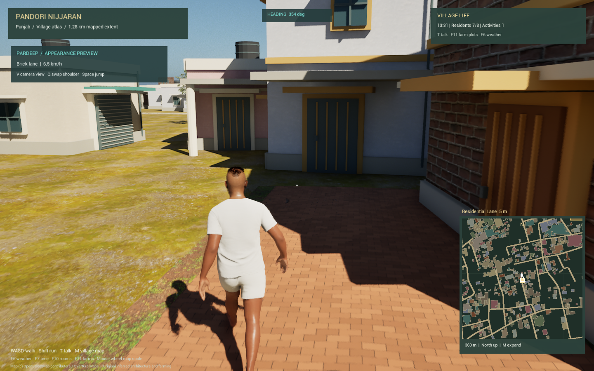

# Pardeep player and village streets

This local iteration adds a third-person protagonist slot and a separate village map, `/Game/VillageMeshV3/Lvl_PandoriV3_Pardeep_WP`. It retains the mapped road routes, 821 building outlines, eight regional house styles, nine public-site interpretations and 41 authored fields from V3.

**Appearance is provisional.** The designated `E:\me_too\data\raw\face_ref` directory contained no reference files during this task. The existing Manpreet MetaHuman supplies the temporary player visual. It is not a reconstruction of Pardeep, and the character's current T-shirt/shorts are not completed Punjabi clothing. A specific owner-selected reference is still needed for the likeness. No personal photo archive, face embeddings, messages or credentials were copied into this repository or sent to a cloud service.

Supporting characters can use separately selected references. The existing eight residents retain their identities; photographs in a mixed archive are not assigned to named characters automatically.

## Verified local preview — 24 October 2026

The UE 5.8.4 editor build, street import and World Partition conversion passed. All 44 Python tests passed. The standalone third-person check recorded 26.74 m of player travel, 27.37 m of accumulated component-space foot motion, walking and running speeds, and continuous grounded movement. Camera collision is enabled; that flag is not an exhaustive wall-obstruction test. The walking and idle captures were reviewed. No new packaged build or sustained performance result is claimed.

The initial runtime check caught a reference-pose failure despite actor movement. The generator now explicitly validates and resamples the blend space's runtime data before saving it; a fresh engine run passed after the correction.

The live Unreal preview also passed manual checks of the V first/third-person toggle, Q shoulder swap, and M full-map open/close controls.



[Idle view](third_person_idle.png) · [Runtime result](runtime_check.json) · [World build result](build_report.json).

## Play

```powershell
.\Scripts\pardeep_village.ps1 -Action Play
```

| Control | Action |
| --- | --- |
| WASD / mouse | Camera-relative movement / orbit |
| Shift | Run |
| Space | Jump |
| V | Third-person / first-person view |
| Q | Change camera shoulder |
| M | Village map |
| Tab / Enter | Select / visit map destination |
| T | Talk |
| E / right mouse | Door or physics grab / throw |
| F6 / F7 | Weather / time |

The spring arm retracts against camera collision. Movement turns the visible character independently of camera yaw. A three-sample locomotion blend space follows actual horizontal speed. Jump physics work; a dedicated airborne animation is not included. The HUD adds heading, speed and the material under the player's feet while retaining the village map and destination distances.

## Street design

The 71 mapped routes receive 9 asphalt connector roads, 35 tile-paved lanes, 17 brick lanes and 10 dirt tracks. Existing OSM surface tags take precedence when supplied; remaining surface assignments follow the requested artistic design. These are not surveyed pavement conditions. The road widths also remain inferred.

Paving has metre-scaled joints, small bevel normals and rain-driven color/roughness. The geometry provides a shallow crown, shared cross sections at bends and earthen shoulders. Clear road edges receive solar-panel streetlamp models. The lamp models do not simulate an electrical or sensor network. Existing Punjabi-style verandas, courtyards, balconies, roof terraces, jali details and shop homes remain regional interpretations rather than verified facades.

## Rebuild and verify

Save and close this project's editor before rebuilding:

```powershell
python -m unittest discover -s Tests -v
.\Scripts\pardeep_village.ps1 -Action Build
.\Scripts\pardeep_village.ps1 -Action Check
```

The build creates a copy of the V3 source map, removes inherited uniform road actors from that copy, imports the replacement surfaces and converts it to World Partition. The player blend space references the installed MetaHuman idle/walk/run clips; those raw Epic clips are not redistributed in the repository. UE 5.8.4 with the installed MetaHuman content is the development target. The user approved the temporary appearance for this iteration.

Local build evidence is written to `Saved/VillageStreets/build_report.json`. The standalone runtime check writes `Saved/PardeepPlayer/runtime_check.json` and walking/idle captures. Runtime results, likeness approval, packaging and a sustained performance test are separate gates; generated source assets alone do not establish those outcomes. The existing V3 packaging script excludes the MetaHuman pilot and should not be used to claim a packaged Pardeep build.
