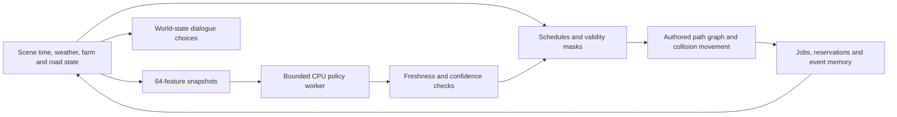

# V2.5 living-village prototype

V2.5 adds an opt-in runtime simulation to the existing V2 Pandori street map. Eight **fictional adult characters**, four inferred demonstration plots, a farm access track, a reserved vehicle shuttle, draft Punjabi subtitle choices and a tiny policy experiment share one scene date: **23 October 2026, Asia/Kolkata**.

The character art is an original articulated prototype. Clothing, voices and local vocabulary have **not** passed local review. This is not a finished realism release or a reconstruction of real residents and farm ownership. See the [acceptance register](../V25_ACCEPTANCE.txt) for the distinction between implemented systems and open gates.


*Actual packaged Unreal capture: draft Gurmukhi text, fictional identities and prototype character geometry.*


*Actual packaged capture of the inferred plots, access track, shelter and wet surfaces.*


## Build and play

The V2 map and its generated assets must already exist; follow [V2 setup](../V2/README.md) on a fresh checkout. This overlay does not regenerate V1/V2 geometry or HLODs.

```powershell
# Verify the committed model and scene contracts.
python -m pip install -r requirements-v25-tools.txt
python -m unittest discover -s Tests -v

# Compile the native runtime and import the audited ONNX policy/material.
.\Scripts\v25.ps1 -EngineRoot 'E:\U.E\UE_5.8' -Action Build

# Deterministic schedules are the default. NNE runs in shadow for measurement.
.\Scripts\v25.ps1 -Action Play

# Explicitly enable experimental learned action ranking.
.\Scripts\v25.ps1 -Action Play -Learned

# Optional reproducible retraining; does not run during normal builds.
python -m pip install torch==2.11.0 --index-url https://download.pytorch.org/whl/cpu
python Scripts/train_v25_policy.py
```

Controls: WASD/mouse to walk/look, Shift to run, T to talk to a nearby resident, 1–5 for dialogue choices, F11 to visit the farms, F5 to switch rules/learned ranking, F6 for weather, F7 for time, and the existing V2 door/physics controls. The scene stays on the same calendar date; crop growth never accelerates just because the player walks around.

V2.5 activates only with `-VillageV25`. Launching V2 without that flag retains its existing gameplay. The public map name remains `Lvl_PandoriV2_WP`; the new assets live under `/Game/VillageMeshV25` and runtime data under `Content/V25`.

## What the models do

| Component | Unique learned parameters | Deployed? |
| --- | ---: | --- |
| 64–256–256–128–48 action MLP | 121,520 | Yes, experimental |
| Byte embedding + GRU intent design | 198,080 | No |
| Recurrent policy alternative | 116,208 | No |
| Tied-embedding micro decoder design | 596,096 | No |

Only the action policy is deployed. There is no hidden ASR, TTS, translation model, remote inference service or language decoder. The other architectures exist for parameter auditing; they are not trained language checkpoints. The one-million limit includes every deployed learned value.

The committed ONNX uses opset 17, fixed FP32 `[1,64] -> [1,48]` tensors and 121,520 physical initializer values. Its exact size/hash and schema are in [the model manifest](../../Assets/Models/npc_model_manifest.json). Training uses an original synthetic rule-controller teacher, disjoint seeds, and held-out route-distance/wetness ranges. [Evaluation](policy_evaluation.json) measures agreement with that teacher; it is not proof of better behaviour, Punjabi understanding or local realism.

NNE uses `NNERuntimeORTCpu`. A single model instance belongs to one bounded worker batch at a time; inputs and outputs are copied plain buffers with no worker access to UObjects. At most one eight-resident batch is in flight. The game thread validates freshness, finite outputs and the current action mask before applying rankings. Missing models, failed inference, low score margins, stale snapshots and unavailable targets retain deterministic rules.

The startup parity fixture compares 64 ONNX reference vectors with actual NNE outputs. A mismatch disables learned inference. No random or untrained weights are substituted when model creation fails.

## State and execution



The current executor uses an explicit graph derived from the V2 OSM lane plus labelled inferred farm links, with native character collision movement. It is **not** a claimed StateTree/NavMesh/Smart Object implementation. Stable IDs, shared passage/job reservations, minimum commitments and actual roof traces enforce the implemented prerequisites. The tractor is a kinematic prototype shuttle, not a calibrated Chaos vehicle or a finished tractor/trolley rig.

Original manifests are created only when absent. Build scripts validate existing authoring files and stage disposable runtime copies. Source hashes record exactly what was staged.

| Authoritative data | Purpose |
| --- | --- |
| [Personas](../../Assets/NPC/personas.json) | Fictional identities, individual capabilities, homes and outfits |
| [Schedules](../../Assets/NPC/schedules.json) | Work windows and rainy alternatives |
| [State/action schema](../../Assets/NPC/action_schema.json) | All 64 features, 48 outputs and reserved actions |
| [Navigation](../../Assets/NPC/navigation.json) | Connected authored paths |
| [Dialogue](../../Assets/Dialogue/punjabi_lines.jsonl) | Gurmukhi, Roman Punjabi, English gloss, review/audio status |
| [Wardrobe](../../Assets/Wardrobe/outfits.json) | Stable prototype outfit choices; no simulated cloth |
| [Parcels](../../Assets/Farms/parcels.geojson) | Four inferred, unowned demonstration plots |
| [Crop calendar](../../Assets/Farms/crop_calendar.json) | Fixed late-October illustrative states |
| [Road profiles](../../Assets/Roads/road_profiles.json) | Unmeasured surface/width designs and passage capacity |
| [Tractor route](../../Assets/Routes/tractor_route.json) | Reserved shuttle route and conservative speed |

Normal play saves to `Saved/VillageMeshV25/save_v1.json`. Version/date/identity validation rejects incompatible state; transient reservations and actor references are never persisted. Test runs use `-V25Check` and avoid the normal user save. Invalid save versions fall back to authored state. This is local single-player persistence, not multiplayer replication.

## Dialogue and font

Dialogue is menu-driven, subtitle-only and visibly marked **draft**. The shipped examples are not labelled native-speaker approved. Shop/weather/activity details come from current simulation state, and unsupported questions use clarification/unknown lines. No intent accuracy or Punjabi fluency is claimed.

Noto Sans Gurmukhi is pinned by source commit and SHA256 under [the asset lock](../../Assets/v25_assets.lock.json), with its [OFL licence](../../Assets/Fonts/OFL.txt). The Slate widget requests full shaping. Packaged visual inspection remains distinct from native-speaker approval of spelling, tone and line breaks.

The original Quaternius source was researched as a possible CC0 character asset; its official download returned quota-exceeded HTML. No files from that failed acquisition are used. Current characters and vehicle geometry are original procedural stand-ins, clearly labelled in the HUD. No legacy character assets with unverified distribution rights enter the V2.5 package.

## Validation and packaging

Run the complete local acceptance sequence with `.\Scripts\validate_v25_release.ps1` after packaging, or add `-Rebuild` to compile/import/package first. It includes an actual 30-minute rendered session and six sequential traversals. The tests use Python 3.12.10 on the recorded workstation.

```powershell
.\Scripts\v25.ps1 -Action Check -RunId editor_rules -Seconds 120
.\Scripts\v25.ps1 -Action Check -RunId editor_learned -Seconds 120 -Learned
.\Scripts\v25.ps1 -Action Check -RunId missing_model -Seconds 120 -MissingModel -Headless
.\Scripts\v25.ps1 -Action Package
.\Scripts\check_v25_package.ps1 -RunId packaged_rules -Seconds 120
.\Scripts\check_v25_package.ps1 -RunId packaged_learned -Seconds 120 -Learned
.\Scripts\check_v25_package.ps1 -RunId packaged_soak -Seconds 1800 -Learned
# Repeat each condition three times, with residents and shadow inference active.
.\Scripts\check_v25_route.ps1 -Condition daylight -RunId v25_daylight1
.\Scripts\check_v25_route.ps1 -Condition rain -RunId v25_rain1
```

The package is written to `Saved/Packages/V25/Windows`; `Play_V25.cmd` supplies the activation flag. Packaging temporarily changes the plugin/cook profile, then restores the project descriptor and engine/game configuration bytes in a `finally` block. NNE ORT remains enabled in this package. Keep the project closed during packaging.

Runtime reports contain rendered/NullRHI and editor/standalone labels, NNE parity, batch inference and queue timings, director game-thread overhead, frame wall times, bounded memory observations, state checks and per-person activity records. NullRHI timing is not rendering performance. A bounded soak is not a memory-leak proof. No fresh-machine result is implied by a local package.

Packaged checks temporarily prevent idle system sleep and restore the previous sleep behaviour on exit. The checker and report publisher reject excessive duration or a frame gap over one minute, so an overnight suspend cannot satisfy the continuous-session requirement.

The final [results](RESULTS.md), [machine-readable evidence](evidence.json), [package audit](package_audit.json), [workstation details](host_environment.json) and [source/package hashes](build_manifest.json) identify the validated build. The summary generator requires four final runtime checks and all six traversals from the same executable; it excludes intermediate debugging runs.

Official NNE API reference: [Epic UE 5.8 NNE overview](https://dev.epicgames.com/documentation/unreal-engine/neural-network-engine-overview-in-unreal-engine?application_version=5.8). The installed engine headers and actual package tests determine compatibility for this project.
