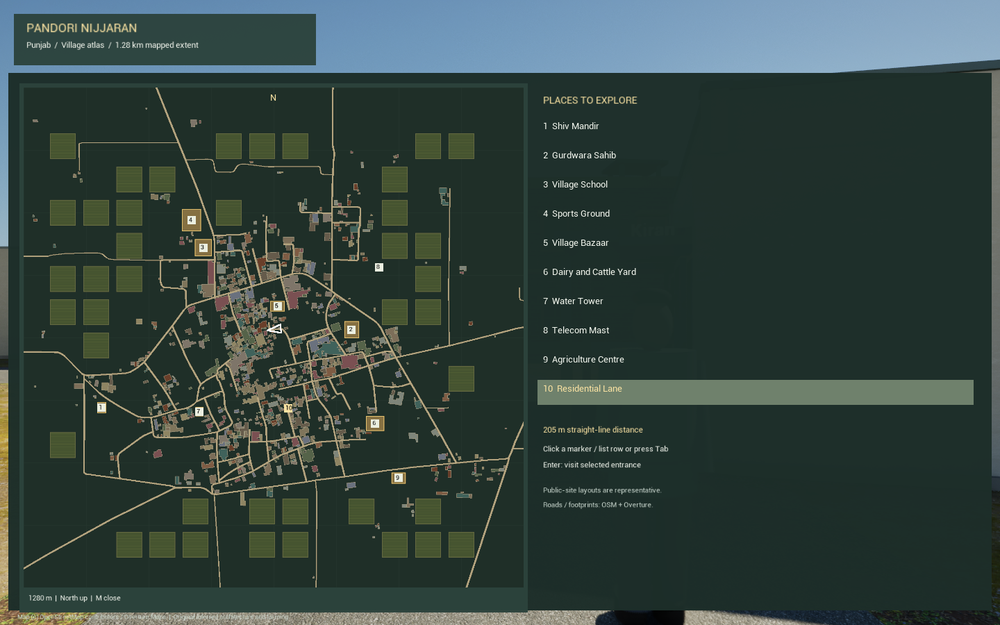
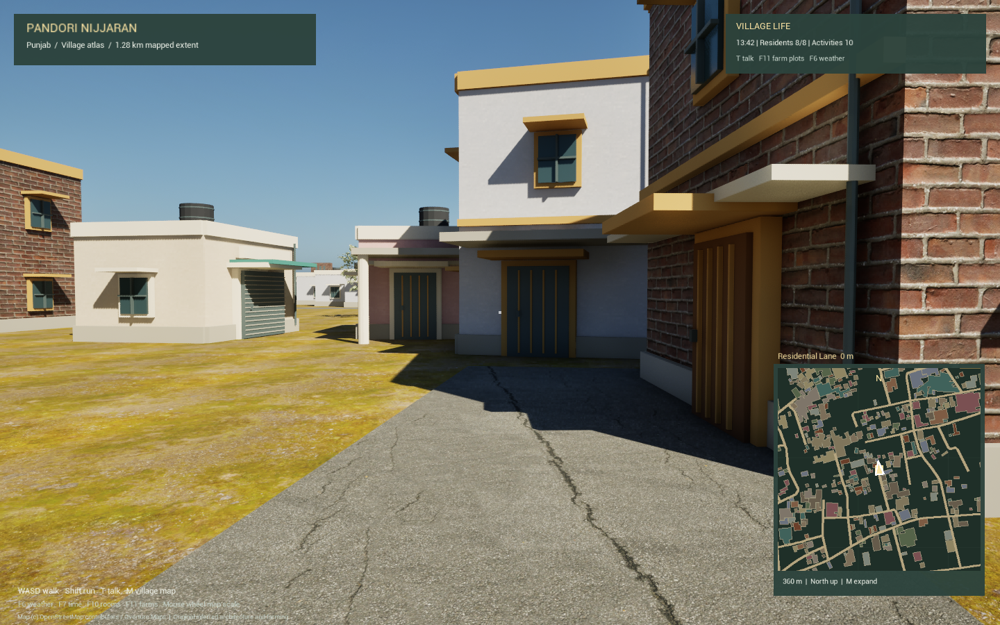
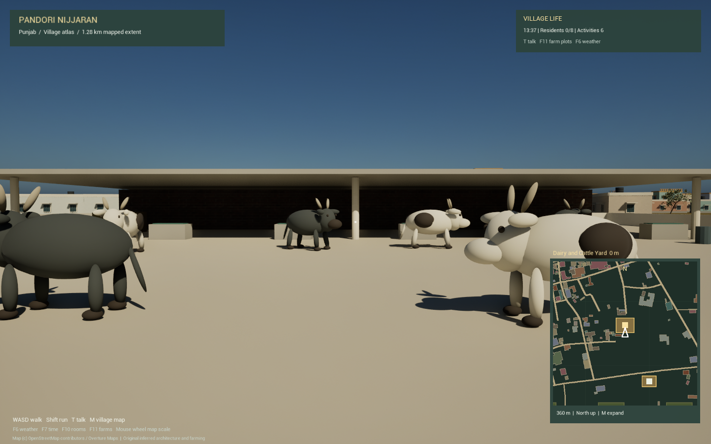

# Pandori village atlas and full mapped village

V3 expands visual detail across the existing **1.28 km by 1.28 km** map, with **821 source building outlines**, **71 OSM road records**, eight regional house recipes, nine public destinations, 41 representative agricultural parcels and 14 animated farm animals. It keeps the V2 pilot interiors and the V2.5 resident/dialogue/CPU-policy systems.

The footprint coverage is the existing map extract, not a claim to cover the village's complete administrative boundary. Buildings, public sites and fields have original procedural art. This is not a surveyed digital twin.

## Play

```powershell
.\Scripts\v3.ps1 -Action Play
```

- **M** opens/closes the full village map; the live minimap stays visible while walking.
- **Click** a map marker or destination row, or **Tab** to cycle destinations.
- **Enter** while the map is open visits the selected entrance.
- **Residential Lane** is selected initially: press M then Enter to see the rebuilt homes outside the preserved pilot. This is a tour label on a mapped road, not an official street name.
- **Mouse wheel** changes the minimap's displayed area. North remains up; the white arrow follows player facing.
- **WASD / mouse** walk/look, **Shift** run, **Space** jump, **T** talk, **1–5** dialogue choices.
- **F6** weather, **F7** time, **F10** pilot rooms, **F11** V2.5 farm plots, **F5** experimental policy.
- **F9** toggles the aerial overview. A dedicated streaming source loads the full mapped area while airborne and releases it on return to ground level.

The selected place shows straight-line distance, not a guaranteed pedestrian route. Opening the atlas disables movement/look while allowing the resident simulation to continue.

To open the V3 level directly in the Unreal editor, run `.\Scripts\v3.ps1 -Action Editor`, then press Play. Its asset path is `/Game/VillageMeshV3/Lvl_PandoriV3_WP`. The V3 level enables village life without requiring a command-line switch. The original project startup map is retained for the earlier build workflows.

## Architecture and village uses

The new background homes use stable source IDs to select lime verandas, exposed-brick courtyard-inspired homes, haveli balconies, modern set-back terraces, pastel jali parapets, farmhouses, shop-house fronts and stepped family homes. These vary geometry as well as colour: canopies, shade projections, columns, shutters, balcony rails, rainwater pipes, roof tanks, solar panels, storey bands and roof pavilions. The existing sixteen detailed pilot buildings keep their entrances and interiors. Most other buildings are exterior shells.

The mandir has a stepped shikhara and porch; the gurdwara has a domed hall, corner pavilions, saffron flagpole and langar veranda. The school has classroom wings and a shaded courtyard. The bazaar has five shuttered shop fronts, awnings and produce bins. The sports ground has football goals, a cricket pitch and swing equipment. The dairy and agriculture centre have open sheds, troughs, fodder and milk churns. A raised water tank and separate telecom mast create distinct skyline landmarks.

The 41 new 65 m square parcels mix rice stubble, vegetables, fodder and tilled soil, with bunds and narrow irrigation channels. Their boundaries and crops are representative, not a cadastral record or observation of current crops. The existing four V2.5 plots are additional to these parcels.

Eight cows/buffalo occupy the dairy, with four goats and two hens at the agriculture centre. They have bounded movement, idle periods, simple animated legs and collision capsules. Their art and gait are procedural; they are not licensed realistic skeletal animal models or veterinary/biomechanical simulations.

## Geography and reference confidence

Road centre lines and building outlines retain the project's pinned OSM/Overture inputs. The generator does not move, erase or relabel those building footprints. Authored public sites occupy clear space, and their exact in-game positions are **representative**, including where the existence of a landmark is supported by a reference. Their shapes and dimensions have not been observed or measured.

| Reference | What it supports | What it does not establish |
| --- | --- | --- |
| [Shiv Temple, Wikimapia](http://wikimapia.org/15450774/Shiv-Temple) | Community-listed temple and approximate reference point 31.4597992, 75.7194471 | Surveyed boundary, facade or exact game placement |
| [Gurudwara Nihang Singh listing](https://yappe.in/punjab/pandori-nijjaran/gurudwara-nihang-singh-pandori-nijjaran/1529679) | Named local gurdwara; listing gives FP6G+6CH | Exact reconstructed building or site boundary |
| [GPS Pandori Nijjaran school listing](https://www.icbse.com/schools/gps-pandori-nijjaran-ezqk9) | A local government primary school; listing describes classrooms and playground | Current verified facilities, footprint or facade |

References accessed 24 October 2026. No external photographs, map tiles, private interiors, real resident identities, or third-party landmark meshes are distributed. Sources may be incomplete or outdated. The map itself labels the authored public sites as representative.

## Rendered destination gallery

These images come from the standalone Unreal runtime check, with the normal game HUD visible.







| Destination | Engine capture |
| --- | --- |
| Shiv Mandir | [Temple porch and shikhara](view_01.png) |
| Gurdwara Sahib | [Domed hall](view_02.png) |
| Village School | [Classrooms and courtyard](view_03.png) |
| Sports Ground | [Cricket pitch, goals and swings](view_04.png) |
| Village Bazaar | [Five shop fronts](view_05.png) |
| Water Tower | [Raised tank and supporting structure](view_07.png) |
| Telecom Mast | [Lattice mast](view_08.png) |
| Agriculture Centre | [Farm shed and small livestock](view_09.png) |
| Full mapped area | [Aerial overview](view_11.png) |

## Rebuild

Requires the existing V2 source map and V2.5 assets. Follow [V2 setup](../V2/README.md) and [V2.5 setup](../V25/README.md) on a clean machine first. Use the Python dependencies from those guides, including Pillow, and UE 5.8.3 with Visual Studio Build Tools.

```powershell
python -m pip install -r requirements-v3-tools.txt
python Scripts/v3_layout.py
python -m unittest discover -s Tests -v
.\Scripts\v3.ps1 -Action Build
.\Scripts\v3.ps1 -Action Check
.\Scripts\v3.ps1 -Action Package
.\Scripts\check_v3_package.ps1
python Scripts/audit_v3_package.py
```

The build creates `/Game/VillageMeshV3/Lvl_PandoriV3`, imports original meshes/materials/map artwork, then converts a separate World Partition map. V1/V2 assets are referenced but not rewritten. Public inputs live in `Assets/World`; runtime JSON is copied to `Content/V3/Data`. Reviewed generated Unreal assets are now included through [Git LFS](../LFS/README.md). OBJ intermediates and packaged builds remain ignored; source scripts still reproduce them.

The V3 vegetation graphs are independent copies. Their original seeded points are filtered around new public sites and fields so trees/shrubs cannot grow through those additions. Wall UVs use their own face plane rather than a ground projection, including on vertical facades.

Veranda columns are omitted where they would obstruct the mapped road width; those houses use cantilevered shade instead. Subsequent builds reuse generated meshes with unchanged OBJ hashes. Use `-ForceReimport` with the Build action to reimport every mesh.

`package_v3.ps1` temporarily enables the appropriate cook profile and restores the project/config bytes in `finally`. It explicitly cooks V3 and V2.5 to retain the atlas, procedural material and optional CPU model. The portable Development build goes to `Saved/Packages/V3/Windows`, with `Play_V3.cmd` as launcher.

## Validation scope

`test_v3_world.py` checks preserved building IDs/outlines, coverage of requested uses, site/road/building separation, finite geometry, distinct geometry for the eight recipes, nondegenerate wall UVs, veranda clearance, and inference labels. The runtime check loads the atlas and visits nine public entrances plus the residential lane in a rendered scene. It captures those stops and an aerial overview, checks player ground state, requires all fourteen animals to move within their yards, and records frame p95. It is a bounded smoke test, not exhaustive village navigation or the earlier V2.5 30-minute soak. V3 must have its own fresh evidence; V2.5 timings do not establish V3 performance.

### Recorded results: 24 October 2026

| Check | Result |
| --- | --- |
| Python suite | 33 tests passed, including eight V3 data/geometry regressions |
| Native builds | Editor and standalone Win64 Development builds passed |
| World Partition conversion | Passed with zero errors and zero warnings |
| Generated art | 570 mesh chunks, 1,326,211 triangles; 805 rebuilt background homes and sixteen retained pilot buildings |
| Packaged runtime | Passed in 168.082 seconds; atlas loaded, ten destinations grounded, all fourteen animals moved within their yard bounds |
| Full-map visibility | Streaming completed and all 570 generated mesh chunks were present in the aerial view |
| Publication/package audit | Passed: staged world contract, V2.5 inputs, pinned fonts/licenses, allowed cooked namespaces, and six frozen source hashes |
| Frame p95 | 29.76 ms in this bounded standalone tour, at 1440x900 with 67% render scale and a 60 FPS cap |

Raw evidence: [runtime results](runtime_packaged.json), [executable hash and render settings](runtime_build.json), and [package/input/source audit](package_audit.json). All twelve captures above were produced by that standalone run. Performance is a local workstation observation with other applications open, not a minimum hardware specification or a guarantee for a full play session. No new thirty-minute V3 soak or exhaustive navigation audit is claimed.

The source/build intermediates remain in `Saved/VillageMeshV3`. The portable package is at `Saved/Packages/V3/Windows`; launch its `Play_V3.cmd`. The reviewed saved Unreal assets are now included through Git LFS. Packaged executables remain local; the repository contains the reproducible sources and reviewed evidence.
