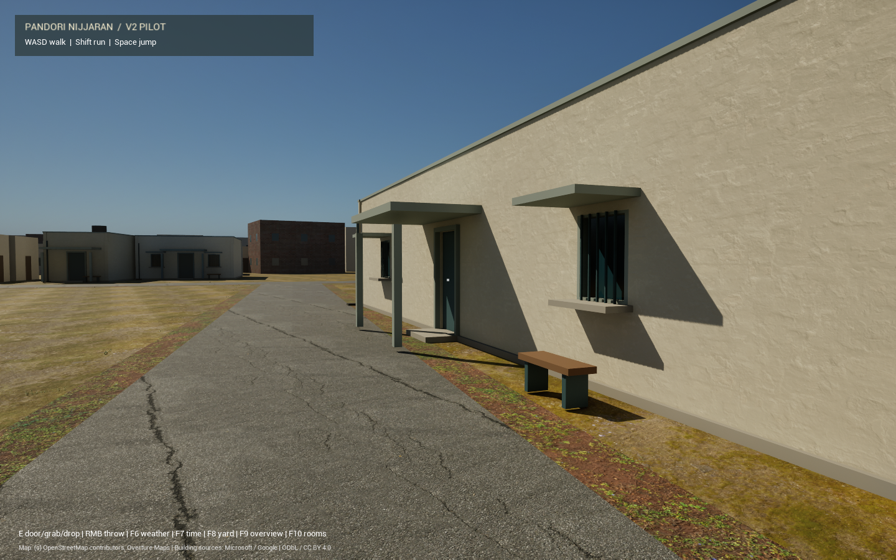
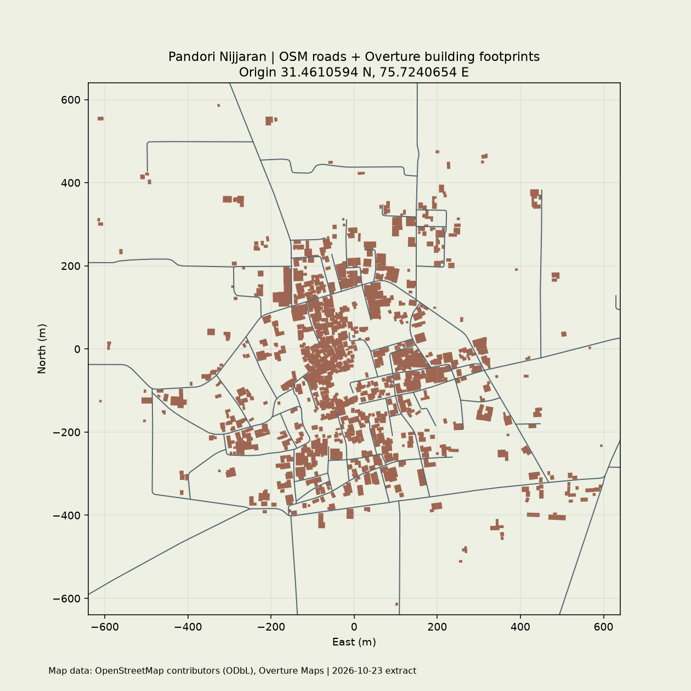
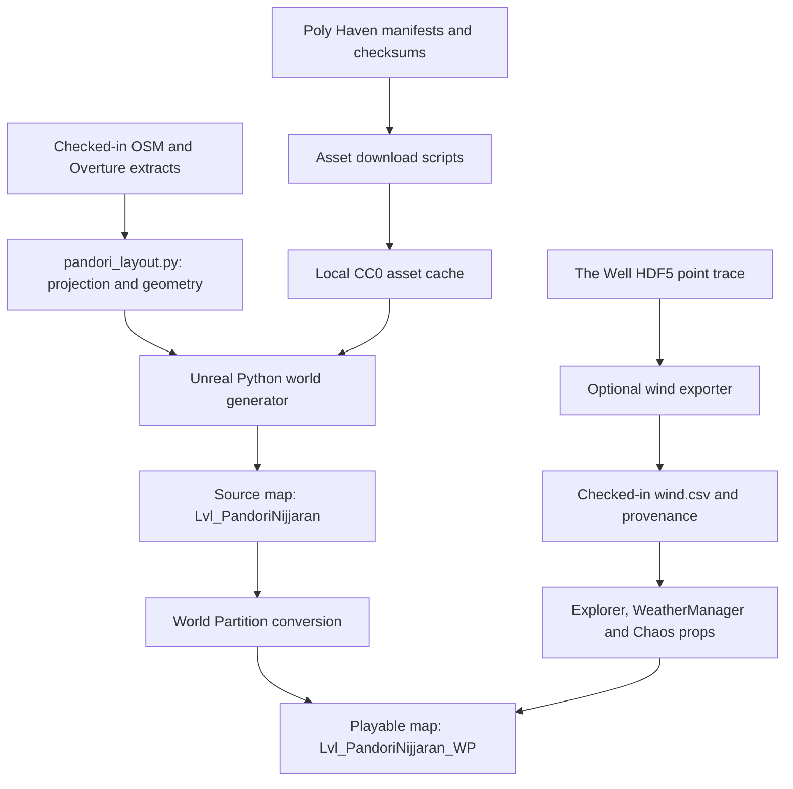

# village_mesh

**V2.5 living-village prototype:** [build and play guide](Docs/V25/README.md) for eight fictional residents, four inferred farm plots, draft Punjabi subtitles, persistent state and the audited 121,520-parameter CPU policy. Character/vehicle art remains a procedural prototype; local wardrobe, voice and language review are pending.

**V2 pilot work:** see the [V2 implementation guide](Docs/V2/README.md) for the separate 240 m street pilot, build/run commands, and milestone status. The V1 overview and recorded validation below remain available for comparison.

An explorable Unreal Engine village based on **Pandori Nijjaran, Adampur, Punjab, India, PIN 144102**. OpenStreetMap road centerlines and Overture building footprints provide the geographic layout. Procedural architecture, CC0 materials and vegetation, dynamic weather, and interactive Chaos physics turn that layout into a playable environment.

**Current status:** a working, map-based environment foundation. Building heights, facades, road widths, vegetation placement, and terrain elevation are approximations. This is not yet a surveyed digital twin or a finished photorealistic game.

The repository publishes project source, generation scripts, small geographic extracts, asset manifests, and validation evidence. Unreal maps and imported binary assets are generated locally. The C++ module and project file retain the original name, `rural_pardeep`.



*Actual V2 engine capture. See the [V2 guide, weather comparisons and results](Docs/V2/README.md). The [original village overview](Docs/overview.png), [V1 street capture](Docs/street.png), and [source map](Docs/pandori_map.png) remain available for comparison.*

## Contents

- [What is implemented](#what-is-implemented)
- [Requirements](#requirements)
- [First-time setup](#first-time-setup)
- [Open and play an existing build](#open-and-play-an-existing-build)
- [Controls](#controls)
- [Geography and architecture](#geography-and-architecture)
- [Generation and runtime architecture](#generation-and-runtime-architecture)
- [Physics, weather, and The Well](#physics-weather-and-the-well)
- [Rebuild and customize](#rebuild-and-customize)
- [Toolkit integration](#toolkit-integration)
- [Repository layout](#repository-layout)
- [Validation](#validation)
- [Troubleshooting](#troubleshooting)
- [Current limitations and next work](#current-limitations-and-next-work)
- [Licensing and attribution](#licensing-and-attribution)
- [Contributing](#contributing)

## What is implemented

| Area | Current implementation |
| --- | --- |
| Village layout | 821 building shells generated from mapped footprints, with OSM road centerlines |
| Play area | A finite 1.28 km by 1.28 km area around the village reference origin |
| Architecture | Brick/plaster walls, roofs, visual doors/windows, and 399 procedural roof-tank and shade detail actors in the recorded build |
| World Partition | A converted streaming map, with the source map preserved for regeneration |
| Vegetation | Seeded native PCG tree/shrub spawning; 146 instances measured in the recorded runtime check |
| Materials | Five CC0 Poly Haven PBR sets, plus CC0 tree and shrub geometry/textures |
| Lighting | Software Lumen, Substrate, virtual shadow maps, sky atmosphere, volumetric fog, and daylight changes |
| Weather | Clear, overcast, rain, and storm profiles; surface wetness, wind, rain streaks, and lightning flashes |
| Interaction | First-person walking/running/jumping, grabbing and throwing physics props, a demonstration yard, and an aerial overview |
| Physics | Chaos rigid bodies, collision, CCD, substepping, aerodynamic drag, and a designated buoyant prop |
| The Well | A checked-in 49-sample shear-flow velocity trace, normalized and retimed to drive visual wind |
| Original gameplay | Source for villagers, animals, darts, kancha, and kites is retained; these systems are separate from the portable explorer map |

Counts above describe the recorded build, not a guaranteed count after changing inputs or generation rules. See [VALIDATION.md](VALIDATION.md) for the evidence and its limits.

## Requirements

| Dependency | Purpose and tested scope |
| --- | --- |
| Windows | The supplied launch/build scripts use PowerShell. Other platforms are not validated. |
| Unreal Engine 5.8 | The project was built and checked with **5.8.3**. Engine binaries are installed separately. |
| Visual Studio 2022 C++ build tools and Windows SDK | Compile the `rural_pardeepEditor` target. The recorded build used MSVC 14.44. |
| Git | Clone the project and initialize The Well submodule. |
| Python 3.10 or later on PATH | Download assets and run standalone geometry/data tools. Normal bootstrap uses the standard library. |
| Packages in `requirements-tools.txt` | Optional for regenerating The Well trace and running Python tests: NumPy, h5py, and fsspec HTTP support. |
| Internet access | Initial source/CC0 asset retrieval; supplied map extracts and the wind trace are already checked in. |
| Storage | Approximately 200 MB of CC0 downloads, plus several GB for generated Unreal assets, build outputs, and shader caches; excludes the engine installation. |

GPU smoke checks were performed on an RTX 4050 Laptop GPU. This is a tested machine, not a published minimum specification or an FPS guarantee. Hardware ray tracing and path tracing are disabled in the default configuration.

## First-time setup

Run these commands in PowerShell:

```powershell
git clone --recurse-submodules https://github.com/martian3062/village_mesh.git
cd village_mesh
.\Scripts\bootstrap.ps1 -EngineRoot 'E:\U.E\UE_5.8' -OpenEditor
```

Replace `E:\U.E\UE_5.8` with your engine installation directory: the directory containing `Engine`, not `Engine` itself. Run subsequent examples from the repository root.

For an existing clone whose submodule has not been initialized:

```powershell
git submodule update --init --recursive
```

Bootstrap performs these steps in order:

1. Downloads or reuses the texture/model cache and verifies source MD5 and pinned SHA256 hashes.
2. Compiles `rural_pardeepEditor` for Win64 Development.
3. Runs `build_pandori_world.py` inside Unreal's Python commandlet to create materials, geometry, actors, and the source map.
4. Converts a copy of the source map to World Partition.
5. Opens Unreal Editor when `-OpenEditor` is supplied.

The default editor/game map is `/Game/VillageMesh/Lvl_PandoriNijjaran_WP`. Once loading finishes, press **Play** in Unreal Editor.

An ordinary source clone does not contain `.umap` or `.uasset` files. Generating them is part of setup. Initial import and shader compilation can take time; scripts stop on errors and Unreal writes details under `Saved/Logs`.

## Open and play an existing build

After bootstrap has completed, open `rural_pardeep.uproject` in Unreal Editor. To select the village explicitly from PowerShell:

```powershell
$EngineRoot = 'E:\U.E\UE_5.8'
$ProjectPath = (Resolve-Path '.\rural_pardeep.uproject').Path
& "$EngineRoot\Engine\Binaries\Win64\UnrealEditor.exe" $ProjectPath '/Game/VillageMesh/Lvl_PandoriNijjaran_WP'
```

For an interactive game window without the editor workspace:

```powershell
.\Scripts\play.ps1 -EngineRoot 'E:\U.E\UE_5.8'
```

This launches the generated map at 1440 by 900 using the installed editor executable in game mode. It is an uncooked development session, not a packaged game. The script disables editor Python startup for this mode because experimental MCP authoring scripts depend on editor-only classes.

`play.ps1` only launches the world. **It does not download, compile, or regenerate assets.** Use `bootstrap.ps1` to rebuild them.

## Controls

These are the portable explorer's gameplay bindings:

| Control | Action |
| --- | --- |
| W / A / S / D | Move forward / left / backward / right |
| Mouse | Look around |
| Left Shift | Run while held |
| Space | Jump |
| E | Grab or drop a simulating physics object within 4 m, up to 40 kg |
| Right mouse button | Throw the held object |
| F6 | Cycle clear, overcast, rain, and storm profiles |
| F7 | Advance the sun by three hours |
| F8 | Toggle between the Pandori physics yard and village start |
| F9 | Toggle aerial overview and return to the previous walking position |

In Unreal Play in Editor, click the game viewport to give it input focus. These gameplay bindings apply when the game receives input; the editor can also consume its own shortcuts. The separate game window is useful for trying all function-key controls.

The physics yard contains movable crates and a pond demonstration. Building doors and windows in the mapped village are visual details on closed shells, rather than usable entrances to furnished interiors.

## Geography and architecture



| Input or convention | Value |
| --- | --- |
| Locality reference | Pandori Nijjaran, Adampur, Punjab 144102 |
| WGS84 origin | Latitude **31.4610594 N**, longitude **75.7240654 E** |
| Local axes | X east, Y north, Z up |
| Units | 100 Unreal units per meter; world coordinates use centimeters |
| Terrain | Flat datum; no elevation raster or surveyed height model |
| Building source | Overture Maps release **2026-10-21.0** |
| Building selection | 824 source features; 821 centers inside the playable boundary |
| Roads | OpenStreetMap extract fetched through Overpass on **2026-10-23** |
| Provenance | Checked-in source metadata and SHA256 hashes |

The [district post-office listing](https://jalandhar.nic.in/public-utility/pandori-nijjran-b-o/) identifies Pandori Nijjran and PIN 144102. The coordinate origin is a locality reference, not a surveyed marker. Source details and extraction bounds are recorded in [Assets/Geodata/README.md](Assets/Geodata/README.md) and [provenance.json](Assets/Geodata/provenance.json).

The generator projects downloaded outlines into local coordinates, triangulates roofs, and groups geometry spatially into material-specific mesh chunks. The recorded build contains 265 such chunks. Geometry tests check that triangulation preserves every included footprint's area.

Building outlines and road centerlines are sourced. One/two-storey heights, facade colors, windows, doors, roof tanks, shades, road widths, and vegetation are procedural choices. Machine-generated building outlines and community road data may omit or misidentify features. No village landmark is presented as surveyed from the public tour reference alone.

Refreshing geodata changes a reproducible input. Keep original provider metadata, update provenance hashes, review changed geometry, and update tests where the intended feature selection changes. The geodata README includes a separate-output download example.

## Generation and runtime architecture



### Maps and generated content

| Unreal asset path | Role |
| --- | --- |
| `/Game/VillageMesh/Lvl_PandoriNijjaran` | Source map written by the geographic generator |
| `/Game/VillageMesh/Lvl_PandoriNijjaran_WP` | Converted World Partition map used for normal play |
| `/Game/VillageMesh/Lvl_OpenVillage` | Earlier fictional 20-home alternative generated by `build_open_world.py` |
| `/Game/Village/Lvl_Village` | Original local village, where its pre-existing assets are available |

Generated materials, meshes, and PCG assets live under `/Game/VillageMesh`. World Partition also creates external actor/object packages under Unreal's corresponding content directories.

Terrain, the current PCG biome, and core weather/physics actors stay loaded. Building/detail actors can stream. The overview control temporarily increases the runtime loading range and restores it when returning to walking. HLOD baking and sustained traversal profiling remain separate tasks.

### Runtime responsibilities

| Component | Responsibility |
| --- | --- |
| `AVillageExplorer` | Movement, view, interaction, yard/overview controls, and development smoke checks |
| `AVillageExplorerGameMode` / `AVillageExplorerHUD` | Portable pawn selection and controls/attribution overlay |
| `AWeatherManager` | Weather blending, daylight, wind playback, material parameters, rain, and lightning |
| `AVillagePhysicsProp` | Chaos body setup, drag forces, and optional plane-water buoyancy |
| Native PCG graph | Seeded tree/shrub placement with road/building exclusion supplied by the layout tools |

Original character, interaction, mini-game, villager, and animal classes remain in `Source/rural_pardeep`. Their existing blueprint/animation assets are not redistributed or wired into the portable first-person map. Automatic legacy asset generation requires the explicit `-VillageLegacyBootstrap` argument and its original local content.

## Physics, weather, and The Well

### Real-time physics

Chaos handles collision, gravity, friction, and rigid-body motion. The explorer uses a physics handle for grabbing. Throws scale the impulse by mass, while prop drag uses the relative air velocity.

CCD is enabled on the small moving props and marbles. Physics substeps target a maximum of 1/120 second, capped at eight steps per rendered frame. This bounds individual steps under normal conditions; it does not guarantee 120 Hz physics during long stalls.

The pond demonstration applies buoyancy only to explicitly designated props against a flat water plane. It does not solve a flowing water volume or couple the pond to a fluid simulation.

### Weather and rendering

Weather profiles blend sunlight, fog, wind intensity, wetness, and rain amount. The weather material parameter collection supplies surface wetness and foliage wind. Rain uses a camera-following streak shell; a Niagara rain system can also be assigned to `WeatherManager`.

The generated map enables a daylight cycle. `WeatherManager` exposes time of day, day length, wind speed, automatic weather cycling, transition duration, and individual profiles for editing. F6/F7 provide immediate in-game demonstrations.

Software Lumen, virtual shadows, atmospheric sky, fog, and Substrate form the rendering configuration. Imported foliage uses Nanite area preservation. These features improve presentation, but do not make procedural buildings measured or photorealistic.

### What The Well contributes

[The Well](https://github.com/PolymathicAI/the_well) provides simulation datasets and research tooling. **Chaos remains the real-time physics engine.** This project uses a small derived wind signal from The Well rather than running a trained model or a real-time fluid solver.

| Trace setting | Checked-in value |
| --- | --- |
| Source submodule commit | `aac88c0b5eb9cbe4b7b2797eaaa550a43706fb44` |
| Dataset | Polymathic AI `shear_flow`, test split, Reynolds 1e4 / Schmidt 1e-1 file |
| Dataset revision | `1bca59aef4f2167f1d07d875ace6ea8c646d7cce` |
| Selection | Trajectory 0, spatial point `(128, 170)`, 48 sampled frames |
| Export | 49 rows including a matching loop endpoint; columns `time,x,y,z` |
| Transformation | Peak-normalized XY velocity, horizontal mapping, retimed to a 120-second loop |
| Runtime input | `Content/Well/wind.csv`, with attribution and checksum in `wind.source.json` |

Native weather code reads the CSV and uses it to drive wind for foliage and props. Procedural gusts provide the fallback when the trace is absent. This is art-directed playback of simulation data, not a local atmospheric forecast or a scientifically validated village-weather model.

The supplied CSV is sufficient for normal play. To regenerate it from the pinned public HDF5 source:

```powershell
python -m pip install -r requirements-tools.txt
python Scripts/export_well_wind.py --demo
```

The exporter uses HTTP range reads to extract selected points without downloading the entire source file. Transfer size depends on the HDF5 layout and remote service. The export replaces `wind.csv` and its provenance sidecar; review both together.

For a compatible local 2D Cartesian velocity dataset:

```powershell
python Scripts/export_well_wind.py --source 'D:\datasets\shear_flow.hdf5' --trajectory 0 --point 128 170 --frames 48 --duration 120
```

The local source must follow the supported Well field layout, `[sample, time, x, y, component]`, with two velocity components and the required metadata. Other datasets may need an adapter. Preserve the actual dataset's license and attribution when replacing the demonstration trace.

## Rebuild and customize

Save your work and close the editor before commandlet generation or C++ rebuilds. Generation replaces the named generated maps and assets; preserve manual variants under separate names before rerunning it.

### Rebuild the full generated world

```powershell
.\Scripts\bootstrap.ps1 -EngineRoot 'E:\U.E\UE_5.8'
```

Existing valid downloads are reused. This rebuilds the portable geographic world and converts it again; it does not rebuild the original `/Game/Village` map.

### Compile only C++

```powershell
$EngineRoot = 'E:\U.E\UE_5.8'
$ProjectPath = (Resolve-Path '.\rural_pardeep.uproject').Path
& "$EngineRoot\Engine\Build\BatchFiles\Build.bat" rural_pardeepEditor Win64 Development "-Project=$ProjectPath" -WaitMutex -NoHotReloadFromIDE
```

### Regenerate geometry without repeating the C++ build

This assumes the editor module is already compiled and the CC0 downloads exist:

```powershell
$EngineRoot = 'E:\U.E\UE_5.8'
$ProjectPath = (Resolve-Path '.\rural_pardeep.uproject').Path
$GeneratorPath = (Resolve-Path '.\Scripts\build_pandori_world.py').Path
& "$EngineRoot\Engine\Binaries\Win64\UnrealEditor-Cmd.exe" $ProjectPath -run=pythonscript "-script=$GeneratorPath" -unattended -NullRHI -nosound
if ($LASTEXITCODE -ne 0) { throw 'World generation failed; inspect Saved\Logs.' }
.\Scripts\partition_world.ps1 -EngineRoot $EngineRoot
```

`polish_pandori.py` can be used in the same commandlet form for a material/detail pass without reimporting GIS geometry. It edits the source map; run `partition_world.ps1` afterward to refresh the playable copy. For the fictional alternative, use `build_open_world.py` and open `/Game/VillageMesh/Lvl_OpenVillage`; the supplied partition script specifically targets Pandori.

### Where to make changes

| Desired change | Starting point |
| --- | --- |
| Projection, building heights, facade geometry, road geometry, placement exclusions | [Scripts/pandori_layout.py](Scripts/pandori_layout.py) |
| Flat datum and real-location generator entry point | [Scripts/build_pandori_world.py](Scripts/build_pandori_world.py) |
| Materials, lighting, spawn point, prop setup, world assembly | [Scripts/build_open_world.py](Scripts/build_open_world.py) |
| Roof tanks and shades | [Scripts/decorate_pandori.py](Scripts/decorate_pandori.py) |
| PCG graph and vegetation imports | [Scripts/build_pcg_biome.py](Scripts/build_pcg_biome.py), [Scripts/build_cc0_vegetation.py](Scripts/build_cc0_vegetation.py) |
| Player movement and interaction | [VillageExplorer.cpp](Source/rural_pardeep/Character/VillageExplorer.cpp) |
| Weather profiles and wind playback | [WeatherManager.cpp](Source/rural_pardeep/Environment/WeatherManager.cpp) |
| Prop forces and buoyancy | [VillagePhysicsProp.cpp](Source/rural_pardeep/Environment/VillagePhysicsProp.cpp) |
| Default maps, rendering, physics settings | [Config/DefaultEngine.ini](Config/DefaultEngine.ini) |

## Toolkit integration

[TOOLKIT_STATUS.md](TOOLKIT_STATUS.md) maps the supplied [UE5 open-world toolkit catalogue](ue5-open-world-toolkit.md) to concrete implementation status. Catalogue version, availability, price, and licensing claims are not treated as verification of installed functionality.

The checked-in project enables the authoring profile. It includes native PCG, procedural vegetation/terrain authoring tools, USD import, Water/Landmass, Niagara Fluids, NNE ORT, Learning Agents, MassAI, StateTree, SmartObjects, PoseSearch, and MCP editor toolsets where installed.

**Enabled plugins are available tools, not evidence that every feature is integrated.** The current map uses the systems described above; it contains no trained agent, ONNX model, scanned village, Cesium globe, or completed multiplayer backend. Several installed authoring plugins are marked experimental.

Inspect installed plugins without changing the project:

```powershell
python Scripts/configure_toolkit.py --engine-root 'E:\U.E\UE_5.8' --profile authoring
```

Apply a profile with the editor closed:

```powershell
python Scripts/configure_toolkit.py --engine-root 'E:\U.E\UE_5.8' --profile authoring --apply
```

The smaller `core` profile retains PCG and MCP editor toolsets and disables optional plugins managed by this script. It does not remove unrelated project plugins. Neither profile downloads missing plugins; a requested missing plugin causes an error.

Automatic installation of optional Python training dependencies is disabled. Install those dependencies only when using the corresponding tools. The MCP server uses manual startup, and no external AI account credentials are configured by this project.

## Repository layout

```text
village_mesh/
|-- rural_pardeep.uproject       Unreal project and enabled plugins
|-- Source/rural_pardeep/       C++ explorer, environment, interactions, mini-games
|-- Config/                    Engine, input, editor, and game configuration
|-- Scripts/                   Download, generation, launch, audit, and export tools
|-- Tests/                     Standalone geometry and Well-data unit tests
|-- Assets/
|   |-- Geodata/               Checked-in geographic extracts and provenance
|   |-- textures.lock.json     Pinned PBR asset URLs and hashes
|   |-- models.lock.json       Pinned vegetation URLs and hashes
|   `-- Downloaded/            Local download cache; ignored by Git
|-- Content/
|   |-- Python/init_unreal.py  Startup hook with explicit legacy-generation opt-in
|   |-- Well/                  Small checked-in wind CSV and provenance
|   `-- VillageMesh/           Locally generated Unreal assets; ignored by Git
|-- ThirdParty/the_well/       Pinned source submodule
|-- Docs/                      Published engine captures and validation snapshots
|-- Saved/                     Local logs, generated reports, and captures; ignored
|-- VALIDATION.md              Recorded checks and unverified areas
|-- TOOLKIT_STATUS.md          Implemented, enabled, and pending integrations
`-- THIRD_PARTY_NOTICES.md     Source, asset, and data attribution
```

`Binaries`, `Intermediate`, `DerivedDataCache`, `Saved`, downloaded assets, and most `Content` are excluded from Git. Original local art remains on its workstation because redistribution provenance has not been established. The portable asset dependency audit checks that the generated world does not require that art.

## Validation

The following results were recorded on **2026-10-23**, using Windows, Unreal Engine 5.8.3, MSVC 14.44, and an RTX 4050 Laptop GPU:

| Check | Recorded result |
| --- | --- |
| C++ editor build | Passed |
| Python script compilation | Passed |
| Python unit tests | 7 passed |
| Asset dependency audit | 1,026 packages traversed; no legacy `/Game/Village` or other out-of-scope game-content dependencies |
| Asset downloads | 15 PBR maps plus 17 vegetation files verified against manifests |
| World Partition conversion | Completed with source map preserved |
| Native wind playback | 49 validated samples loaded |
| Runtime smoke | Player grounded at 90.15 cm; 13 simulating props; buoyancy check passed; 146 instanced vegetation items |

Published machine-readable snapshots: [runtime_smoke.json](Docs/runtime_smoke.json), [portability.json](Docs/portability.json), and [toolkit_inventory.json](Docs/toolkit_inventory.json). They describe the recorded run and are not automatically refreshed by a local rebuild.

### Run the Python tests

```powershell
python -m pip install -r requirements-tools.txt
python -m unittest discover -s Tests -v
```

Tests cover coordinate scale, roof-triangulation area preservation, road exclusion, geographic source hashes, terrain geometry, and Well sampling/normalization/provenance. They do not require Unreal to be running.

### Run the engine smoke checks

After building the map, close the interactive editor to avoid running duplicate heavy sessions:

```powershell
# Simulation checks without rendering; this does not validate visual output.
.\Scripts\play.ps1 -EngineRoot 'E:\U.E\UE_5.8' -Smoke -Headless

# Rendered street-level smoke and capture.
.\Scripts\play.ps1 -EngineRoot 'E:\U.E\UE_5.8' -Smoke

# Rendered overview smoke and capture.
.\Scripts\play.ps1 -EngineRoot 'E:\U.E\UE_5.8' -Smoke -Overview
```

In development builds, smoke mode checks ground contact, prop simulation/finite positions, the designated floating prop, and an instanced-vegetation threshold after 35 seconds of simulation. It requests a capture after 40 seconds and exits after 45 seconds, or exits with a nonzero status on check failure. Startup and slow frames can make wall-clock duration longer. Use `-Overview` with `-Smoke`; normal interactive play uses F9.

Reports are written to `Saved/VillageMeshGenerated/runtime_smoke.json`. Rendered captures use `playable.png` or `overview.png` in the same directory. A headless run supplies simulation evidence only.

### Audit generated asset dependencies

```powershell
$EngineRoot = 'E:\U.E\UE_5.8'
$ProjectPath = (Resolve-Path '.\rural_pardeep.uproject').Path
$AuditPath = (Resolve-Path '.\Scripts\validate_open_world.py').Path
& "$EngineRoot\Engine\Binaries\Win64\UnrealEditor-Cmd.exe" $ProjectPath -run=pythonscript "-script=$AuditPath" -unattended -NullRHI -nosound
```

The audit traverses the source/partitioned map dependencies and external actor packages, rejects game-content dependencies outside the generated namespace, and writes `Saved/VillageMeshGenerated/portability.json`. Engine/plugin dependencies are expected. See [VALIDATION.md](VALIDATION.md) for the full interpretation of these checks.

## Troubleshooting

| Symptom | What to check |
| --- | --- |
| Map missing after cloning | Generated Unreal assets are not in Git. Complete bootstrap before opening the map. |
| `EngineRoot` error | Supply the installation directory containing `Engine/Build/BatchFiles/Build.bat`. |
| Missing module or compile failure | Verify engine version, MSVC C++ toolchain, and Windows SDK; close the editor, then run the C++ build command and inspect its first error. |
| `unreal` cannot be imported in a shell | World-generation and audit scripts run through Unreal's Python commandlet, not standalone system Python. |
| Python tests cannot import NumPy or h5py | Install `requirements-tools.txt` into the same Python environment used to run tests. |
| CC0 download or checksum failure | Inspect the named URL/file and network access. Retry with the supplied downloader. Replace a corrupt cached file only after identifying it; retain the pinned hashes. |
| Empty distant buildings in an overview | Confirm the `_WP` map is running. Use in-game F9, which expands loading range, and allow streaming to settle. |
| Input does not reach the explorer | Focus the PIE viewport or use `play.ps1` for a separate game window. |
| Editor-only MCP/Python errors in game mode | Use `play.ps1`, which supplies `-DisablePython`. Keep Python enabled for generation commandlets and full editor authoring. |
| Slow imports or memory pressure | Avoid simultaneous editor/smoke sessions and allow asset/shader work to finish. Optional training dependencies are not required for normal play. |
| Plugin missing in a different engine installation | Inspect the toolkit inventory. Use the tested engine setup; `core` can reduce optional dependencies if its required plugins are available. |
| Editor-widget or HLOD-settings warnings in uncooked play | These remain documented in the recorded validation. HLOD baking is unfinished; investigate new errors separately. |

General engine logs are under `Saved/Logs`; the conversion wrapper writes `Saved/Logs/VillageMeshPartition.log`. Generated reports and intermediate geometry are under `Saved/VillageMeshGenerated`.

## Current limitations and next work

The remaining work is substantial and explicit:

- **Site fidelity:** acquire suitable elevation data, measured building heights, street-facing references, and landmark dimensions before claiming a faithful architectural replica.
- **Architecture:** replace generic shells with reviewed local building types and add navigable interiors where supported by evidence and gameplay needs.
- **Landscape:** add measured terrain and land-cover inputs, improve agricultural fields and roadside detail, and review plant placement/species.
- **Streaming and performance:** bake HLODs, profile long traversals and memory use, and establish measured quality/performance presets.
- **Gameplay:** connect selected legacy mini-games, villagers, animals, animation, and audio using assets with verified redistribution rights.
- **Delivery:** validate an independent fresh-machine bootstrap and packaged builds. Multiplayer and shipping distribution have not been validated.
- **Advanced tooling:** integrate selected catalogue tools only when there is a concrete workflow; enabled plugins alone do not complete those integrations.

Current tests do not establish survey accuracy, scientific fluid accuracy, sustained frame rate, every control path, or long-duration stability. The visible world is a finite local reconstruction, not an entire globe or an unlimited world.

## Licensing and attribution

The source code is open source, while engine, geographic data, and third-party content retain separate terms:

| Material | License / attribution |
| --- | --- |
| Original project code | [MIT](LICENSE) |
| Unreal Engine | [Epic's Unreal Engine terms](https://www.unrealengine.com/en-US/eula/unreal); engine binaries are not distributed here |
| The Well source submodule | BSD-3-Clause; see [its license](ThirdParty/the_well/LICENSE) |
| Derived shear-flow wind trace | CC BY 4.0; The Well / Polymathic AI, Rudy Morel, CCM, Flatiron Institute; transformations recorded beside the CSV |
| Poly Haven materials and vegetation | [CC0](https://polyhaven.com/license); source URLs and checksums retained in manifests |
| OpenStreetMap roads | Copyright OpenStreetMap contributors, [ODbL 1.0](https://www.openstreetmap.org/copyright) |
| Overture building database | ODbL 1.0, with retained Microsoft Global ML Building Footprints and Google Open Buildings source attribution; see [Overture attribution](https://docs.overturemaps.org/attribution/#buildings) |
| Google Open Buildings contribution | CC BY 4.0 attribution retained in geographic source metadata |
| Original imported local art | Excluded from publication pending verified redistribution rights |

The five downloaded PBR sets are `brown_mud_leaves_01`, `red_brick_03`, `rough_plaster_03`, `aerial_grass_rock`, and `asphalt_02`. Vegetation uses `tree_small_02` and `shrub_01`. Public village photos/videos are reference links, not redistributed assets.

Original-code MIT licensing does not replace data licenses. Geographic databases and adaptations retain their applicable terms and attribution. See [THIRD_PARTY_NOTICES.md](THIRD_PARTY_NOTICES.md) and [geodata provenance](Assets/Geodata/README.md) before redistributing derived material.

## Contributing

Keep changes reproducible: edit source/generation rules, retain input provenance, and record whether results were checked in Python, inside Unreal, or in a packaged build. Run relevant geometry/data tests after changing those inputs, and repeat engine checks when runtime or generated-content behavior changes.

Commit source, manifests, small licensed inputs, and deliberately selected evidence. Keep credentials, private captures, engine binaries, unverified art, downloaded caches, and generated build output out of Git. For visual changes, include a new engine capture and explain which geographic or architectural details remain approximate.
