# Village Mesh

**An explorable Punjabi village in Unreal Engine, built from mapped streets and building footprints.**

Village Mesh recreates a **1.28 km × 1.28 km** area around **Pandori Nijjaran, Adampur, Punjab 144102**. It combines 821 mapped building outlines, varied regional homes, public destinations, farms, village life and a third-person Pardeep character. Source, generation tools and reviewed Unreal assets are published here; large assets use **Git LFS**.

This is a playable development project. Road centre lines and building footprints are sourced; facades, heights, terrain, public-site placement and agricultural parcels remain authored approximations. It is not a surveyed digital twin or a finished photorealistic game.

[Quick start](#quick-start) · [System architecture](#system-architecture) · [Controls](#controls) · [Validation](#validation-and-known-limits) · [Detailed architecture](#architecture-details) · [Asset and licence guide](#git-lfs-and-assets)


*Actual Unreal runtime capture. [Face preview](Docs/PardeepPlayer/pardeep_portrait.png), [hand detail](Docs/PardeepPlayer/hand_detail.png), and [village destination gallery](#v3-rendered-destination-gallery).*

## What you can explore

| System | Current implementation |
| --- | --- |
| Mapped village | 821 building outlines and 71 OSM road records within the finite map extract |
| Regional homes | Eight geometry styles: verandas, courtyard-inspired brick homes, haveli balconies, terraces, jali parapets, farmhouses, shop fronts and stepped family homes |
| Streets | 9 asphalt connectors, 35 tile lanes, 17 brick lanes and 10 dirt tracks; missing surface tags are filled with artistic choices |
| Public destinations | Mandir, gurdwara, school, sports ground, bazaar, dairy, water tower, telecom mast and agriculture centre; representative placement and architecture |
| Farms and animals | 41 authored agricultural parcels plus four earlier demonstration plots; 14 procedural cows/buffalo, goats and hens |
| Village life | Eight fictional adult residents, schedules, path reservations, jobs and draft Punjabi subtitle choices |
| Pardeep | Reference-guided MetaHuman, original black turban, beard, brown eyes, High-quality face/body skin, idle/walk/run locomotion and inspection views |
| Map and HUD | Live north-up minimap, full atlas, destination selection, visit controls, heading, speed and ground-surface readout |
| Environment | Software Lumen, virtual shadows, atmospheric lighting, wet surfaces, rain, wind and a day cycle |
| Physics | Chaos props, collision, grabbing/throwing, drag and a designated buoyancy demonstration |
| TinyAI | Optional 121,520-parameter CPU action policy; deterministic rules remain the default |

Most buildings are exterior shells. Sixteen pilot buildings retain their earlier detailed treatment, with selected pilot interiors. Residents and livestock still use procedural prototype art. Pardeep's exact likeness, Punjabi outfit and dedicated airborne animation remain unfinished.

## Quick start

The current development target is **Windows + Unreal Engine 5.8.4**, with Visual Studio 2022 C++ build tools and a Windows SDK. Install **MetaHuman Creator Core Data** in the engine's Epic Launcher Options. The project also expects its enabled engine plugins; see [MetaHuman setup](#metahuman-setup-core-data-setup-for-another-machine) and [toolkit status](#toolkit-status).

Git LFS is required for saved maps and assets. Python 3.10+ runs the manifest and standalone tools; the development workstation uses Python 3.12. Replace the engine path below with your installation directory containing `Engine`.

```powershell
git lfs install
git clone --recurse-submodules https://github.com/martian3062/village_mesh.git
cd village_mesh
git lfs pull
python Scripts/lfs_publication.py verify

$EngineRoot = 'E:\U.E\UE_5.8'
& "$EngineRoot\Engine\Build\BatchFiles\Build.bat" rural_pardeepEditor Win64 Development "-Project=$PWD\rural_pardeep.uproject" -WaitMutex -NoHotReloadFromIDE
if ($LASTEXITCODE -ne 0) { throw 'Editor build failed; inspect the first build error.' }
.\Scripts\pardeep_village.ps1 -EngineRoot $EngineRoot -Action Play
```

Use `-Action Editor` instead of `Play` to open the current world in Unreal Editor. The launch script selects `/Game/VillageMeshV3/Lvl_PandoriV3_Pardeep_WP` explicitly. `Play` opens an uncooked development game window; it does not build or package the project. Epic sign-in is needed when running the character rig/assembly workflow, not to clone the repository.

For an existing checkout: `git pull --ff-only`, `git submodule update --init --recursive`, `git lfs pull`, then verify and rebuild the editor module. Storage includes the [published asset snapshot](#git-lfs-and-assets), a local LFS object cache, build/shader caches, and the separate engine/Core Data installation. The tested RTX 4050 Laptop GPU is an observation, not a minimum specification or FPS guarantee.

## System architecture

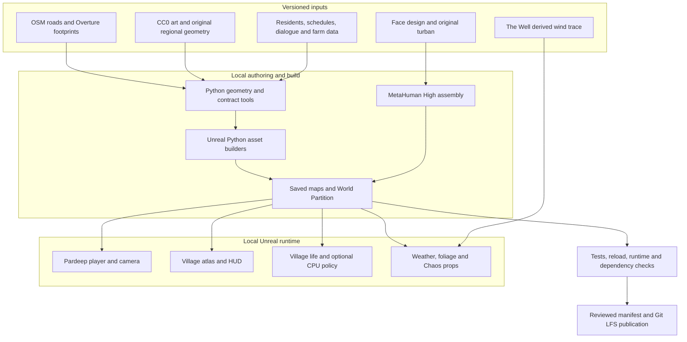

The C++ module remains named `rural_pardeep`. Authoring scripts produce assets; native code runs movement, village life, weather and the atlas. Saved World Partition packages stream the scene. MetaHuman assembly uses Epic's installed tooling and rigging service when required. Kaggle is an optional offline training path; normal gameplay has no remote model service.

The [detailed architecture](#architecture-details) includes **world-generation, gameplay, character, TinyAI, weather/physics and publication flowcharts**, plus source locations and data ownership.

### The Well and TinyAI

**Chaos supplies real-time physics.** The Well contributes a small, attributed shear-flow trace that is normalized and retimed into a 120-second wind loop. It drives visual wind and prop drag, with procedural gusts as fallback. It is not a live fluid solver or a village weather forecast. See the [wind provenance](Content/Well/wind.source.json) and [V1 physics guide](#v1-what-the-well-contributes).

TinyAI uses fixed `[1,64] → [1,48]` ONNX inference through Unreal NNE/ORT CPU. Rules, validity masks, reservations and fallback logic remain authoritative. The [Kaggle experiment](#kaggle) trained a separate candidate on synthetic controller states; it has not replaced the deployed model. There is no deployed speech recognition, voice synthesis or Punjabi language model.

## Controls

| Control | Action |
| --- | --- |
| WASD / mouse | Move / look |
| Shift / Space | Run / jump |
| V / Q | First- or third-person view / change camera shoulder |
| P | Cycle face close-up, hand close-up and third-person view |
| M | Open or close the village atlas |
| Tab or map click / Enter | Select / visit a destination while the atlas is open |
| Mouse wheel | Change minimap scale |
| T / 1–5 | Talk / choose a draft subtitle response |
| E / right mouse | Use a supported door or grab/drop / throw a prop |
| F6 / F7 | Weather / time of day |
| F9 / F10 / F11 | Aerial overview / pilot rooms / demonstration farm plots |
| F5 | Toggle experimental learned action ranking |

The atlas visit action moves the player to an authored entrance; its displayed distance is straight-line distance, not a navigation route. Input requires focus in the game window or Play in Editor viewport.

## Project guide

| Guide | Purpose |
| --- | --- |
| [Architecture](#architecture-details) | Components, data flow, runtime boundaries and publication pipeline |
| [Pardeep and streets](#pardeep) | Current player, High skin assets, turban, controls and rebuild commands |
| [V3 village atlas](#v3) | Varied architecture, public places, fields, animals and destination gallery |
| [V2.5 village life](#v25) | Residents, local state, Punjabi draft dialogue, CPU policy and acceptance gates |
| [V2 street pilot](#v2) | Detailed mapped street, pilot interiors and earlier world workflow |
| [V1 foundation](#v1) | Earlier geography, Chaos, weather, The Well and bootstrap reference |
| [MetaHuman pilot](#metahuman-setup) | Preserved Manpreet pilot and Creator Core Data requirements |
| [Kaggle](#kaggle) | Optional private numeric training job and candidate evaluation |
| [LFS publication](#git-lfs-and-assets) | Asset allowlist, hashes, engine dependencies and clone verification |

### Repository layout

```text
Source/rural_pardeep/   Native player, atlas, village life, environment and legacy gameplay
Scripts/               Geometry, Unreal authoring, launch, training and audit entry points
Assets/                Geographic inputs, world/NPC contracts, design files and source locks
Content/               Reviewed saved Unreal assets, external actors and runtime data
Config/                Engine, maps, rendering, physics, input and packaging configuration
Tests/                 Python geometry, schema, model-bundle and publication checks
Docs/                  Engine captures and selected validation evidence
ThirdParty/the_well/    Pinned research-source submodule
Saved/                 Local generated intermediates, logs, saves and packages; ignored
```

`Binaries`, `Intermediate` and `DerivedDataCache` are local build products. Private reference photos, credentials and unverified legacy imported art are excluded from publication. [assets.json](Docs/LFS/assets.json) lists the reviewed saved-asset snapshot exactly.

## Rebuild and validate

Save and close this project's editor before compiling or rebuilding assets. Generation replaces named generated outputs; keep manual variants under separate names. The published saved assets avoid a full world/character regeneration just to play.

```powershell
# Standalone geometry, schema and publication tests.
python -m pip install -r requirements-v3-tools.txt
python -m unittest discover -s Tests -v

# Current rendered movement and skin-inspection check.
.\Scripts\pardeep_village.ps1 -Action Check

# Reload every saved Pardeep asset in a fresh engine process.
.\Scripts\pardeep_appearance.ps1 -Action Verify

# Verify every published asset's size and SHA-256.
python Scripts/lfs_publication.py verify
```

| Change | Entry point |
| --- | --- |
| Current street surfaces and player map | `Scripts/pardeep_village.ps1 -Action Build` |
| Character face rig and High assembly | `Scripts/pardeep_appearance.ps1 -Action Character` |
| Eye, hair, skin and turban finish | `Scripts/pardeep_appearance.ps1 -Action Refine` |
| Regional homes, public sites and fields | `Scripts/v3.ps1 -Action Build` |
| Resident contracts and deployed policy import | `Scripts/v25.ps1 -Action Build` |
| Earlier geographic foundation | `Scripts/bootstrap.ps1` |

Follow the stage sections below for dependencies and ordering. Asset-generating Python scripts import `unreal` and must run inside the engine; standalone system Python is used for data tools. The existing V3 packaging profile excludes the MetaHuman pilot and does **not** produce a validated Pardeep package.

## Validation and known limits

Evidence below was recorded on **24 October 2026**. These are separate checks, not a single release certification.

| Check | Recorded evidence |
| --- | --- |
| Python suite | 46 tests passed, including single-README report/export checks |
| Native editor module | UE 5.8.4 Win64 Development build passed |
| Pardeep saved assets | 338 assets reloaded successfully in a fresh engine process |
| Current rendered runtime | Walk/run, ground contact, reference-guided actor and attached turban passed; 26.71 m player travel |
| Skin close-ups | Face/body LOD 0 in the High export, 100% screen percentage, full-resolution subsurface scattering |
| Saved package references | 9,064 packages audited with no missing or excluded project dependencies |
| Earlier V3 package | Bounded destination/animal/overview checks passed on its own build; this does not validate the current Pardeep package |

See [runtime evidence](Docs/PardeepPlayer/runtime_check.json), [skin inventory](Docs/PardeepPlayer/skin_asset_audit.json), [actual render settings](Docs/PardeepPlayer/skin_runtime_quality.json), [asset reload](Docs/PardeepPlayer/saved_asset_check.json) and [V3 package evidence](Docs/V3/runtime_packaged.json).

The High assembly saved its assets but the editor exited with an access violation during shutdown. A fresh reload passed independently. One early rendered launch hit a GPU device-hung error; a retry and the final refined runtime check passed. These issues remain recorded in the [player guide](#pardeep); long-session stability and a packaged Pardeep build remain unverified.

Other open work includes measured terrain/facades, custom Punjabi clothing, likeness review, realistic resident/animal art, reviewed Punjabi language and audio, HLOD/performance work, and broader navigation coverage. No multiplayer or shipping build is claimed. Enabled toolkit plugins do not imply every catalogue feature is integrated.

### Troubleshooting

| Symptom | Next step |
| --- | --- |
| Missing or unreadable `.uasset` / `.umap` | Run `git lfs pull`, then the manifest verifier; LFS pointers are not Unreal asset data |
| Missing MetaHuman animation or content | Check UE 5.8.4, Creator Core Data and the [pilot setup](#metahuman-setup) |
| Wrong world on launch | Use `pardeep_village.ps1`; editor startup selects Pardeep, while the generic game default retains V1 |
| Missing native module | Close the editor and compile `rural_pardeepEditor` with the installed engine/toolchain |
| `unreal` import fails in normal Python | Run the authoring script through its Unreal wrapper |
| GPU pressure or slow rendering | Avoid duplicate Unreal sessions; try `-ScreenPercentage 67` with the play command and inspect `Saved/Logs` |
| Village state is not saved in Pardeep preview | This launcher deliberately supplies `-V25NoSave`; normal V3/V2.5 play uses its own local save |
| Plugin missing | Inspect [TOOLKIT_STATUS.md](#toolkit-status); plugin availability and runtime integration are separate |

## Licensing and contribution

Original project code and original generated geometry are [MIT](LICENSE). Unreal Engine and generated MetaHuman content retain Epic's terms. MetaHuman assets are **not MIT**. Geographic data retains OSM/Overture attribution and applicable ODbL/CC BY terms; Poly Haven art is CC0, the Gurmukhi font is SIL OFL, The Well source is BSD-3-Clause and the derived wind trace is attributed CC BY 4.0 material. See [THIRD_PARTY_NOTICES.md](#third-party-notices) and the [publication scope](#git-lfs-and-assets) before redistribution.

This is the single maintained project Markdown guide. Detailed sections below retain build procedures, evidence, provenance and notices; upstream submodule documentation remains owned by its upstream project.

Contribute through source and reproducible generation rules. Keep provenance, update the relevant checks and provide an engine capture for visible changes. Report generators update bounded sections of this README. Package tools export its third-party notices as a text file and a portable copy of the guide. Review the exact asset manifest and diff before staging. Commit selected evidence; keep private references, credentials, engine binaries, caches and packaged executables local.


## Complete guide index

- [Detailed system architecture](#architecture-details)
- [Pardeep and village streets](#pardeep)
- [V3 architecture, atlas and destination gallery](#v3)
- [V2.5 residents, farms, dialogue and TinyAI](#v25)
- [Recorded V2.5 validation](#v25-results)
- [V2 detailed street pilot](#v2)
- [Recorded V2 validation](#v2-results)
- [MetaHuman setup and preserved Manpreet pilot](#metahuman-setup)
- [Optional Kaggle GPU experiment](#kaggle)
- [Git LFS, assets and publication](#git-lfs-and-assets)
- [Geographic inputs and provenance](#geodata)
- [Third-party notices](#third-party-notices)
- [Toolkit integration status](#toolkit-status)
- [Original toolkit catalogue](#toolkit-catalogue)
- [Historical V1 foundation and rebuild reference](#v1)
- [Recorded V1 validation](#v1-validation)
- [Legacy mini-game wiring reference](#legacy-wiring)

<a id="architecture-details"></a>

## Detailed system architecture

<!-- BEGIN:architecture-details -->

<a id="architecture-details-village-mesh-system-architecture"></a>

This document describes the implementation in the repository as of **24 October 2026**. The current player world is `/Game/VillageMeshV3/Lvl_PandoriV3_Pardeep_WP`. All diagrams describe implemented paths unless a node explicitly says optional, candidate or pending.

<a id="architecture-details-1-system-boundaries"></a>
### 1. System boundaries

Village Mesh has one native Unreal runtime module, `rural_pardeep`, supported by standalone Python data tools and Unreal Python authoring scripts. The executable, renderer, physics and gameplay run locally. GitHub stores source and reviewed LFS assets; it is not a game backend. Kaggle provides an optional offline experiment. Epic's rigging service is used by character authoring when required.

| Layer | Authoritative inputs | Outputs / owner |
| --- | --- | --- |
| Geography and source art | `Assets/Geodata`, texture/model locks | Pinned source extracts and licensed art |
| Village design | `Assets/World`, V2 layouts, street recipes | Generated geometry, map art and destination contracts |
| Simulation design | `Assets/NPC`, `Dialogue`, `Farms`, `Roads`, `Routes`, `Wardrobe` | Validated runtime copies under `Content/V25` |
| Pilot destinations | V2 generated route and interior contract | Exact `Content/Validation/pilot.json` used by F10 and diagnostics |
| Character design | `Assets/MetaHumans/pardeep_face_design.json`, original turban generator | Separate Pardeep source character and High assembly |
| Saved Unreal scene | `Content/VillageMesh*`, `Content/MetaHumanPilot` and external packages | Reviewed `.umap` / `.uasset` files through LFS |
| Gameplay | Native actors, components and runtime data | Player, village life, HUD, weather and physics |
| Local state/evidence | `Saved` | Saves, logs, captures, build intermediates and packages |
| Publication | `Docs/LFS/assets.json`, source diff and selected evidence | Git commits and LFS objects |

Private portraits stay outside the publication inputs. The published face design is a manual artistic approximation. The current character build report records that source photographs were neither copied nor uploaded; generated rig data is distinct from those photographs.

<a id="architecture-details-2-world-generation-flow"></a>
### 2. World-generation flow

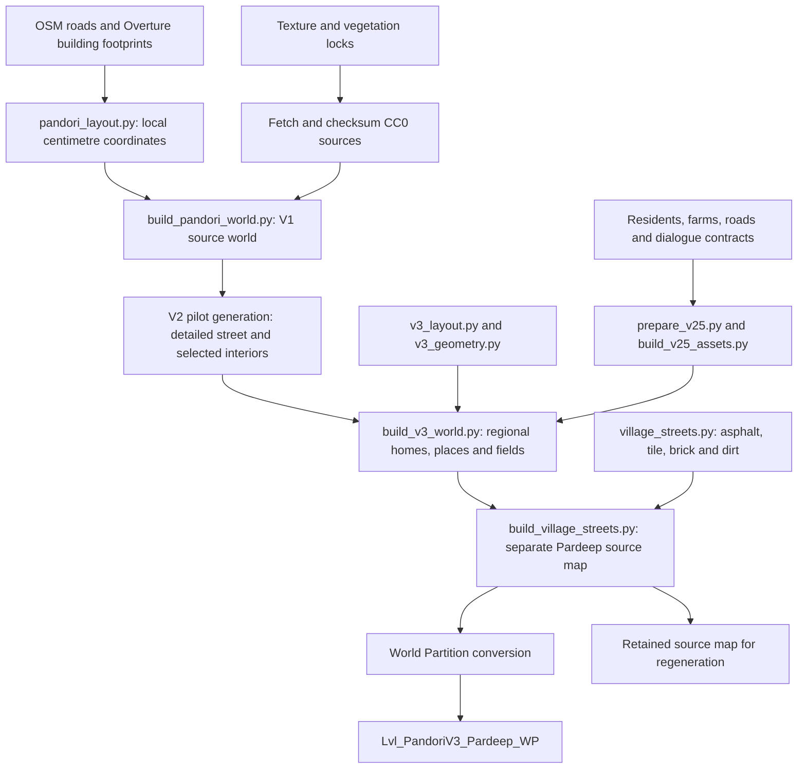

World regeneration is staged; the current player build is not a command to recreate every earlier stage. The reviewed LFS snapshot already contains the saved worlds. Source maps are retained alongside `_WP` playable copies. External actor/object packages must travel with their maps.

The coordinate origin is **31.4610594 N, 75.7240654 E**; local **X is east, Y is north, Z is up**, with **100 Unreal units per metre**. Terrain uses a flat datum. Stable building IDs preserve the mapped outline while recipe selection varies its facade geometry. Road widths and unspecified surfaces are inferred. Public places, field boundaries and crop choices are labelled representative.

<a id="architecture-details-scene-generations"></a>
#### Scene generations

| Generation | Playable asset / workflow | Scope |
| --- | --- | --- |
| V1 | `/Game/VillageMesh/Lvl_PandoriNijjaran_WP` | Geographic foundation, vegetation, weather and Chaos yard |
| V2 | `/Game/VillageMeshV2/Lvl_PandoriV2_WP` | Detailed mapped pilot street and selected interiors |
| V2.5 | V2 map with village-life activation | Eight residents, four plots, dialogue, persistence and CPU policy |
| V3 | `/Game/VillageMeshV3/Lvl_PandoriV3_WP` | Full extract architecture, atlas, public places, farms and animals |
| Pardeep | `/Game/VillageMeshV3/Lvl_PandoriV3_Pardeep_WP` | Separate street surfaces and third-person MetaHuman player |

The editor startup map selects Pardeep. `GameDefaultMap` still selects V1 for legacy workflows. Each launch wrapper supplies its intended map explicitly, so these settings must not be treated as interchangeable.

<a id="architecture-details-3-runtime-and-player-flow"></a>
### 3. Runtime and player flow

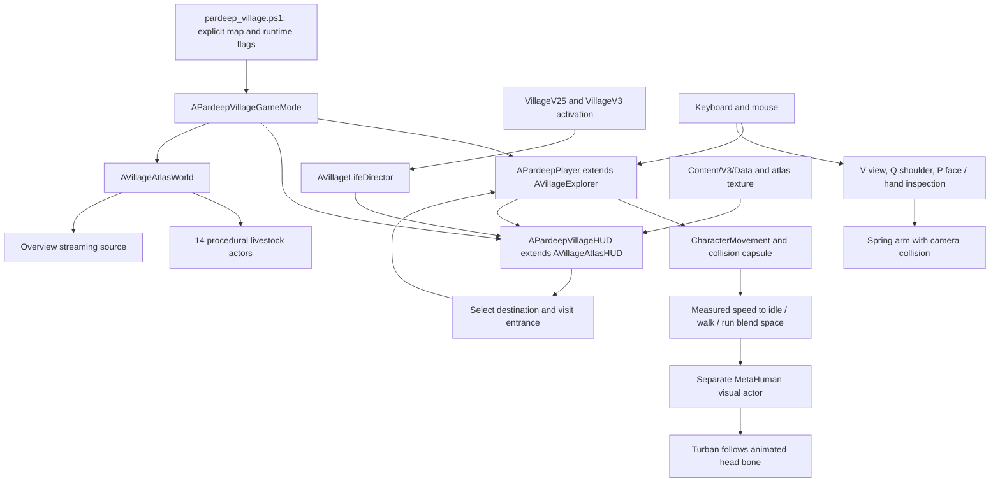

The collision capsule drives movement; the attached visual actor has actor collision disabled. `BS_PlayerLocomotion` follows horizontal speed and references installed MetaHuman neutral idle/walk/run clips. Those raw engine/plugin animations are not copied into the repository. The separate Pardeep Blueprint is preferred, with the earlier temporary visual and Manpreet as fallbacks. Runtime validation requires the intended reference-guided actor rather than accepting a fallback silently.

The spring arm retracts against collision. Inspection chooses the hand on the sun-facing side using the scene's directional light; it does not create a separate portrait lighting rig. `P` cycles the face, hand and ordinary camera. `V` or `Q` leaves inspection mode. Camera collision being enabled is separate from testing every obstruction in the village.

The atlas uses a generated raster map and authored destination coordinates. Opening it suspends player movement/look, while village simulation continues. An aerial streaming source expands coverage for the overview and is released on return to ground level. HLOD baking and long traversal profiling remain separate work.

<a id="architecture-details-native-source-map"></a>
#### Native source map

| Component | Source | Responsibility |
| --- | --- | --- |
| Pardeep player, HUD and game mode | [PardeepPlayer.cpp](Source/rural_pardeep/Character/PardeepPlayer.cpp) | Visual actor, camera, turban, locomotion, skin captures and runtime checks |
| Base explorer | [VillageExplorer.cpp](Source/rural_pardeep/Character/VillageExplorer.cpp) | Movement, interaction, weather/time controls and base runtime setup |
| Atlas and livestock | [VillageAtlas.cpp](Source/rural_pardeep/V3/VillageAtlas.cpp) | Map UI, destinations, overview streaming and bounded animal movement |
| Village-life director | [VillageLife.cpp](Source/rural_pardeep/V25/VillageLife.cpp) | Residents, schedules, jobs, paths, reservations, dialogue and saves |
| Tiny CPU policy | [TinyNPCPolicy.cpp](Source/rural_pardeep/V25/TinyNPCPolicy.cpp) | Model creation, parity fixtures and bounded inference worker |
| Weather | [WeatherManager.cpp](Source/rural_pardeep/Environment/WeatherManager.cpp) | Daylight, profiles, rain, wetness and wind |
| Physics props and doors | [VillagePhysicsProp.cpp](Source/rural_pardeep/Environment/VillagePhysicsProp.cpp), [VillageDoor.cpp](Source/rural_pardeep/Environment/VillageDoor.cpp) | Chaos forces/buoyancy and pilot-door interaction |
| Preserved pilot | [MetaHumanPilot.cpp](Source/rural_pardeep/MetaHumanPilot/MetaHumanPilot.cpp) | Separate Manpreet animation/grounding experiments |

Legacy character and mini-game source is retained under `Character`, `MiniGames` and `Interaction`. Its presence does not imply every legacy Blueprint or game mode is wired into the current player world.

<a id="architecture-details-4-character-and-skin-pipeline"></a>
### 4. Character and skin pipeline

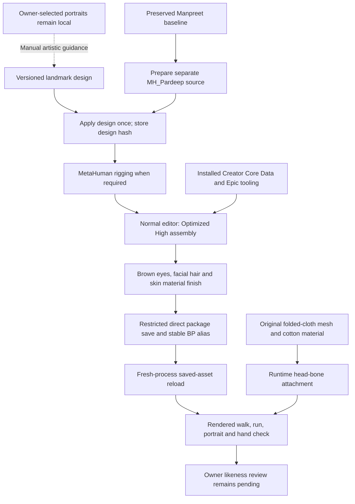

Entry point: [pardeep_appearance.ps1](Scripts/pardeep_appearance.ps1), with `Prepare`, `Character`, `Refine`, `Turban` and `Verify` actions. Assembly runs in a normal editor because its Texture Graph path is unavailable in the commandlet build. `UPardeepAssetTools` saves only the Pardeep namespace directly, avoiding the editor thumbnail allocation spike. It does not resave other project namespaces.

The High export contains **19,283 face vertices** and **25,328 body vertices** at its most detailed exported LOD. Body colour is 4K with 8K normal/surface maps; face colour is 2K with 4K normal/surface maps. These are saved texture dimensions, not a guarantee every virtual-texture page is resident at every camera distance. Runtime LOD 0 means the finest **High export** mesh, not the original cinematic source LOD 0.

The play/check wrapper uses 100% screen percentage and full-resolution subsurface scattering. Skin refinement retains generated colour variation and tunes roughness, specular response and fine normals. The turban hides scalp hair while preserving beard, moustache and brows. Clothing is still a temporary T-shirt/shorts outfit, and the hand/body textures are generated MetaHuman art, not scans of the owner.

The assembly report records the non-clean editor shutdown. Acceptance of saved output requires an independent reload; successful package saves alone do not erase the shutdown failure. [Player evidence and known issues](#pardeep) record the separate rendered check and limitations.

<a id="architecture-details-5-village-life-and-tinyai"></a>
### 5. Village life and TinyAI

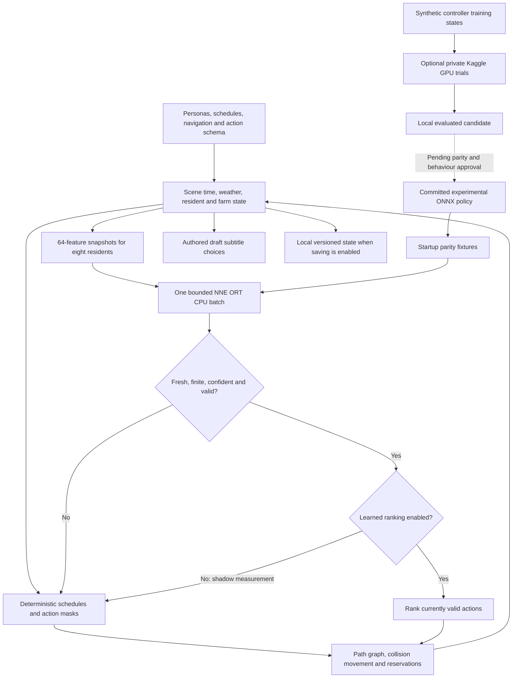

The deployed MLP is **64 → 256 → 256 → 128 → 48**, with **121,520 learned values**, fixed FP32 tensors and ONNX opset 17. One worker owns a model instance and copies numeric buffers; it does not manipulate UObjects. The game thread validates result age, generation, finite values and current action validity. Missing models, parity failures, stale results, low margins and unavailable targets preserve rules-based behaviour.

The executor uses an explicit authored graph, passage/job reservations and native collision movement. It is not a completed StateTree/NavMesh/Smart Object integration. The tractor is a kinematic reserved-route prototype, not a calibrated Chaos vehicle. Dialogue is authored, subtitle-only and draft; the other audited language-model designs are not deployed.

Normal V2.5/V3 play stores compatible state in `Saved/VillageMeshV25/save_v1.json`. Persistent identities and events are validated; transient reservations and actor references are rebuilt. **The Pardeep wrapper supplies `-V25NoSave` even for Play**, so this preview does not modify the normal village-life save. This is local single-player state, with no multiplayer replication or online database.

The Kaggle source bundle contains only numeric training code; it does not include portraits, MetaHuman assets, animations or geography. Its candidate remains separate from the deployed model. See [V2.5 contracts](#v25) and [Kaggle evidence](#kaggle).

<a id="architecture-details-6-weather-rendering-and-physics"></a>
### 6. Weather, rendering and physics

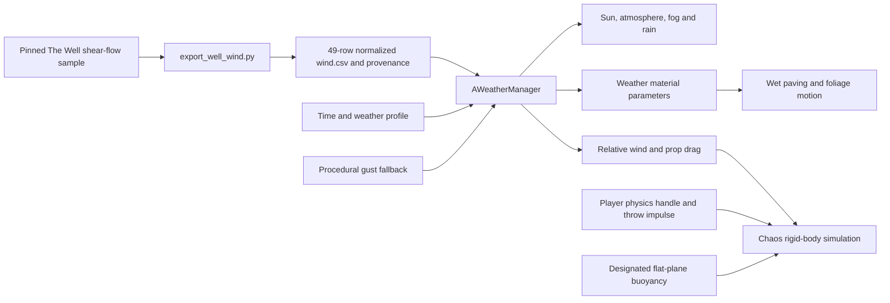

The Well submodule and a derived CSV are research inputs; no Well model runs in the game loop. The trace is peak-normalized, mapped horizontally and retimed into a 120-second loop. The source revision, sampled point and transformations are recorded in [wind.source.json](Content/Well/wind.source.json).

Chaos handles rigid bodies, friction, gravity and collision. Selected small props use CCD; configured substeps target at most 1/120 second with an eight-step cap. The buoyancy example applies forces against a flat water plane. Neither that demo nor enabled Niagara/Water plugins establishes a coupled fluid simulation.

Software Lumen, virtual shadow maps, atmospheric effects and Substrate form the rendering setup. PCG provides seeded foliage with exclusion areas. Skin detail and rendering settings improve presentation; measured terrain, surveyed facades, final art and sustained performance are separate requirements.

<a id="architecture-details-7-validation-and-publication-flow"></a>
### 7. Validation and publication flow

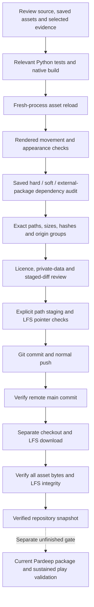

The [publication script](Scripts/lfs_publication.py) builds a manifest only from approved content namespaces, runtime data extensions and pinned CC0 downloads. It rejects traversal/symlink escapes and changed pinned downloads. [The Unreal audit](Scripts/audit_lfs_assets_unreal.py) checks hard/soft references and external packages; required engine/plugin mounts remain installation dependencies.

Git stores LFS pointers for `.uasset`, `.umap`, bulk exports and pinned downloaded art. LFS stores the corresponding bytes. A successful Git push alone does not establish that another checkout can hydrate those bytes. Conversely, byte verification in a separate checkout is not a clean-machine Unreal launch or packaged-game test.

Current evidence: **46 Python tests**, native editor build, **338 reloaded Pardeep assets**, **9,064 audited packages**, and a rendered movement/skin check. The prior V3 package is a separate product of its cook profile, which excludes MetaHuman content. Do not treat it as the current Pardeep package. The known assembly-shutdown and earlier GPU-launch failures remain documented despite successful subsequent checks.

<a id="architecture-details-8-extension-points-and-remaining-work"></a>
### 8. Extension points and remaining work

| Change | Start here | Validation to repeat |
| --- | --- | --- |
| Geographic extent or outlines | `Assets/Geodata`, `pandori_layout.py` | Provenance, projection, geometry and source selection |
| Homes, public sites or agricultural art | `v3_layout.py`, `v3_geometry.py`, `build_v3_world.py` | Geometry, separation, labels and destination captures |
| Streets and paving | `village_streets.py`, `build_village_streets.py` | Surface counts, geometry and player traversal |
| Player, camera or locomotion | `PardeepPlayer.cpp`, locomotion builder | Native build, rendered movement and camera checks |
| Face, skin or turban | Pardeep design and appearance scripts | Assembly/reload, material inventory, captures and owner review |
| Resident actions or policy | V2.5 contracts, `VillageLife.cpp`, `TinyNPCPolicy.cpp` | Schema/mask/parity, routes, persistence and soak |
| Weather or prop physics | Environment sources and wind provenance | Native build, rendered weather and physics checks |
| Packaging or publication | Package scripts, dependency audit and LFS manifest | Cook audit, independent hydration and target-specific runtime |

Priority gaps are exact likeness and wardrobe, improved hand/body presentation in varied lighting, realistic resident/livestock assets, reviewed Punjabi language/audio, measured local architecture/terrain, long-session GPU stability, HLOD/traversal performance and a validated Pardeep package. [Toolkit status](#toolkit-status) distinguishes implemented systems from enabled or planned plugins.

<!-- END:architecture-details -->


<a id="pardeep"></a>

## Pardeep and village streets

<details>
<summary>Expand this section</summary>

<!-- BEGIN:pardeep -->

<a id="pardeep-pardeep-player-and-village-streets"></a>

This local iteration adds a third-person protagonist slot and a separate village map, `/Game/VillageMeshV3/Lvl_PandoriV3_Pardeep_WP`. It retains the mapped road routes, 821 building outlines, eight regional house styles, nine public-site interpretations and 41 authored fields from V3.

**Likeness review is still required.** After the temporary preview, the owner selected four local front/side/chin-up portraits. Pardeep now has a separate character asset and a manual, reference-guided facial design covering cheeks, nose, eyelids, lips and chin. This is an artistic approximation, not a photogrammetric scan or a verified exact likeness. The current T-shirt/shorts remain a temporary outfit; custom Punjabi clothing is unfinished.

The original black turban mesh has layered folds and an arched forehead edge. It follows the animated head bone, covers the scalp hair and retains the beard, moustache and eyebrows. The original Manpreet pilot is preserved. Source portraits, embeddings, messages and credentials are excluded from publication. The photo files remain local; Epic's rigging service processes the generated character data during the build.

Supporting characters can use separately selected references. The existing eight residents retain their identities; photographs in a mixed archive are not assigned to named characters automatically.

<a id="pardeep-verified-local-preview--24-october-2026"></a>
### Verified local preview — 24 October 2026

The UE 5.8.4 editor build passed. All 44 Python tests passed. The latest standalone third-person check loaded the separate Pardeep actor and recorded 26.71 m of player travel, 27.41 m of accumulated component-space foot motion, walking and running speeds, continuous grounded movement, and the turban attached to the animated head. Camera collision is enabled; that flag is not an exhaustive wall-obstruction test. The walking, idle, front portrait and hand-detail captures were reviewed. No new packaged build or sustained performance result is claimed.

A separate commandlet reloaded all 338 saved Pardeep assets and the runtime Blueprint successfully. The new character has brown eyes, retained facial hair and original black folded headwear. The portrait is a likeness preview for owner review, not a claim of identity accuracy.

The skin update uses an **Optimized High** assembly: 19,283 vertices in the most detailed exported face mesh and 25,328 in the body. The saved body has 4K colour and 8K normal/surface maps; the face has 2K colour and 4K normal/surface maps. The shader retains colour variation and subsurface scattering, with adjusted highlight roughness and fine normal detail. These are generated MetaHuman materials, not a scan of the owner's hands or body.

The default play/check commands now render at 100% screen percentage with full-resolution skin scattering. Use `-ScreenPercentage 67` with the play command if a lower rendering cost is needed. The saved texture and mesh inventory is in [skin_asset_audit.json](Docs/PardeepPlayer/skin_asset_audit.json); actual close-up LOD and rendering settings are in [skin_runtime_quality.json](Docs/PardeepPlayer/skin_runtime_quality.json).

The High assembly saved its packages but the editor exited with an access violation during shutdown (`-1073741819`); [character_build.json](Docs/PardeepPlayer/character_build.json) records `assembly_editor_clean_exit: false`. The independent reload succeeded. One early High runtime launch encountered a GPU device-hung/page-fault error in virtual-shadow-map rendering. A retry and the final material/camera refinement check succeeded. The failure is not considered resolved by a short successful run; sustained stability remains unverified.

The initial runtime check caught a reference-pose failure despite actor movement. The generator now explicitly validates and resamples the blend space's runtime data before saving it; a fresh engine run passed after the correction.

The earlier street/temporary-player preview passed manual checks of the V first/third-person toggle, Q shoulder swap, and M full-map open/close controls. The updated appearance preview was launched after its automated checks. Manual testing of the new P inspection key was interrupted when computer control was stopped; the automated run exercised both inspection cameras.


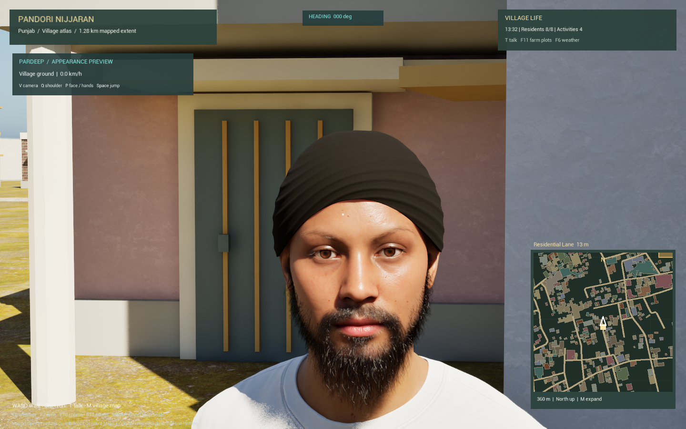

[Hand detail](Docs/PardeepPlayer/hand_detail.png) · [Idle view](Docs/PardeepPlayer/third_person_idle.png) · [Runtime result](Docs/PardeepPlayer/runtime_check.json) · [World build result](Docs/PardeepPlayer/build_report.json).

<a id="pardeep-play"></a>
### Play

```powershell
.\Scripts\pardeep_village.ps1 -Action Play
```

| Control | Action |
| --- | --- |
| WASD / mouse | Camera-relative movement / orbit |
| Shift | Run |
| Space | Jump |
| V | Third-person / first-person view |
| Q | Change camera shoulder |
| P | Cycle face close-up, sun-facing hand close-up and third-person view |
| M | Village map |
| Tab / Enter | Select / visit map destination |
| T | Talk |
| E / right mouse | Door or physics grab / throw |
| F6 / F7 | Weather / time |

This preview launcher uses `-V25NoSave`, so it does not write the normal village-life save.

The spring arm retracts against camera collision. Movement turns the visible character independently of camera yaw. A three-sample locomotion blend space follows actual horizontal speed. Jump physics work; a dedicated airborne animation is not included. The HUD adds heading, speed and the material under the player's feet while retaining the village map and destination distances.

<a id="pardeep-street-design"></a>
### Street design

The 71 mapped routes receive 9 asphalt connector roads, 35 tile-paved lanes, 17 brick lanes and 10 dirt tracks. Existing OSM surface tags take precedence when supplied; remaining surface assignments follow the requested artistic design. These are not surveyed pavement conditions. The road widths also remain inferred.

Paving has metre-scaled joints, small bevel normals and rain-driven color/roughness. The geometry provides a shallow crown, shared cross sections at bends and earthen shoulders. Clear road edges receive solar-panel streetlamp models. The lamp models do not simulate an electrical or sensor network. Existing Punjabi-style verandas, courtyards, balconies, roof terraces, jali details and shop homes remain regional interpretations rather than verified facades.

<a id="pardeep-rebuild-and-verify"></a>
### Rebuild and verify

Save and close this project's editor before rebuilding:

```powershell
python -m unittest discover -s Tests -v
.\Scripts\pardeep_village.ps1 -Action Build
.\Scripts\pardeep_village.ps1 -Action Check
```

The build creates a copy of the V3 source map, removes inherited uniform road actors from that copy, imports the replacement surfaces and converts it to World Partition. The player blend space references the installed MetaHuman idle/walk/run clips; those raw Epic clips are not redistributed in the repository. UE 5.8.4 with the installed MetaHuman content is the development target. The original approved temporary appearance remains available as a fallback.

<a id="pardeep-rebuild-the-reference-guided-appearance"></a>
### Rebuild the reference-guided appearance

The separate actor is `/Game/MetaHumanPilot/Pardeep/Assembled/BP_Pardeep`. Its source character is `/Game/MetaHumanPilot/Pardeep/Characters/MH_Pardeep`. The original temporary visual remains a fallback if the new actor is unavailable.

```powershell
# Compile the project module before using its editor asset helpers.
& 'E:\U.E\UE_5.8\Engine\Build\BatchFiles\Build.bat' rural_pardeepEditor Win64 Development "-Project=$PWD\rural_pardeep.uproject" -WaitMutex -NoHotReloadFromIDE
# Initialize a separate character from the preserved pilot and build the turban.
.\Scripts\pardeep_appearance.ps1 -Action Prepare
# Apply the saved artistic face design, rig and assemble. Requires Epic sign-in.
.\Scripts\pardeep_appearance.ps1 -Action Character
# Rebuild just the original cloth mesh/material after headwear edits.
.\Scripts\pardeep_appearance.ps1 -Action Turban
# Update cloth, eyes, hair and skin materials without repeating facial rigging.
.\Scripts\pardeep_appearance.ps1 -Action Refine
# Reload every saved Pardeep asset in a fresh editor process.
.\Scripts\pardeep_appearance.ps1 -Action Verify
.\Scripts\pardeep_village.ps1 -Action Check
```

The face design is recorded in `Assets/MetaHumans/pardeep_face_design.json`. A saved design hash prevents cumulative application of the same sculpt. A different design requires an intentionally reviewed baseline, rather than applying another set of deltas silently. `Saved/PardeepPlayer` holds local reference metadata, build evidence and the runtime portrait. Photographs are not required by the published build scripts.

Character assembly runs in a normal editor because Texture Graph is unavailable in the commandlet path. The generated character packages are saved directly without rendering editor thumbnails, avoiding the allocation spike that exhausted memory on this development laptop. The save helper is restricted to `MetaHumanPilot/Pardeep`; it does not resave other project assets. A failed assembly remains failed in the report even if its source sculpt and rig have been saved successfully.

Local build evidence is written to `Saved/VillageStreets/build_report.json`. The standalone runtime check writes `Saved/PardeepPlayer/runtime_check.json` and walking/idle captures. Runtime results, likeness approval, packaging and a sustained performance test are separate gates; generated source assets alone do not establish those outcomes. The existing V3 packaging script excludes the MetaHuman pilot and should not be used to claim a packaged Pardeep build.

<!-- END:pardeep -->

</details>


<a id="v3"></a>

## V3 architecture, atlas and destination gallery

<details>
<summary>Expand this section</summary>

<!-- BEGIN:v3 -->

<a id="v3-pandori-village-atlas-and-full-mapped-village"></a>

V3 expands visual detail across the existing **1.28 km by 1.28 km** map, with **821 source building outlines**, **71 OSM road records**, eight regional house recipes, nine public destinations, 41 representative agricultural parcels and 14 animated farm animals. It keeps the V2 pilot interiors and the V2.5 resident/dialogue/CPU-policy systems.

The footprint coverage is the existing map extract, not a claim to cover the village's complete administrative boundary. Buildings, public sites and fields have original procedural art. This is not a surveyed digital twin.

<a id="v3-play"></a>
### Play

```powershell
.\Scripts\v3.ps1 -Action Play
```

- **M** opens/closes the full village map; the live minimap stays visible while walking.
- **Click** a map marker or destination row, or **Tab** to cycle destinations.
- **Enter** while the map is open visits the selected entrance.
- **Residential Lane** is selected initially: press M then Enter to see the rebuilt homes outside the preserved pilot. This is a tour label on a mapped road, not an official street name.
- **Mouse wheel** changes the minimap's displayed area. North remains up; the white arrow follows player facing.
- **WASD / mouse** walk/look, **Shift** run, **Space** jump, **T** talk, **1–5** dialogue choices.
- **F6** weather, **F7** time, **F10** pilot rooms, **F11** V2.5 farm plots, **F5** experimental policy.
- **F9** toggles the aerial overview. A dedicated streaming source loads the full mapped area while airborne and releases it on return to ground level.

The selected place shows straight-line distance, not a guaranteed pedestrian route. Opening the atlas disables movement/look while allowing the resident simulation to continue.

To open the V3 level directly in the Unreal editor, run `.\Scripts\v3.ps1 -Action Editor`, then press Play. Its asset path is `/Game/VillageMeshV3/Lvl_PandoriV3_WP`. The V3 level enables village life without requiring a command-line switch. The original project startup map is retained for the earlier build workflows.

<a id="v3-architecture-and-village-uses"></a>
### Architecture and village uses

The new background homes use stable source IDs to select lime verandas, exposed-brick courtyard-inspired homes, haveli balconies, modern set-back terraces, pastel jali parapets, farmhouses, shop-house fronts and stepped family homes. These vary geometry as well as colour: canopies, shade projections, columns, shutters, balcony rails, rainwater pipes, roof tanks, solar panels, storey bands and roof pavilions. The existing sixteen detailed pilot buildings keep their entrances and interiors. Most other buildings are exterior shells.

The mandir has a stepped shikhara and porch; the gurdwara has a domed hall, corner pavilions, saffron flagpole and langar veranda. The school has classroom wings and a shaded courtyard. The bazaar has five shuttered shop fronts, awnings and produce bins. The sports ground has football goals, a cricket pitch and swing equipment. The dairy and agriculture centre have open sheds, troughs, fodder and milk churns. A raised water tank and separate telecom mast create distinct skyline landmarks.

The 41 new 65 m square parcels mix rice stubble, vegetables, fodder and tilled soil, with bunds and narrow irrigation channels. Their boundaries and crops are representative, not a cadastral record or observation of current crops. The existing four V2.5 plots are additional to these parcels.

Eight cows/buffalo occupy the dairy, with four goats and two hens at the agriculture centre. They have bounded movement, idle periods, simple animated legs and collision capsules. Their art and gait are procedural; they are not licensed realistic skeletal animal models or veterinary/biomechanical simulations.

<a id="v3-geography-and-reference-confidence"></a>
### Geography and reference confidence

Road centre lines and building outlines retain the project's pinned OSM/Overture inputs. The generator does not move, erase or relabel those building footprints. Authored public sites occupy clear space, and their exact in-game positions are **representative**, including where the existence of a landmark is supported by a reference. Their shapes and dimensions have not been observed or measured.

| Reference | What it supports | What it does not establish |
| --- | --- | --- |
| [Shiv Temple, Wikimapia](http://wikimapia.org/15450774/Shiv-Temple) | Community-listed temple and approximate reference point 31.4597992, 75.7194471 | Surveyed boundary, facade or exact game placement |
| [Gurudwara Nihang Singh listing](https://yappe.in/punjab/pandori-nijjaran/gurudwara-nihang-singh-pandori-nijjaran/1529679) | Named local gurdwara; listing gives FP6G+6CH | Exact reconstructed building or site boundary |
| [GPS Pandori Nijjaran school listing](https://www.icbse.com/schools/gps-pandori-nijjaran-ezqk9) | A local government primary school; listing describes classrooms and playground | Current verified facilities, footprint or facade |

References accessed 24 October 2026. No external photographs, map tiles, private interiors, real resident identities, or third-party landmark meshes are distributed. Sources may be incomplete or outdated. The map itself labels the authored public sites as representative.

<a id="v3-rendered-destination-gallery"></a>
### Rendered destination gallery

These images come from the standalone Unreal runtime check, with the normal game HUD visible.


| Destination | Engine capture |
| --- | --- |
| Shiv Mandir | [Temple porch and shikhara](Docs/V3/view_01.png) |
| Gurdwara Sahib | [Domed hall](Docs/V3/view_02.png) |
| Village School | [Classrooms and courtyard](Docs/V3/view_03.png) |
| Sports Ground | [Cricket pitch, goals and swings](Docs/V3/view_04.png) |
| Village Bazaar | [Five shop fronts](Docs/V3/view_05.png) |
| Water Tower | [Raised tank and supporting structure](Docs/V3/view_07.png) |
| Telecom Mast | [Lattice mast](Docs/V3/view_08.png) |
| Agriculture Centre | [Farm shed and small livestock](Docs/V3/view_09.png) |
| Full mapped area | [Aerial overview](Docs/V3/view_11.png) |

<a id="v3-rebuild"></a>
### Rebuild

Requires the existing V2 source map and V2.5 assets. Follow [V2 setup](#v2) and [V2.5 setup](#v25) on a clean machine first. Use the Python dependencies from those guides, including Pillow, and UE 5.8.3 with Visual Studio Build Tools.

```powershell
python -m pip install -r requirements-v3-tools.txt
python Scripts/v3_layout.py
python -m unittest discover -s Tests -v
.\Scripts\v3.ps1 -Action Build
.\Scripts\v3.ps1 -Action Check
.\Scripts\v3.ps1 -Action Package
.\Scripts\check_v3_package.ps1
python Scripts/audit_v3_package.py
```

The build creates `/Game/VillageMeshV3/Lvl_PandoriV3`, imports original meshes/materials/map artwork, then converts a separate World Partition map. V1/V2 assets are referenced but not rewritten. Public inputs live in `Assets/World`; runtime JSON is copied to `Content/V3/Data`. Reviewed generated Unreal assets are now included through [Git LFS](#git-lfs-and-assets). OBJ intermediates and packaged builds remain ignored; source scripts still reproduce them.

The V3 vegetation graphs are independent copies. Their original seeded points are filtered around new public sites and fields so trees/shrubs cannot grow through those additions. Wall UVs use their own face plane rather than a ground projection, including on vertical facades.

Veranda columns are omitted where they would obstruct the mapped road width; those houses use cantilevered shade instead. Subsequent builds reuse generated meshes with unchanged OBJ hashes. Use `-ForceReimport` with the Build action to reimport every mesh.

`package_v3.ps1` temporarily enables the appropriate cook profile and restores the project/config bytes in `finally`. It explicitly cooks V3 and V2.5 to retain the atlas, procedural material and optional CPU model. The portable Development build goes to `Saved/Packages/V3/Windows`, with `Play_V3.cmd` as launcher.

<a id="v3-validation-scope"></a>
### Validation scope

`test_v3_world.py` checks preserved building IDs/outlines, coverage of requested uses, site/road/building separation, finite geometry, distinct geometry for the eight recipes, nondegenerate wall UVs, veranda clearance, and inference labels. The runtime check loads the atlas and visits nine public entrances plus the residential lane in a rendered scene. It captures those stops and an aerial overview, checks player ground state, requires all fourteen animals to move within their yards, and records frame p95. It is a bounded smoke test, not exhaustive village navigation or the earlier V2.5 30-minute soak. V3 must have its own fresh evidence; V2.5 timings do not establish V3 performance.

<a id="v3-recorded-results-24-october-2026"></a>
#### Recorded results: 24 October 2026

| Check | Result |
| --- | --- |
| Python suite | 33 tests passed, including eight V3 data/geometry regressions |
| Native builds | Editor and standalone Win64 Development builds passed |
| World Partition conversion | Passed with zero errors and zero warnings |
| Generated art | 570 mesh chunks, 1,326,211 triangles; 805 rebuilt background homes and sixteen retained pilot buildings |
| Packaged runtime | Passed in 168.082 seconds; atlas loaded, ten destinations grounded, all fourteen animals moved within their yard bounds |
| Full-map visibility | Streaming completed and all 570 generated mesh chunks were present in the aerial view |
| Publication/package audit | Passed: staged world contract, V2.5 inputs, pinned fonts/licenses, allowed cooked namespaces, and six frozen source hashes |
| Frame p95 | 29.76 ms in this bounded standalone tour, at 1440x900 with 67% render scale and a 60 FPS cap |

Raw evidence: [runtime results](Docs/V3/runtime_packaged.json), [executable hash and render settings](Docs/V3/runtime_build.json), and [package/input/source audit](Docs/V3/package_audit.json). All twelve captures above were produced by that standalone run. Performance is a local workstation observation with other applications open, not a minimum hardware specification or a guarantee for a full play session. No new thirty-minute V3 soak or exhaustive navigation audit is claimed.

The source/build intermediates remain in `Saved/VillageMeshV3`. The portable package is at `Saved/Packages/V3/Windows`; launch its `Play_V3.cmd`. The reviewed saved Unreal assets are now included through Git LFS. Packaged executables remain local; the repository contains the reproducible sources and reviewed evidence.

<!-- END:v3 -->

</details>


<a id="v25"></a>

## V2.5 residents, farms, dialogue and TinyAI

<details>
<summary>Expand this section</summary>

<!-- BEGIN:v25 -->

<a id="v25-v25-living-village-prototype"></a>

V2.5 adds an opt-in runtime simulation to the existing V2 Pandori street map. Eight **fictional adult characters**, four inferred demonstration plots, a farm access track, a reserved vehicle shuttle, draft Punjabi subtitle choices and a tiny policy experiment share one scene date: **23 October 2026, Asia/Kolkata**.

The character art is an original articulated prototype. Clothing, voices and local vocabulary have **not** passed local review. This is not a finished realism release or a reconstruction of real residents and farm ownership. See the [acceptance register](Docs/V25_ACCEPTANCE.txt) for the distinction between implemented systems and open gates.

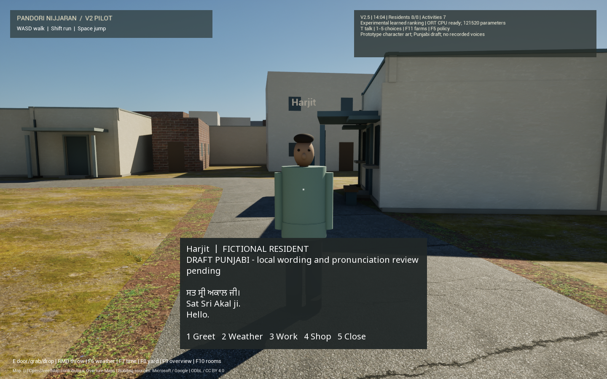

*Actual packaged Unreal capture: draft Gurmukhi text, fictional identities and prototype character geometry.*

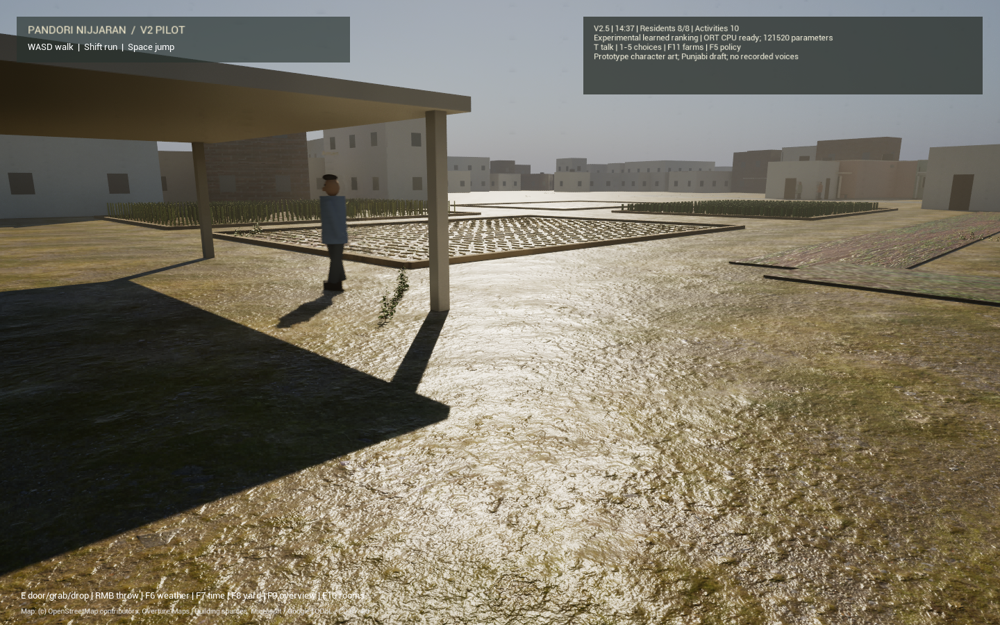

*Actual packaged capture of the inferred plots, access track, shelter and wet surfaces.*

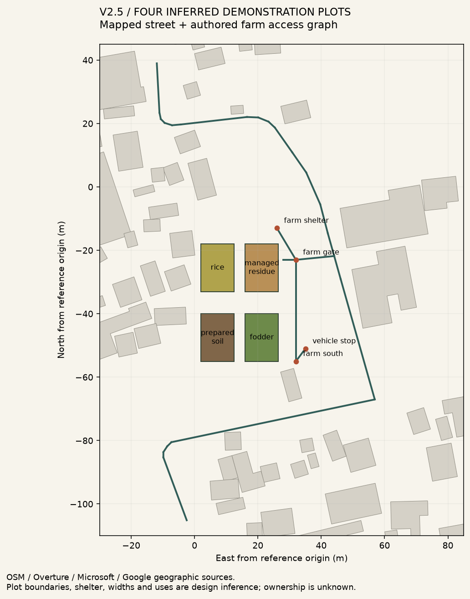

<a id="v25-build-and-play"></a>
### Build and play

The V2 map and its generated assets must already exist; follow [V2 setup](#v2) on a fresh checkout. This overlay does not regenerate V1/V2 geometry or HLODs.

```powershell
# Verify the committed model and scene contracts.
python -m pip install -r requirements-v25-tools.txt
python -m unittest discover -s Tests -v

# Compile the native runtime and import the audited ONNX policy/material.
.\Scripts\v25.ps1 -EngineRoot 'E:\U.E\UE_5.8' -Action Build

# Deterministic schedules are the default. NNE runs in shadow for measurement.
.\Scripts\v25.ps1 -Action Play

# Explicitly enable experimental learned action ranking.
.\Scripts\v25.ps1 -Action Play -Learned

# Optional reproducible retraining; does not run during normal builds.
python -m pip install torch==2.11.0 --index-url https://download.pytorch.org/whl/cpu
python Scripts/train_v25_policy.py
```

Controls: WASD/mouse to walk/look, Shift to run, T to talk to a nearby resident, 1–5 for dialogue choices, F11 to visit the farms, F5 to switch rules/learned ranking, F6 for weather, F7 for time, and the existing V2 door/physics controls. The scene stays on the same calendar date; crop growth never accelerates just because the player walks around.

V2.5 activates only with `-VillageV25`. Launching V2 without that flag retains its existing gameplay. The public map name remains `Lvl_PandoriV2_WP`; the new assets live under `/Game/VillageMeshV25` and runtime data under `Content/V25`.

<a id="v25-what-the-models-do"></a>
### What the models do

| Component | Unique learned parameters | Deployed? |
| --- | ---: | --- |
| 64–256–256–128–48 action MLP | 121,520 | Yes, experimental |
| Byte embedding + GRU intent design | 198,080 | No |
| Recurrent policy alternative | 116,208 | No |
| Tied-embedding micro decoder design | 596,096 | No |

Only the action policy is deployed. There is no hidden ASR, TTS, translation model, remote inference service or language decoder. The other architectures exist for parameter auditing; they are not trained language checkpoints. The one-million limit includes every deployed learned value.

The committed ONNX uses opset 17, fixed FP32 `[1,64] -> [1,48]` tensors and 121,520 physical initializer values. Its exact size/hash and schema are in [the model manifest](Assets/Models/npc_model_manifest.json). Training uses an original synthetic rule-controller teacher, disjoint seeds, and held-out route-distance/wetness ranges. [Evaluation](Docs/V25/policy_evaluation.json) measures agreement with that teacher; it is not proof of better behaviour, Punjabi understanding or local realism.

NNE uses `NNERuntimeORTCpu`. A single model instance belongs to one bounded worker batch at a time; inputs and outputs are copied plain buffers with no worker access to UObjects. At most one eight-resident batch is in flight. The game thread validates freshness, finite outputs and the current action mask before applying rankings. Missing models, failed inference, low score margins, stale snapshots and unavailable targets retain deterministic rules.

The startup parity fixture compares 64 ONNX reference vectors with actual NNE outputs. A mismatch disables learned inference. No random or untrained weights are substituted when model creation fails.

<a id="v25-state-and-execution"></a>
### State and execution

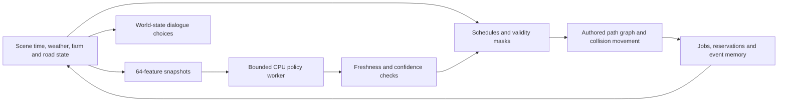

The current executor uses an explicit graph derived from the V2 OSM lane plus labelled inferred farm links, with native character collision movement. It is **not** a claimed StateTree/NavMesh/Smart Object implementation. Stable IDs, shared passage/job reservations, minimum commitments and actual roof traces enforce the implemented prerequisites. The tractor is a kinematic prototype shuttle, not a calibrated Chaos vehicle or a finished tractor/trolley rig.

Original manifests are created only when absent. Build scripts validate existing authoring files and stage disposable runtime copies. Source hashes record exactly what was staged.

| Authoritative data | Purpose |
| --- | --- |
| [Personas](Assets/NPC/personas.json) | Fictional identities, individual capabilities, homes and outfits |
| [Schedules](Assets/NPC/schedules.json) | Work windows and rainy alternatives |
| [State/action schema](Assets/NPC/action_schema.json) | All 64 features, 48 outputs and reserved actions |
| [Navigation](Assets/NPC/navigation.json) | Connected authored paths |
| [Dialogue](Assets/Dialogue/punjabi_lines.jsonl) | Gurmukhi, Roman Punjabi, English gloss, review/audio status |
| [Wardrobe](Assets/Wardrobe/outfits.json) | Stable prototype outfit choices; no simulated cloth |
| [Parcels](Assets/Farms/parcels.geojson) | Four inferred, unowned demonstration plots |
| [Crop calendar](Assets/Farms/crop_calendar.json) | Fixed late-October illustrative states |
| [Road profiles](Assets/Roads/road_profiles.json) | Unmeasured surface/width designs and passage capacity |
| [Tractor route](Assets/Routes/tractor_route.json) | Reserved shuttle route and conservative speed |

Normal play saves to `Saved/VillageMeshV25/save_v1.json`. Version/date/identity validation rejects incompatible state; transient reservations and actor references are never persisted. Test runs use `-V25Check` and avoid the normal user save. Invalid save versions fall back to authored state. This is local single-player persistence, not multiplayer replication.

<a id="v25-dialogue-and-font"></a>
### Dialogue and font

Dialogue is menu-driven, subtitle-only and visibly marked **draft**. The shipped examples are not labelled native-speaker approved. Shop/weather/activity details come from current simulation state, and unsupported questions use clarification/unknown lines. No intent accuracy or Punjabi fluency is claimed.

Noto Sans Gurmukhi is pinned by source commit and SHA256 under [the asset lock](Assets/v25_assets.lock.json), with its [OFL licence](Assets/Fonts/OFL.txt). The Slate widget requests full shaping. Packaged visual inspection remains distinct from native-speaker approval of spelling, tone and line breaks.

The original Quaternius source was researched as a possible CC0 character asset; its official download returned quota-exceeded HTML. No files from that failed acquisition are used. Current characters and vehicle geometry are original procedural stand-ins, clearly labelled in the HUD. No legacy character assets with unverified distribution rights enter the V2.5 package.

<a id="v25-validation-and-packaging"></a>
### Validation and packaging

Run the complete local acceptance sequence with `.\Scripts\validate_v25_release.ps1` after packaging, or add `-Rebuild` to compile/import/package first. It includes an actual 30-minute rendered session and six sequential traversals. The tests use Python 3.12.10 on the recorded workstation.

```powershell
.\Scripts\v25.ps1 -Action Check -RunId editor_rules -Seconds 120
.\Scripts\v25.ps1 -Action Check -RunId editor_learned -Seconds 120 -Learned
.\Scripts\v25.ps1 -Action Check -RunId missing_model -Seconds 120 -MissingModel -Headless
.\Scripts\v25.ps1 -Action Package
.\Scripts\check_v25_package.ps1 -RunId packaged_rules -Seconds 120
.\Scripts\check_v25_package.ps1 -RunId packaged_learned -Seconds 120 -Learned
.\Scripts\check_v25_package.ps1 -RunId packaged_soak -Seconds 1800 -Learned
# Repeat each condition three times, with residents and shadow inference active.
.\Scripts\check_v25_route.ps1 -Condition daylight -RunId v25_daylight1
.\Scripts\check_v25_route.ps1 -Condition rain -RunId v25_rain1
```

The package is written to `Saved/Packages/V25/Windows`; `Play_V25.cmd` supplies the activation flag. Packaging temporarily changes the plugin/cook profile, then restores the project descriptor and engine/game configuration bytes in a `finally` block. NNE ORT remains enabled in this package. Keep the project closed during packaging.

Runtime reports contain rendered/NullRHI and editor/standalone labels, NNE parity, batch inference and queue timings, director game-thread overhead, frame wall times, bounded memory observations, state checks and per-person activity records. NullRHI timing is not rendering performance. A bounded soak is not a memory-leak proof. No fresh-machine result is implied by a local package.

Packaged checks temporarily prevent idle system sleep and restore the previous sleep behaviour on exit. The checker and report publisher reject excessive duration or a frame gap over one minute, so an overnight suspend cannot satisfy the continuous-session requirement.

The final [results](#v25-results), [machine-readable evidence](Docs/V25/evidence.json), [package audit](Docs/V25/package_audit.json), [workstation details](Docs/V25/host_environment.json) and [source/package hashes](Docs/V25/build_manifest.json) identify the validated build. The summary generator requires four final runtime checks and all six traversals from the same executable; it excludes intermediate debugging runs.

Official NNE API reference: [Epic UE 5.8 NNE overview](https://dev.epicgames.com/documentation/unreal-engine/neural-network-engine-overview-in-unreal-engine?application_version=5.8). The installed engine headers and actual package tests determine compatibility for this project.

<!-- END:v25 -->

</details>


<a id="v25-results"></a>

## Recorded V2.5 validation

<details>
<summary>Expand this section</summary>

<!-- BEGIN:v25-results -->

<a id="v25-results-v25-local-validation"></a>

These results belong to this workstation and Development build. Rendered checks use D3D12 at 1440 x 900, 67% render scale and a 60 FPS cap. The workstation also ran other applications; these are not isolated hardware benchmarks. Automated scene time/weather changes are labelled test behaviour; crop growth remains disabled.

| Run | Rendering / build | Outcome | Frame p95 / max ms | CPU batch p95 ms | Director tick p95 ms |
| --- | --- | --- | --- | --- | --- |
| packaged_rendered | rendered standalone | pass | 16.81 / 198.32 | 0.343 | 0.057 |
| packaged_missing_model | NullRHI standalone | pass | not rendering evidence | 0.000 | 0.081 |
| packaged_rules | rendered standalone | pass | 16.85 / 184.97 | 0.492 | 0.073 |
| packaged_soak | rendered standalone | pass | 28.69 / 58.36 | 0.403 | 0.099 |

| Fictional resident | Rules / 180 s | Learned / 180 s | Learned soak / 1800 s |
| --- | ---: | ---: | ---: |
| Harjit | 0 | 0 | 5 |
| Simran | 3 | 3 | 20 |
| Aman | 0 | 0 | 10 |
| Gurleen | 0 | 0 | 4 |
| Navdeep | 4 | 4 | 14 |
| Mehar | 0 | 0 | 0 |
| Kiran | 3 | 3 | 18 |
| Jas | 0 | 0 | 0 |

Activity-completion coverage remains open for **Mehar, Jas**: neither completed an activity in this accelerated weather/schedule run. The bounded stability pass does not accept every resident routine.

Counts represent completed generic prototype activities, not reviewed human work animations. The two short runs use matched time/weather/capture scripts; the camera follows a moving resident, so the resulting views can differ. These individual runs do not establish a statistical behaviour or frame-rate advantage. The longer run uses a different weather period and is not a direct speed comparison.

A CPU batch is up to eight serialized policy calls on one worker-owned instance. The director tick excludes worker inference. Frame distributions exclude the first 20 simulation seconds; later streaming, font and capture hitches remain included. Queue delay, stale rejections, per-person activity and save/restore results are retained in [evidence.json](Docs/V25/evidence.json). A successful bounded check does not certify every daily routine or an animation/vehicle swept path.

Six collision-enabled pedestrian traversals (three daylight, three rain) ran in the V2.5 standalone scene with residents and the CPU policy loaded in shadow mode. Exact paths, durations and frame measurements are retained in the traversal records in evidence.json. These checks are not vehicle clearance certification. The separate 30-minute simulation soak keeps the player at the start and exercises accelerated schedules/weather; it is not the earlier V2 moving-camera soak.

The original synthetic policy achieved 99.65% agreement with its rule teacher on the held-out scenario dataset; no advantage over that teacher is established. Rules remain the default. [Training evaluation](Docs/V25/policy_evaluation.json).

<a id="v25-results-open-acceptance"></a>
### Open acceptance

Local wardrobe/voice/language review, complete cloth/contact/vehicle animation, measured roads/farms, separate GPU profiling, and independent fresh-machine release testing remain open. See the [acceptance register](Docs/V25_ACCEPTANCE.txt).

Continuous run `packaged_soak`: 30.00 minutes, 4 completed tractor legs, peak process physical memory 1563.0 MiB. These bounded observations are not a memory-leak proof.

<!-- END:v25-results -->

</details>


<a id="v2"></a>

## V2 detailed street pilot

<details>
<summary>Expand this section</summary>

<!-- BEGIN:v2 -->

<a id="v2-v2-pilot-implementation"></a>

The [V2 plan](Village_Mesh_V2_Hyperrealism_Plan_20261023.txt) is being implemented as a separate, reproducible pilot. The user selected the mapped street near the original starting area. The pilot follows approximately **240 m**, with **16 mapped frontages**, **three representative enterable spaces**, and **eight fixed camera viewpoints**.

This is a Punjab-inspired architectural pass on sourced footprints. Local facade photographs, measurements, elevation control, and resident review have not been supplied. No private interior or distinctive landmark is represented as a surveyed reconstruction. The full M0–M6 plan remains subject to the [acceptance register](Docs/V2_ACCEPTANCE.txt).

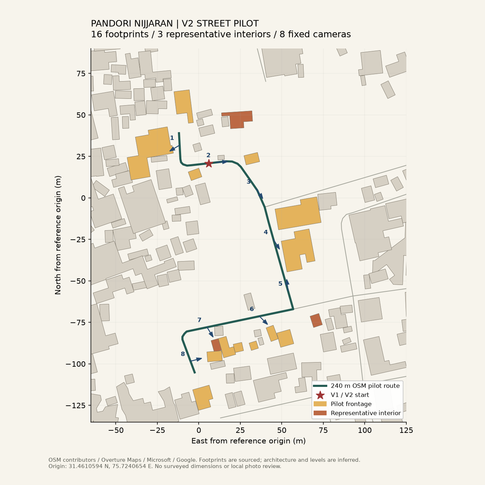

<a id="v2-run-the-pilot"></a>
### Run the pilot

Run from the repository root, with Unreal Engine 5.8.3 installed. Close the editor before generation, HLOD building, or packaging.

```powershell
# Build C++, verify CC0 assets, generate V2, and convert its World Partition copy.
.\Scripts\v2.ps1 -EngineRoot 'E:\U.E\UE_5.8' -Action Build

# Launch the V2 map in a separate game window.
.\Scripts\v2.ps1 -EngineRoot 'E:\U.E\UE_5.8' -Action Play

# Audit dependencies and build HLOD proxies.
.\Scripts\v2.ps1 -EngineRoot 'E:\U.E\UE_5.8' -Action Audit
.\Scripts\v2.ps1 -EngineRoot 'E:\U.E\UE_5.8' -Action HLOD
```

The generated source is `/Game/VillageMeshV2/Lvl_PandoriV2`; the playable map is `/Game/VillageMeshV2/Lvl_PandoriV2_WP`. V1 remains under `/Game/VillageMesh`. `Content/VillageMeshAuthored` is reserved and is never overwritten by either generator.

Use the existing WASD/mouse/Shift/Space controls. **F10** cycles through the three room entrances; aim at a door and press **E** to open it. Other pilot doors remain closed decorative entrances. **F6** changes weather, **F7** advances local time, **F8** visits the physics yard, and **F9** toggles the overview. Door state survives actor recreation within the current world through a stable-ID store; this is not a disk save or multiplayer persistence system.

<a id="v2-inputs-and-regeneration"></a>
### Inputs and regeneration

| Input | Purpose |
| --- | --- |
| `Assets/Reference/manifest.json` | One reference/confidence record per selected frontage; local photographs and measurements are explicitly absent |
| `Assets/Routes/pilot_street.json` | User-approved pilot selection, stable building IDs, facade edges, and eight cameras |
| `Assets/Routes/validation_route.json` | Walking route, units, warmup, and proposed frame-time target |
| `Assets/Geodata/overrides.geojson` | Corrections keyed by stable building ID; two explicitly inferred design overrides choose single-storey representative rooms |
| `Assets/Geodata/terrain_manifest.json` | Coordinate convention and explicit inferred street/threshold heights |
| `Assets/Architecture/archetypes.json` | Original procedural kit dimensions, palettes, and component names |
| `Assets/Architecture/authored_content.json` | Exact authored package allowlist and future distribution requirements; initially empty |

Precedence is pinned source data, normalized attributes, explicit reviewed overrides, then seeded defaults for missing values. A source refresh that orphans an override raises an error. Array position no longer controls V2 facade variation or fallback height. `prepare_v2.py` preserves existing selections and reference registers.

The audit found **zero populated height/floor attributes in all 824 source features**. The selected 821 footprints therefore retain inferred heights, with separate confidence and reason fields. A future height override requires a `building_id`, `height_m`, `confidence`, and `reason`; measured values must come from actual evidence.

The current kit is recovered from tracked recipes, engine basic shapes, and pinned CC0 files, so it needs no private binary bundle. Before adding authored binary art, provide its license, bundle/checksum or LFS distribution path, and exact approved package names. The dependency audit continues rejecting unapproved legacy art.

<a id="v2-appearance-and-environment"></a>
### Appearance and environment

Pilot buildings use 25 component types and 932 detail boxes: separate thick walls, roof and ceiling surfaces, window openings/reveals, grills, coping, porches, pipes, tanks, and selected benches/furniture. Three spaces have actual doorway collision openings. Their layouts are representative rather than observed private interiors. The street verges add 128 small CC0 shrub instances, placed outside roads and building footprints.

Pilot road meshes use continuous shared cross-sections with inferred 6 cm crowns and 2.5 cm edges. The base terrain remains an arbitrary flat datum; no DEM or measured drainage model is introduced.

The existing directional light is driven by Epic's installed SunPosition library using latitude 31.4610594, longitude 75.7240654, 2026-10-23, and UTC+05:30. X remains east and Y north; no second sun is added. Weather exposes a common wind vector in m/s, a designed rainfall-rate parameter, cloudiness, wetness, and sun elevation. Wetness accumulates and dries gradually. Overhead traces suppress the player's rain effects under roofs; this is a local shelter approximation. Roof runoff, spatial puddles, rain audio, and Niagara splash/collision layers remain pending.

The Well trace and its original source pin are unchanged. This work adds no atmospheric model training or local meteorological validation.

<a id="v2-repeatable-checks"></a>
### Repeatable checks

```powershell
python -m unittest discover -s Tests -v

# Collision-aware walk; returns nonzero on a blocked route or fall-through.
.\Scripts\v2.ps1 -EngineRoot 'E:\U.E\UE_5.8' -Action Route -RunId trial1

# Three door/entrance/shelter checks.
.\Scripts\v2.ps1 -EngineRoot 'E:\U.E\UE_5.8' -Action Interactions -Condition rain

# Physics/grounding smoke plus HLOD overview (preserves V1's saved evidence).
.\Scripts\smoke_v2.ps1 -EngineRoot 'E:\U.E\UE_5.8'

# Eight fixed views; repeat for evening, overcast, and rain.
.\Scripts\v2.ps1 -EngineRoot 'E:\U.E\UE_5.8' -Action Capture -Condition daylight -Quality capture

# Cook and stage a local Development package.
.\Scripts\v2.ps1 -EngineRoot 'E:\U.E\UE_5.8' -Action Package

# Validate the standalone executable, then run a continuous 30-minute soak.
.\Scripts\check_v2_package.ps1 -Action Route -RunId packaged_trial1
.\Scripts\check_v2_package.ps1 -Action Interactions -Condition rain
.\Scripts\check_v2_package.ps1 -Action Soak -RunId packaged_soak
```

Reports/captures are written to `Saved/VillageMeshV2`. Logs are under `Saved/Logs`. `-Headless` is available for simulation-only diagnostic runs and does not establish rendering performance. The `playable` preset uses 1440×900 output at 67% screen percentage; `capture` uses 100%. Both use Epic scalability, with dynamic resolution and VSync disabled. Automated diagnostics are uncapped; interactive `Play` and the packaged launcher cap at 60 FPS. The settings are explicit in [v2_quality.json](Config/v2_quality.json).

Route summaries report observed frame wall-time median/p95/p99/max after warmup and peak process physical memory. The automated rendered runs use D3D12 with `-RenderOffscreen`; they are local development measurements, not a promise of interactive FPS on other machines. They do not contain separate game/render/GPU timing or VRAM peaks. The p95 <=33.3 ms threshold is a proposed target; a successful route and a passing performance target are separate fields. Capture/interaction timing is not a traversal benchmark.

Packaging applies the explicit [runtime plugin profile](Config/v2_runtime_plugins.json) and selects V2 as the packaged default map, then restores both the authoring project descriptor and `DefaultEngine.ini` byte-for-byte in a `finally` block. The output is under `Saved/Packages/V2/Windows`; run `Play_V2.cmd` there for the tested graphics preset. The package includes its own README, attribution, map extracts, and source manifests. Packaging requires a closed project so its configuration cannot change under an editor session. A successful local package is still separate from a fresh-machine or shipping release acceptance.

The soak walks the same route continuously in both directions, changes between daylight/overcast/rain/evening after each leg, and requires 30 wall-clock minutes after warmup. It checks blocked movement and fall-through and samples process memory each minute. The package checker also records whole-adapter NVIDIA memory, temperature, power and utilization where available; these include other applications and are not process-specific VRAM figures. A soak pass is a bounded local stability observation, not a memory-leak proof.

<a id="v2-evidence-and-remaining-gates"></a>
### Evidence and remaining gates

- [Frozen V1 inputs](Docs/V2/baseline_inputs.json)
- [Building attribute audit](Docs/V2/building_attribute_audit.json)
- [Hardware and power snapshot](Docs/V2/hardware_snapshot.json)
- [Recorded run results](#v2-results)
- [Final source and package fingerprint](Docs/V2/build_manifest.json)
- [Engine checks and corrections](Docs/V2/engine_checks.json)
- [Unaccepted Lumen diagnostic attempt](Docs/V2/lumen_diagnostic_attempt.json)
- [Milestone acceptance register](Docs/V2_ACCEPTANCE.txt)

The [evidence index](Docs/V2/evidence.json) records all local diagnostic outcomes and SHA256 hashes of the 32 captures. The following are actual engine screenshots from fixed camera 4, not concept renders:

| Daylight | Evening |
| --- | --- |
|  | 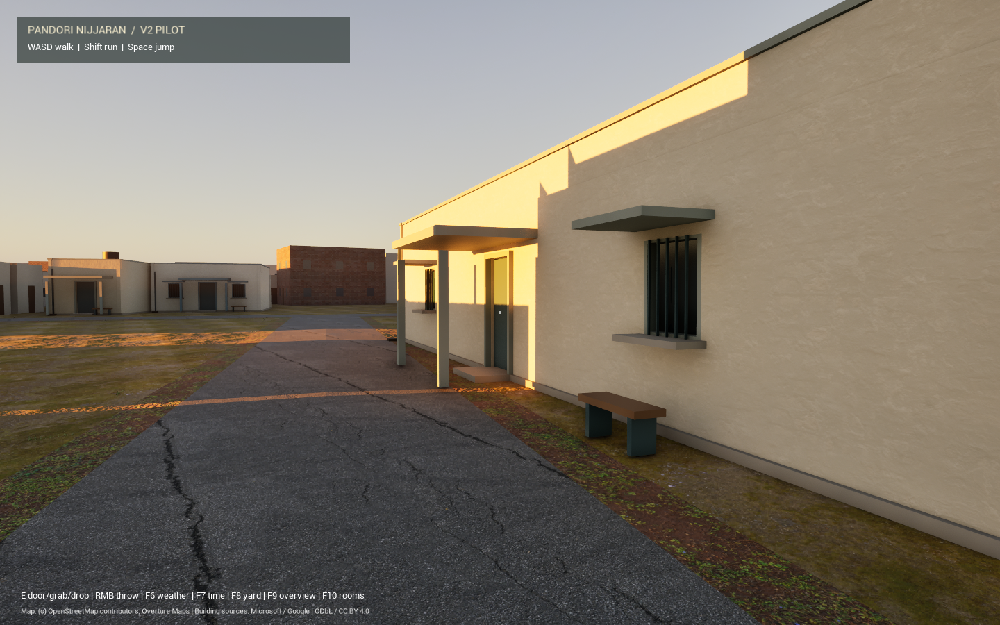 |
| **Overcast** | **Rain** |
| 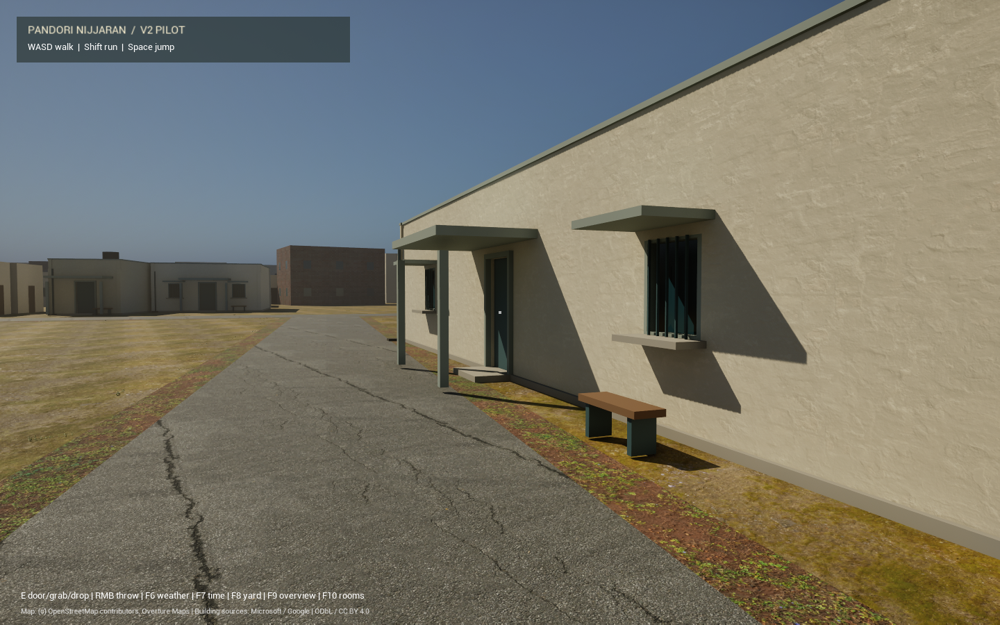 | 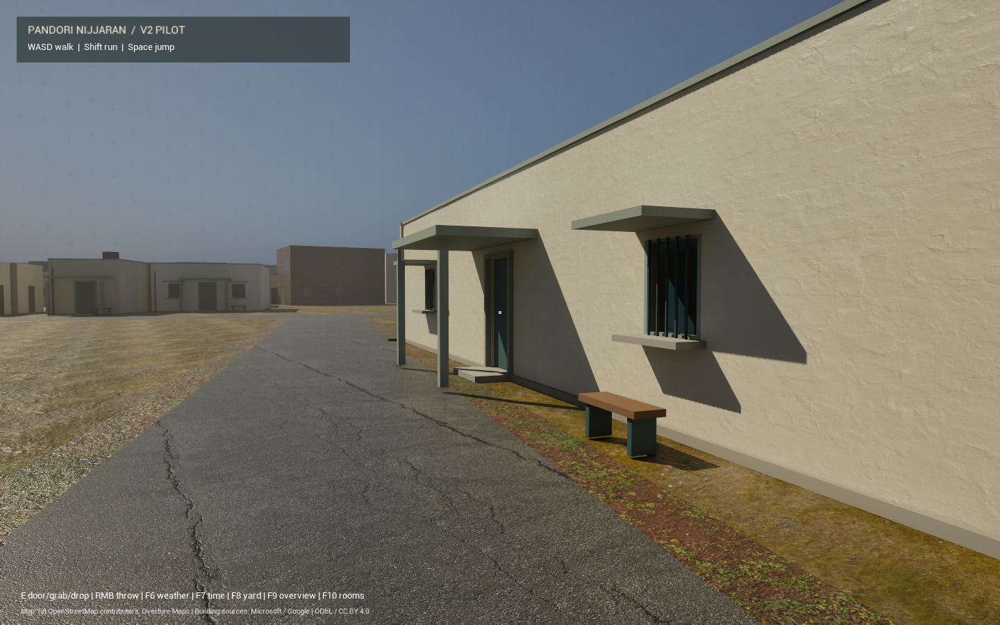 |

The [overview](Docs/V2/overview.png) shows the wider mapped village with HLOD proxies. The 16 pilot buildings receive the detailed kit; surrounding buildings remain simpler generated shells.

Generation, World Partition conversion, 119 HLOD proxies, 32 camera captures, six rendered route trials, three standalone room checks, and the Windows Development package have passed their recorded local checks. The 2,230-package dependency audit found no unapproved legacy-art references. Local architectural review, calibrated reference comparisons, dedicated Lumen diagnostic views, people/animals/traffic/audio, and fresh-machine release testing remain open. The continuous-soak outcome is tracked separately in [RESULTS.md](#v2-results).

HLOD command usage follows [Epic's UE 5.8 documentation](https://dev.epicgames.com/documentation/en-us/unreal-engine/world-partition---hierarchical-level-of-detail-in-unreal-engine?application_version=5.8). Building-layer choices and measured outcomes belong in this project's evidence, not in assumptions based on the engine's capabilities.

<!-- END:v2 -->

</details>


<a id="v2-results"></a>

## Recorded V2 validation

<details>
<summary>Expand this section</summary>

<!-- BEGIN:v2-results -->

<a id="v2-results-local-v2-results"></a>

Unreal 5.8.3 on the [recorded workstation](Docs/V2/hardware_snapshot.json). Rendered diagnostics use offscreen D3D12, Epic scalability, 1440 x 900 output, 67% render scale for traversal and 100% for captures. Timings are observed frame wall time after warmup, not a separate CPU/GPU profile.

| Run | Build | Outcome | p95 / max frame ms | Peak process MiB |
| --- | --- | --- | --- | --- |
| capture_daylight_local.json | editor game | pass | not a route benchmark | 2401.7 |
| capture_evening_local.json | editor game | pass | not a route benchmark | 3257.7 |
| capture_overcast_local.json | editor game | pass | not a route benchmark | 3262.9 |
| capture_rain_local.json | editor game | pass | not a route benchmark | 2320.0 |
| interactions_rain_local.json | editor game (NullRHI) | pass | not a route benchmark | 1919.5 |
| interactions_rain_packaged_final.json | standalone package | pass | not a route benchmark | 1499.6 |
| route_daylight_packaged_trial1.json | standalone package | pass | 10.98 / 15.82 | 1575.8 |
| route_daylight_packaged_trial2.json | standalone package | pass | 13.13 / 31.43 | 1507.1 |
| route_daylight_packaged_trial3.json | standalone package | pass | 12.25 / 29.23 | 1474.7 |
| route_daylight_trial1.json | editor game | pass | 12.06 / 93.72 | 2233.2 |
| route_daylight_trial2.json | editor game | pass | 10.94 / 29.77 | 3239.0 |
| route_daylight_trial3.json | editor game | pass | 12.40 / 87.04 | 3237.6 |
| soak_daylight_packaged_soak.json | standalone package | pass | not a route benchmark | 1546.1 |

The proposed route target is p95 <=33.3 ms. Passing that percentile does not mean every frame stayed below the target. Capture and interaction timings are deliberately excluded from this comparison.

<a id="v2-results-captures"></a>
### Captures

32 fixed-camera PNGs indexed with SHA256 checksums in [evidence.json](Docs/V2/evidence.json). Four representative views appear in the [pilot README](#v2); the complete set remains in `Saved/VillageMeshV2`.

<a id="v2-results-continuous-soak"></a>
### Continuous soak

soak_daylight_packaged_soak.json: **pass**, 30.0 wall-clock minutes, 31 completed route legs. Weather cycled between daylight, overcast, rain and evening. Per-minute process memory samples are retained in the evidence index.

Mixed-weather frame p95 12.71 ms; largest frame 62.10 ms. This is not an additional comparable daylight trial.

Whole-adapter monitoring for this run peaked at 4,297 MiB and 89 C, including other applications.

Interactive launchers cap at 60 FPS; automated measurements remain uncapped. Process-memory samples do not prove absence of all leaks.

<a id="v2-results-acceptance-limits"></a>
### Acceptance limits

Local facade photographs, measured ground/facade dimensions, local architectural review, dedicated Lumen diagnostic views, complete people/animal/traffic/audio work, separate CPU/GPU frame profiling, and independent fresh-machine testing remain outstanding. This is a reproducible procedural pilot, not an accepted hyperrealistic reconstruction. See the [milestone register](Docs/V2_ACCEPTANCE.txt).

The offscreen Lumen visualization attempts produced lit images despite accepting the console settings. They are excluded from the beauty evidence and do not establish surface-cache coverage. See the [attempt record](Docs/V2/lumen_diagnostic_attempt.json).

<!-- END:v2-results -->

</details>


<a id="metahuman-setup"></a>

## MetaHuman setup and preserved Manpreet pilot

<details>
<summary>Expand this section</summary>

<!-- BEGIN:metahuman-setup -->

<a id="metahuman-setup-manpreet-metahuman-pilot"></a>

This is the first milestone of the character proposal: one fictional adult named Manpreet, authored locally with MetaHuman Creator in UE 5.8.4. He is a separate pilot. The existing roster is Harjit, Simran, Aman, Gurleen, Navdeep, Mehar, Kiran and Jas; none has been renamed or replaced.

The pilot uses Epic's white T-shirt and shorts, with bare feet. These are the installed default garments for checking the character pipeline. They are not the planned Punjabi wardrobe. The design profile is a frozen assembly input; current review outcomes are recorded in `setup_status.json`.

<a id="metahuman-setup-current-verified-state"></a>
### Current verified state

On 24 October 2026 the project's Creator, SDK, HairStrands, RigLogic, Chaos Cloth Asset and Chaos Outfit Asset plugins were enabled. The Launcher update installed UE 5.8.4 and MetaHuman Creator Core Data. The native `rural_pardeepEditor Win64 Development` rebuild succeeded on the updated engine.

The filesystem and Unreal asset registry both report **96 wardrobe items**. The staged driver loaded `/Game/MetaHumanPilot/Characters/MH_Manpreet`, applied the 176 cm height target and skin design, and saved six selections: pulled-back hair, full beard, full mustache, natural eyebrows, fine eyelashes and Epic's default garment. `Style` and `Wardrobe` finished with **zero errors and zero warnings**. A separate `Inspect` process reopened the saved asset and confirmed all six selections. This is an authoring milestone, not a finished villager.

The user completed Epic's browser authentication. Cloud rigging finished and its facial blendshape flag was verified, followed by a successful high-resolution texture request. Both stages saved the character. Optimized Medium assembly produced **318 assets**, and all **10 generated Blueprints** compiled. Two missing Control Rig connections were repaired and verified after a fresh reload. The rendered full-body, walking and close-up views were reviewed. The isolated standalone checks, short performance comparison and a separate **Play-in-Editor run all passed**. No MetaHuman has replaced a resident or the player, and no custom Punjabi garment has been completed.

The full Python suite passes **38 tests**, including the private Kaggle upload boundary. Python and PowerShell syntax checks pass. [The recorded setup evidence](Docs/MetaHumanPilot/setup_status.json) includes the saved asset digest and the remaining gates. Local detailed stage reports are in `Saved/MetaHumanPilot`; raw engine/authentication logs stay local.

<a id="metahuman-setup-rendered-pilot-and-local-measurement"></a>
### Rendered pilot and local measurement

These are captures from the actual V3 village runtime, using the temporary Epic garment.

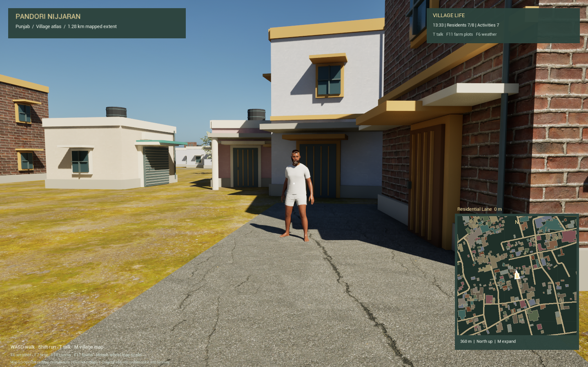

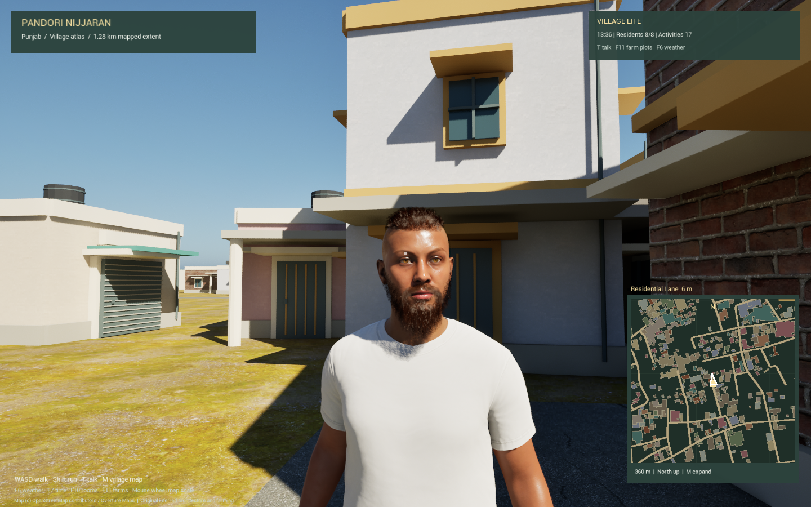

[Walking capture](Docs/MetaHumanPilot/character_walk.png).

| Standalone check | Result |
| --- | --- |
| Resolution / screen percentage / frame cap | 1440 x 900 / 67% / 60 FPS |
| Measured frames, without / with Manpreet | 1,821 / 1,813 |
| Mean frame time, without / with Manpreet | 21.76 / 21.82 ms |
| 95th percentile, without / with Manpreet | 29.72 / 29.77 ms |
| Shader work during measured frames | None in either run |
| Ground contact, idle clip, walk clip | Passed |
| Swept actor travel during walking | 8.42 m |
| Blocking collision / initial penetration | None on this short lane path |

The observed p95 difference is approximately 0.04 ms. These two capped runs, with other applications open, cannot isolate the character's GPU cost or establish crowd capacity. Locomotion is exercised during warmup to load its visible materials before sampling; earlier runs with overlapping shader work were rejected. The current clips and short scripted path verify the pilot, while speed-matched locomotion blends, navigation and resident behavior integration remain future work.

PIE separately passed ground contact, idle/walk, 8.42 m of swept travel and a clean sampling interval. The editor's original game mode was restored, and the village map's on-disk hash remained unchanged. An editor-only Lumen surface-cache warning cleared when `r.LumenScene.SurfaceCache.CardTexelDensityScale` was reduced from 100 to 50 after measurement. The PIE launcher now applies this preview setting and disables automatic source-file imports for that session. The standalone comparison retains its original settings. Editor timings are not compared against standalone timings.

<a id="metahuman-setup-core-data-setup-for-another-machine"></a>
### Core Data setup for another machine

This installation is complete on the development machine. For a clean installation:

1. Close Unreal Editor.
2. Open **Epic Games Launcher → Unreal Engine → Library**.
3. On the **Unreal Engine 5.8** installation tile, click the small **down arrow beside Launch**.
4. Select **Options**.
5. Check **MetaHuman Creator Core Data**, then click **Apply** and wait for the download to finish.
6. Run the preflight below. Sign in to Epic inside the official UI when requested; no passwords or tokens belong in the scripts or profile.

This component contains presets, grooms, texture models and other required data. Installing the Creator plugin alone does not install it. Epic's [UE 5.8 setup guide](https://dev.epicgames.com/documentation/metahuman/getting-started-with-metahuman-creator-in-unreal-engine?application_version=5.8) also confirms that auto-rigging and texture synthesis use cloud services.

<a id="metahuman-setup-repeatable-stages"></a>
### Repeatable stages

Run from the repository root. `-EngineRoot` can override the local default `E:\U.E\UE_5.8`.

```powershell
.\Scripts\metahuman_pilot.ps1 -Action Preflight
.\Scripts\metahuman_pilot.ps1 -Action Create
.\Scripts\metahuman_pilot.ps1 -Action Inspect
```

`Create` reuses an existing pilot asset. It does not overwrite authoring work. `Inspect` records the installed wardrobe paths and saved character selections in `Saved/MetaHumanPilot/inspect.json`. The [design profile](Assets/MetaHumans/manpreet.json) now selects six installed Epic assets. The wardrobe stage scans the optional content registry, validates each slot selection by value, and explicitly saves the character package because nested collection edits do not always mark it dirty.

After Core Data and wardrobe selections are ready:

```powershell
.\Scripts\metahuman_pilot.ps1 -Action Style
.\Scripts\metahuman_pilot.ps1 -Action Wardrobe
.\Scripts\metahuman_pilot.ps1 -Action Edit
```

`Edit` opens Creator over a lightweight engine template map. Review the face, body and wardrobe there, and complete any required Epic sign-in. Close this project's editor before each automated build stage:

```powershell
.\Scripts\metahuman_pilot.ps1 -Action Rig
.\Scripts\metahuman_pilot.ps1 -Action Textures
.\Scripts\metahuman_pilot.ps1 -Action Assemble
```

The scripted target is an **Optimized / Medium** assembly under `/Game/MetaHumanPilot/Assembled`. The rig stage requests joints and blendshapes (`JOINTS_AND_BLEND_SHAPES` in the tested UE 5.8.4 Python API) so the stored blendshape flag can verify completion. The texture stage checks its stored high-resolution flag. Assembly retains wardrobe validation and requires a current successful wardrobe report. The runner uses a normal editor session and defers assembly until editor initialization, because Texture Graph did not initialize in Python commandlets, including with `-AllowCommandletRendering`. Shader workers are limited on this machine. A fresh actor Blueprint on disk is required before assembly can pass.

Epic's [Python scripting guide](https://dev.epicgames.com/documentation/metahuman/metahuman-creator-python-scripting-in-unreal-engine?application_version=5.8) describes the subsystem editing/commit workflow and blocking cloud requests. The installed API was checked directly where its enum spelling differed from the documentation.

The tested UE 5.8.4 assembly reported four legacy reroute diagnostics and dropped two numeric Control Rig connections. The driver recognizes only those exact diagnostics, requires the engine's current assembly-success message, and saves the generated assets explicitly. It restores the two reported source-to-target connections only when their inputs are disconnected, then recompiles and checks the graphs. Repairs apply to the generated copies under `/Game/MetaHumanPilot/Assembled/Common/Face`. Unknown errors or conflicting inputs fail the stage.

To recheck a successfully generated and saved assembly without repeating rigging, texture synthesis or mesh generation:

```powershell
.\Scripts\metahuman_pilot.ps1 -Action ValidateAssembly
```

Recovery requires the current design profile and a report confirming that engine assembly and asset saving completed. A fresh validation session confirmed that both repaired connections persisted.

<a id="metahuman-setup-isolated-village-runtime-pilot"></a>
### Isolated village runtime pilot

The runtime driver selects a separate native game mode through the map URL; the normal village modes and eight residents keep their existing behavior. The test uses the mapped Residential Lane viewpoint and the installed MetaHuman idle/walk clips. A swept capsule supplies pilot collision, and component-space foot motion distinguishes real skeletal animation from actor translation. The attached visual actor ignores its parent capsule to avoid self-blocking. A 2 cm floor clearance prevents initial penetration, and the mesh's +Y forward axis is aligned with the probe's +X axis.

```powershell
.\Scripts\metahuman_pilot_runtime.ps1 -Action Check
.\Scripts\metahuman_pilot_runtime.ps1 -Action Play
.\Scripts\metahuman_pilot_runtime.ps1 -Action PIE
```

Close this project between launches. `Check` runs the same view with and without Manpreet at 1440 x 900, 67% screen percentage and a 60 FPS cap, collecting 40 seconds of frame times after a 25-second warmup. Warmup restarts while shaders are compiling, with a ten-minute limit; compilation during measured frames fails the check. A close-up camera follows the measurement period. It saves separate baseline/character reports, screenshots and a comparison under `Saved/MetaHumanPilot`. This is a short local measurement with other applications open, not a crowd benchmark or release soak. `PIE` temporarily sets the editor world's game mode, restores it once the play world exists, and does not save the village map. Its report is separate from the standalone comparison.

`Play` opens an interactive standalone village with Manpreet. Use WASD and mouse look to inspect him. Locomotion is exercised during warmup, followed by idle and a short back-and-forth walk after 45 seconds. `PIE` first runs the automated checks, then returns movement and look control to you and leaves the editor open. Add `-SkipCompile` only when the current native sources have already been built. Use `M` for the village map.

The existing V2/V2.5/V3 packaging profile disables the new pilot plugins for its procedural-world builds. It does not cook the isolated MetaHuman folder. Integrating MetaHumans into a distributable village build requires a new runtime/package validation pass; the earlier V3 performance result is not evidence for a MetaHuman build.

Reports include the design profile's SHA-256 and stage scope. Errors remain errors; a base asset or an old report is not treated as a successful assembled character. The build driver does not accept or store credentials. Cloud stage failures should be resolved through Epic's UI and the matching local log.

<a id="metahuman-setup-wardrobe-and-integration-milestones"></a>
### Wardrobe and integration milestones

The first appearance/performance pilot can use suitable Epic-supplied clothing once it is installed. That does not fulfill the custom Punjabi wardrobe milestone. Pagri, kurta-pajama, salwar kameez/chunni and jutti need separately authored meshes, fitting, skinning/cloth setup and visual review. A pagri should be fitted/skinned headwear; loose garments can use cloth where appropriate.

Epic's [wardrobe documentation](https://dev.epicgames.com/documentation/metahuman/tailoring-your-own-wardrobe-items?application_version=5.8) distinguishes fixed skeletal clothing from resizable Chaos outfits. Parametric outfits require suitable source sizes and setup; an arbitrary garment mesh does not automatically fit every body.

Before replacing residents, complete custom Punjabi clothing, review garment fit through movement, inspect LODs/hair cards, implement speed-matched navigation and animation, and measure a representative crowd and packaged build. The existing procedural resident animation consists of component transforms, not a skeletal locomotion animation set that can simply be retargeted. The pilot clips and collision probe do not replace that behavior system.

<a id="metahuman-setup-source-and-licensing"></a>
### Source and licensing

The profile and project-authored orchestration are published with the repository's source license. Epic technology and generated MetaHuman binary art are **not** relabelled MIT. Following the user's asset-publication request, the saved pilot `.uasset` files are included through Git LFS. The generated character and assembled grooms, garment, rig and textures retain their applicable Epic terms. The full Creator Core Data library and engine/plugin distribution are not bundled. See the [LFS manifest and clone instructions](#git-lfs-and-assets).

For UE 5.8, Epic's current [MetaHuman licensing page](https://www.metahuman.com/license) points to the [Unreal Engine EULA](https://www.unrealengine.com/eula/unreal). The proposal's older MetaHuman Creator EULA reference is not the basis for this implementation. Epic's current MetaHuman FAQ permits packaging created assets for distribution through Fab and third-party marketplaces. This project includes its generated character under the applicable Epic terms, without relabelling Epic material as MIT. Other releases must follow the applicable Epic and individual asset terms.

The NPC policy's numeric state data remains separate from MetaHuman assets. The pilot workflow does not use MetaHuman characters, DNA, animation or rendered output as AI/ML training data.

Reference implementation locations in the installed engine: `MetaHumanCharacter/Content/Python/examples/` and `MetaHumanCharacter/Source/MetaHumanCharacterEditor/Public/`. No Epic source files are copied into the repository.

<!-- END:metahuman-setup -->

</details>


<a id="kaggle"></a>

## Optional Kaggle GPU experiment

<details>
<summary>Expand this section</summary>

<!-- BEGIN:kaggle -->

<a id="kaggle-kaggle-gpu-training-for-village-mesh"></a>

The project account is connected. On 24 October 2026, private kernel version 1 completed three CUDA training trials on a **Tesla T4**. The session exposed two T4 devices; this small model used `cuda:0`. Server metadata readback confirmed `is_private: true`, `enable_gpu: true`, and `machine_shape: NvidiaTeslaT4`.

This provides remote compute for the numeric TinyAI experiment. Unreal Editor, rendering, character assembly and interactive play still run on the local machine.

<a id="kaggle-verified-result"></a>
### Verified result

| Check | Result |
| --- | --- |
| Architecture | 64-256-256-128-48 MLP, 121,520 learned values |
| Training | Three seeds, 16,000 synthetic states and 36 epochs per trial |
| Validation | Separate seed 9001, 4,000 states; selects a candidate |
| Final evaluation | Seed 9002, 4,000 states, evaluated after selection |
| Candidate agreement with the authored controller | 99.8% on the final set |
| Existing experimental model on the same final set | 99.675% |
| Invalid actions after the mandatory action mask | 0 for both |
| Candidate ONNX size | 486,961 bytes |
| Local validation | Download/source hashes, ONNX structure, parameter count and CPU inference passed |

The [GPU report](Docs/Kaggle/gpu_evaluation.json), [local validation](Docs/Kaggle/local_validation.json), and [source digests](Docs/Kaggle/source_hashes.json) record the evidence. This is synthetic controller imitation, not proof of better gameplay, Punjabi language ability or improvement over the deterministic rules. The rules remain the default, and the existing experimental runtime model has not been replaced. Promotion requires Unreal NNE parity and behavior checks.

The candidate is local at `Saved/Kaggle/results/v1/village_mesh_results/candidate_npc_policy.onnx`. Weights, downloaded logs, the Python environment and account metadata stay under ignored `Saved/Kaggle`.

<a id="kaggle-run-again"></a>
### Run again

The installed CLI is isolated from the project Python environment:

```powershell
python -m venv Saved/Kaggle/venv
.\Saved\Kaggle\venv\Scripts\python.exe -m pip install kaggle==2.2.5
```

On this machine the project token is already in `%LOCALAPPDATA%\VillageMesh\Kaggle\access_token`, outside Git, with access restricted to the current Windows user. For another machine, create this local file with that machine's own token. Never add the token or a credential screenshot to the repository. The runner supplies the token through a child-process environment and restores the caller's environment afterward.

```powershell
.\Scripts\kaggle_policy.ps1 -Action Prepare
.\Scripts\kaggle_policy.ps1 -Action Run
.\Scripts\kaggle_policy.ps1 -Action Status
.\Scripts\kaggle_policy.ps1 -Action Logs
.\Scripts\kaggle_policy.ps1 -Action Readback
.\Scripts\kaggle_policy.ps1 -Action Download
python Scripts/evaluate_kaggle_candidate.py --results Saved/Kaggle/results/v1/village_mesh_results
```

Use the version recorded in `Saved/Kaggle/run.json` in the last command. `Prepare` authenticates and builds an explicit source bundle. `Run` creates a private kernel version, requests T4 compute, and caps execution at 1,800 seconds. The remaining commands address that exact version. A job fails if CUDA is unavailable; it does not silently claim CPU execution as a GPU run.

Only `v25_contracts.py`, `train_v25_policy.py` and `train_v25_gpu.py` enter the upload. The job generates synthetic states remotely. It contains no credentials, resident records, geographic assets, MetaHuman art, DNA, animations or rendered images. The candidate workflow does not train on Epic content.

The [official Kaggle authentication documentation](https://github.com/Kaggle/kaggle-cli/blob/main/docs/README.md#authentication) describes token authentication. The [kernel CLI documentation](https://github.com/Kaggle/kaggle-cli/blob/main/docs/kernels.md) documents private-job metadata, versioned results and accelerator requests. Actual GPU availability and quota are determined by Kaggle for the account at run time.

<!-- END:kaggle -->

</details>


<a id="git-lfs-and-assets"></a>

## Git LFS, assets and publication

<details>
<summary>Expand this section</summary>

<!-- BEGIN:git-lfs-and-assets -->

<a id="git-lfs-and-assets-published-unreal-assets-with-git-lfs"></a>

The repository includes the saved V1/V2/V2.5/V3 village assets, the separate Pardeep third-person village, their World Partition actors/objects, the generated Manpreet and reference-guided Pardeep MetaHumans, original turban geometry, pinned CC0 source textures/vegetation, and runtime data/fonts. The current snapshot contains **9,115 files / 1,943,686,355 bytes**. Of these, **9,096 files** use LFS. Duplicate content is stored once by LFS, so uploaded storage can be smaller than the file total.

The largest file is `Content/MetaHumanPilot/Pardeep/Characters/MH_Pardeep.uasset` (144,975,169 bytes). It is stored as an LFS object; Git contains its small pointer. Existing history is preserved without a migration or force push.

<a id="git-lfs-and-assets-clone-and-open"></a>
### Clone and open

Install [Git LFS](https://git-lfs.com/), then run:

```powershell
git lfs install
git clone --recurse-submodules https://github.com/martian3062/village_mesh.git
cd village_mesh
git lfs pull
python Scripts/lfs_publication.py verify
```

For an existing checkout, run `git lfs install`, `git pull --ff-only` and `git lfs pull`. Opening the project before LFS downloads finish will leave pointer text where Unreal expects binary assets.

Use a licensed Unreal Engine **5.8.4** installation to build `rural_pardeepEditor`. The MetaHuman pilot and temporary Pardeep player also require **MetaHuman Creator Core Data** and the project-enabled plugins. Engine/plugin dependencies remain external, including Epic's neutral idle, walk and run clips. See the [pilot setup guide](#metahuman-setup). The editor now starts on `/Game/VillageMeshV3/Lvl_PandoriV3_Pardeep_WP`; use `Scripts/pardeep_village.ps1 -Action Play` for the third-person world. The previous V3 map remains available. No new packaged release is included.

<a id="git-lfs-and-assets-what-is-published"></a>
### What is published

| Files | Origin and terms |
| --- | --- |
| `Content/VillageMesh*` and their corresponding external actors/objects | Generated by this project's scripts. Original work is MIT; mapped geography retains ODbL/provider attribution; incorporated Poly Haven art is CC0. The temporary MetaHuman-derived appearance under `VillageMeshV3/Player` retains Epic terms. |
| `Content/MetaHumanPilot` | Generated Manpreet and Pardeep characters and assembled assets, subject to applicable Epic terms, **not MIT**. |
| Exact pinned files under `Assets/Downloaded` | Poly Haven CC0, checked against `textures.lock.json` and `models.lock.json`. |
| `Content/V25`, `Content/V3` | Runtime copies of authored/geographic inputs and the SIL OFL Gurmukhi font. |
| `Content/Validation/pilot.json` | Exact runtime route and pilot-room destination data read by the explorer and diagnostics; geographic attribution is retained. |

The [asset manifest](Docs/LFS/assets.json) records the exact file allowlist, SHA-256, size, source group and LFS status. [Third-party notices](#third-party-notices) retain the relevant attribution. Epic's [current MetaHuman FAQ](https://www.metahuman.com/license) permits packaging created MetaHuman assets for distribution through Fab and third-party marketplaces; the [Unreal Engine EULA](https://www.unrealengine.com/en-US/eula/unreal) still governs Epic technology and its restrictions. Publication here does not grant MIT rights to Epic material or permit using MetaHuman assets for AI training/testing. The Kaggle job remains limited to synthetic numeric controller states.

The old imported `Content/Village` assets and unrelated template content are excluded because their provenance has not been established for this publication. Credentials, raw logs, `Saved`, caches, generated executables, engine binaries and the full Creator Core Data library are excluded. The repository is not a backup of every local file.

<a id="git-lfs-and-assets-verification-and-future-asset-updates"></a>
### Verification and future asset updates

The read-only Unreal dependency audit checked **9,064 packages**, including hard/soft references and World Partition packages, with no missing or excluded project dependencies. Required installation mounts are listed in the manifest. This verifies saved package references; it is not a new clean-machine play or package test. All 338 Pardeep character assets also passed a fresh-process reload. The separate local third-person movement check and portrait are documented in [the player guide](#pardeep).

Run the audit using the installed editor commandlet, then prepare and verify a new snapshot:

```powershell
& 'E:\U.E\UE_5.8\Engine\Binaries\Win64\UnrealEditor-Cmd.exe' "$PWD\rural_pardeep.uproject" -run=pythonscript "-script=$PWD\Scripts\audit_lfs_assets_unreal.py" -NullRHI -unattended -nosound
python Scripts/lfs_publication.py prepare
python Scripts/lfs_publication.py verify
git add --pathspec-from-file=Saved/LFS/asset-paths.txt
git lfs status
```

Review licenses and diffs before staging an updated manifest and committing. New download files must match a pinned source hash; unrelated directories and traversal paths are rejected. Only saved on-disk assets are captured. Unsaved editor changes are not included. Do not remove the ignore rules for the entire `Content` tree.

GitHub's [LFS documentation](https://docs.github.com/en/repositories/working-with-files/managing-large-files/about-git-large-file-storage) explains pointers and plan-dependent file limits. The client uses the configured account's LFS service; no paid plan or billing setting is changed by this workflow.

<!-- END:git-lfs-and-assets -->

</details>


<a id="geodata"></a>

## Geographic inputs and provenance

<details>
<summary>Expand this section</summary>

<!-- BEGIN:geodata -->

<a id="geodata-pandori-nijjaran-map-extracts"></a>

Origin: **31.4610594 N, 75.7240654 E**. X points east and Y north in the
Unreal map. One meter is 100 Unreal units. This origin is a locality reference,
not a surveyed marker. The [district post-office page](https://jalandhar.nic.in/public-utility/pandori-nijjran-b-o/)
confirms Pandori Nijjran, Jalandhar-II, PIN 144102.

- `pandori_nijjaran.osm.json`: OpenStreetMap roads, fetched through Overpass
  on 2026-10-23. Query bounds: south 31.453, west 75.714, north 31.469, east 75.734.
- `pandori_nijjaran.buildings.geojson`: Overture Maps buildings, release
  2026-10-21.0, downloaded with overturemaps 1.0.2. 824 source features;
  821 centers lie inside the playable boundary. Provider metadata is preserved.
- `provenance.json`: checksums, bounds, sources, and explicit assumptions.

Attribution: **© OpenStreetMap contributors, Overture Maps Foundation;
Microsoft Global ML Building Footprints; Google Open Buildings**.
The road/building databases and their adaptations are available under
[ODbL 1.0](https://opendatacommons.org/licenses/odbl/1-0/).
Google Open Buildings attribution is retained under
[CC BY 4.0](https://creativecommons.org/licenses/by/4.0/).
See [Overture's source attribution](https://docs.overturemaps.org/attribution/#buildings).
The source-code MIT license does not replace these data licenses.

To fetch a *new* Overture extract into a separate file:

```powershell
python -m pip install overturemaps
overturemaps download --bbox=75.7173,31.4553,75.7308,31.4668 -f geojson --type=building -o new_buildings.geojson
```

The client defaults to the latest release. The checked-in extract is the
reproducible input; refreshing it requires updating provenance and geometry tests.
Mapped outlines are machine-generated and may be inaccurate. Heights, materials,
openings, vegetation and terrain elevation are not measurements. Building
shells have collision and closed exterior walls; visual doors do not provide
surveyed or explorable interiors.

<!-- END:geodata -->

</details>


<a id="third-party-notices"></a>

## Third-party notices

<!-- BEGIN:third-party-notices -->

<a id="third-party-notices-third-party-notices"></a>

<a id="third-party-notices-unreal-engine"></a>
### Unreal Engine

This project requires Unreal Engine 5.8. Engine binaries and BasicShapes are
loaded from the user's licensed installation; they are not distributed here.
The engine is subject to [Epic's Unreal Engine license](https://www.unrealengine.com/en-US/eula/unreal).
The project source is open source; Unreal itself is not MIT-licensed.

<a id="third-party-notices-the-well"></a>
### The Well

[PolymathicAI/the_well](https://github.com/PolymathicAI/the_well) is included as
a Git submodule pinned to `aac88c0b5eb9cbe4b7b2797eaaa550a43706fb44`.
Its source is BSD-3-Clause; see `ThirdParty/the_well/LICENSE`.

`Content/Well/wind.csv` is adapted from the shear-flow dataset by Rudy Morel,
CCM, Flatiron Institute, distributed by The Well / Polymathic AI under
[CC BY 4.0](https://creativecommons.org/licenses/by/4.0/).
Source: [shear_flow on Hugging Face](https://huggingface.co/datasets/polymathic-ai/shear_flow).
The exact revision, file, spatial point, trajectory and checksum are recorded
in `Content/Well/wind.source.json`.

Changes: one spatial velocity trace was extracted, normalized by its peak
speed, mapped to horizontal XY wind, retimed to 120 seconds, and given a
matching endpoint for looping. No endorsement by the authors is implied.
This is visual playback of simulation data, not a real-time fluid solver,
atmospheric forecast, or scientific validation of village weather.

Research citation: Ohana et al. (2024), *The Well: a Large-Scale Collection
of Diverse Physics Simulations for Machine Learning*, NeurIPS 37,
44989–45037. For the shear-flow solver: Burns et al. (2020), *Dedalus:
A Flexible Framework for Numerical Simulations with Spectral Methods*,
Physical Review Research 2, 023068.

<a id="third-party-notices-poly-haven-textures"></a>
### Poly Haven textures

The downloader retrieves these [CC0 assets](https://polyhaven.com/license):

- [Brown Mud Leaves 01](https://polyhaven.com/a/brown_mud_leaves_01)
- [Red Brick 03](https://polyhaven.com/a/red_brick_03)
- [Rough Plaster 03](https://polyhaven.com/a/rough_plaster_03)

`Assets/textures.lock.json` records source URLs, channel, resolution URLs,
MD5 and SHA256. The exact pinned source downloads are now included through Git LFS; see `Docs/LFS/assets.json`.

<a id="third-party-notices-existing-local-content"></a>
### Existing local content

The pre-existing `Content/Village`, mannequins, imported architecture,
maps, textures and binary assets are excluded from publication because
their redistribution provenance has not been established. They remain on
the original workstation. The portable generator has no dependency on them.

<a id="third-party-notices-geographic-data"></a>
### Geographic data

Pandori Nijjaran roads: copyright OpenStreetMap contributors, ODbL 1.0.
Buildings: Overture Maps Foundation, release 2026-10-21.0, ODbL 1.0.
The extract includes Microsoft Global ML Building Footprints (ODbL 1.0)
and Google Open Buildings (CC BY 4.0). Source records and provider metadata
are retained in `Assets/Geodata`, with source URLs and hashes. Generated
geographic databases remain under ODbL; MIT covers original code only.
See https://docs.overturemaps.org/attribution/#buildings and
https://www.openstreetmap.org/copyright.

<a id="third-party-notices-additional-cc0-vegetation"></a>
### Additional CC0 vegetation

Poly Haven `tree_small_02` and `shrub_01`, geometry and textures, CC0 1.0.
Download paths and checksums are pinned in `Assets/models.lock.json`.
Public village photos/videos are reference links only and are not redistributed.

<a id="third-party-notices-v25-gurmukhi-font"></a>
### V2.5 Gurmukhi font

Noto Sans Gurmukhi, copyright The Noto Project Authors, SIL Open Font License
1.1. The font and original OFL text are included under `Assets/Fonts` and staged
with the V2.5 package. The exact source commit, URL and SHA256 are recorded in
`Assets/v25_assets.lock.json`. Source: https://github.com/google/fonts/tree/main/ofl/notosansgurmukhi.

The V2.5 action policy was trained from this repository's original synthetic
controller and is distributed under the repository MIT license. No external
pretrained language, speech-recognition or voice model is included. The current
character/vehicle prototype geometry is original procedural code. Quaternius
assets were researched but not acquired or included after a download quota error.

<a id="third-party-notices-v3-atlas-regional-architecture-and-farming"></a>
### V3 atlas, regional architecture and farming

V3 building, landmark, animal and farm geometry is original procedural code under
the repository MIT license. `Assets/World/v3_world.json` and the atlas image are
derived from the pinned OSM/Overture geographic inputs and retain the geographic
data attribution and ODbL obligations above; they are not solely MIT data.

Public landmark listings are linked in `README.md#v3`: Wikimapia Shiv Temple,
Yappe Gurudwara Nihang Singh and iCBSE GPS Pandori Nijjaran. These support reference
context, not surveyed game positions or verified facades. No listing photographs,
external map tiles, private resident details or third-party landmark meshes are
redistributed. All nine in-game public sites are marked representative.

<a id="third-party-notices-metahuman-authoring-pilot"></a>
### MetaHuman authoring pilot

The separate Manpreet pilot uses Epic's installed MetaHuman Creator APIs. Epic
technology and generated MetaHuman assets retain their applicable Epic terms;
they are not relicensed under this repository's MIT source-code license. Pilot
binary assets under `Content/MetaHumanPilot` are now included through Git LFS as generated character assets under the applicable Epic terms. The user requested this publication after the initial local pilot.
The pilot references Epic's installed MetaHuman neutral idle and forward-walk
animation clips. These remain local and retain their applicable Epic terms.
The Pardeep third-person preview reuses that generated visual through a separate
Blueprint under `Content/VillageMeshV3/Player`. It is a user-approved temporary
appearance, not a reconstruction of Pardeep. Its project-authored blend space
references the installed Epic idle, walk and run clips; the raw clips are not
redistributed. The generated visual and its dependencies retain the same Epic
terms. No personal photo archive or face-recognition data is included.
The separate reference-guided Pardeep character and assembly under
`Content/MetaHumanPilot/Pardeep` retain the same applicable Epic terms. Facial
adjustments are authored from owner-selected local portrait references; the raw
photographs are excluded. The original procedural black turban and cotton
material under `Content/VillageMeshV3/Player/Headwear`, and their generator, are
project-authored work under the repository license.
The generated character includes its assembled grooms, garment, rig and textures. The full Creator Core Data library, engine/plugin binaries and plugin example source files are not redistributed. See `README.md#git-lfs-and-assets` for the publication scope and current license references, and `README.md#metahuman-setup` for the verified setup
state, original orchestration scripts, and current official licensing links.

<!-- END:third-party-notices -->


<a id="toolkit-status"></a>

## Toolkit integration status

<details>
<summary>Expand this section</summary>

<!-- BEGIN:toolkit-status -->

Historical integration inventory from the V1 pass; current MetaHuman, TinyAI and LFS work is described above. Installed-tool observations here may be stale.

<a id="toolkit-status-toolkit-application-and-remaining-work"></a>

The supplied [ue5-open-world-toolkit.md](#toolkit-catalogue) is the
reference catalogue. Its version, maturity, price and licensing claims are
not treated as verified facts. Installed UE 5.8.3 plugin descriptors and
official documentation take precedence for this build.

<a id="toolkit-status-working-in-the-generated-world"></a>
### Working in the generated world

| Toolkit component | Concrete use |
| --- | --- |
| OSM / Overture | Pandori Nijjaran road centerlines and 821 building outlines inside a 1.28 km play area; source extracts and hashes are checked in |
| Poly Haven | Checksummed 2K soil/brick/plaster and tree textures, tree geometry, 1K shrub geometry/textures; CC0 |
| PCG | Two seeded point-source/spawner layers generate instanced vegetation; road and building exclusion rules use GIS geometry |
| Nanite | Imported vegetation uses Nanite with area preservation; terrain collision keeps its full fallback geometry |
| Lumen / Substrate / virtual shadows | Existing UE rendering pipeline, weather-driven surface shading, dynamic sky and fog |
| Chaos | Interactive rigid bodies, CCD, substepping, grab/throw and a bounded plane-buoyancy demonstration |
| The Well | Pinned source submodule; a real shear-flow velocity trace drives foliage/prop wind; no neural solver is claimed |
| World Partition | Converter produces `Lvl_PandoriNijjaran_WP`, preserving the source map; HLOD baking and long-distance streaming profiling remain unverified |
| Reproducible generation | Python source creates the assets and map, source licenses remain separated, no unverified imported art is published |

<a id="toolkit-status-native-authoring-tools"></a>
### Native authoring tools

`Scripts/configure_toolkit.py --engine-root <UE-root> --profile authoring --apply`
enables installed PCG, PVE, Mesh Terrain, USD import, Water, Landmass,
Niagara Fluids, NNE ORT, Learning Agents, MassAI, StateTree, SmartObjects,
PoseSearch and the MCP/editor/PCG toolsets. This checkout has the authoring profile enabled. The smaller `core` profile contains
PCG and editor MCP toolsets. Neither profile downloads plugins.

Enabling a plugin makes its authoring tools available; it does not create
a water body, trained agent, ONNX model, animation database, or smoke simulation.
Automatic Python dependency installation is disabled; optional training tools
need their own dependencies before use. MCP's server is not automatically started by this setup. Its local engine
settings default to manual start. No external AI account configuration is stored.

PVE, Mesh Terrain, Water, Learning Agents, MassAI and the MCP toolsets are
marked experimental in this installed engine. Nanite area preservation is
used for the imported foliage; PVE-generated voxel foliage is a separate task.

<a id="toolkit-status-external-tools-and-datasets-from-the-catalogue"></a>
### External tools and datasets from the catalogue

| Catalogue group | Status and concrete requirement |
| --- | --- |
| Cesium / QGIS / GDAL / BlenderGIS / OSM2World | Real coordinates are already converted locally; Cesium is not installed, QGIS/GDAL are not on PATH. No globe or satellite imagery is embedded |
| Copernicus DEM / Bhuvan / CartoDEM / OpenTopography | No elevation raster has been acquired. The level explicitly uses a flat datum; it is not surveyed terrain |
| ESA WorldCover / Sentinel / NASA / Natural Earth | No land-cover classification yet; vegetation positions are designed, constrained by mapped roads/buildings |
| Blender / Send to Unreal / USD / Infinigen | USD import can be enabled with the authoring profile; Blender is not on PATH. No Blender/Infinigen scene was generated |
| Gaea / Houdini / Material Maker / ArmorPaint / Krita / WFC | Alternative authoring pipelines, not dependencies of this source build; no licensed software or projects installed |
| Genesis / MuJoCo / Warp / Taichi / PhysX | Offline simulation alternatives; not substituted for UE Chaos. No cross-solver validation performed |
| The Well 3D VDB / SVT / 2D Niagara flipbooks | Wind playback is implemented. Volume conversion, SVT import, flipbooks and neural surrogates remain separate integrations; no multi-terabyte download |
| PDEBench / APEBench / JHU / Multimodal Universe / ERA5 / WeatherBench | Research datasets, not game content. No model training or weather assimilation performed |
| Fab / Megascans / ambientCG / Quaternius / Kenney / Smithsonian / OpenGameArt / Objaverse | Poly Haven is the chosen verified asset source for this pass. Other assets must retain their individual licenses and provenance |
| Freesound / Sonniss / CMU / Mixamo | No audio or animation pack acquired; first-person exploration has no proprietary character dependency |
| TRELLIS / Pixal / Hunyuan / Roblox Cube / HY-World / Matrix Game / LingBot / Cosmos / FLUX | No model weights, hosted inference, generated props or world-model rollout. These alternatives are not interchangeable production engines |
| COLMAP / Meshroom / RealityScan / gsplat / Nerfstudio / FreeMoCap | Need suitable site captures; no scan of this village exists in the project |
| MetaHuman / MPFB / MakeHuman / Motion Matching | No new human rig or animation database; original character source is retained separately |
| Llama-Unreal / whisper.cpp / Kokoro | No local dialogue, speech recognition or speech synthesis service connected |
| Iris / EOS / Nakama / Perforce | No multiplayer backend or replication validation. Git source publication is used; generated binary content is rebuilt locally |
| MegaLights / hardware ray tracing | Not required by the laptop profile; no performance claims for these paths |

The next fidelity bottleneck is site evidence: street-facing photos, measured
heights, elevation and landmark dimensions. The public village-tour title and
transcript confirm a school, entrance gate and a Nishan Sahib, but do not supply
reliable coordinates or facade measurements. None is positioned as a verified
landmark based on that transcript alone.

Sources: [Epic World Partition](https://dev.epicgames.com/documentation/en-us/unreal-engine/world-partition-in-unreal-engine),
[Overture retrieval](https://docs.overturemaps.org/getting-data/),
[Overture attribution](https://docs.overturemaps.org/attribution/#buildings),
[Poly Haven license](https://polyhaven.com/license),
[Pandori Nijjran post office](https://jalandhar.nic.in/public-utility/pandori-nijjran-b-o/),
[public village tour](https://www.youtube.com/watch?v=tFzYOovj_EI).

<!-- END:toolkit-status -->

</details>


<a id="toolkit-catalogue"></a>

## Original toolkit catalogue

<details>
<summary>Expand this section</summary>

<!-- BEGIN:toolkit-catalogue -->

Original user-supplied reference catalogue. Version, pricing, maturity and availability claims below have not been revalidated by this consolidation; this is not an implementation checklist.

<a id="toolkit-catalogue-ue5-open-world-toolkit--tools-data-ai-oct-2026"></a>

**Engine:** Unreal Engine 5.8 (released 17 Jun 2026, last planned big UE5 release). Ships an official **Unreal MCP plugin** so Claude Code can drive the editor. Stay on 5.8 until UE6 early access (~late 2027).

**The Well** ([PolymathicAI](https://github.com/PolymathicAI/the_well)) = 15 TB, 16 datasets of raw PDE simulation grids (fluids, MHD, supernovae, active matter, acoustics). Not game assets. Use it for baked VFX (VDB volumes, flipbooks) or to train neural fluid surrogates run in-engine via NNE.

---

<a id="toolkit-catalogue-contents"></a>
### Contents

1. [Pipeline](#toolkit-catalogue-1-pipeline)
2. [UE-Native Features](#toolkit-catalogue-2-ue-native-features)
3. [External Tools That Plug Into UE](#toolkit-catalogue-3-external-tools-that-plug-into-ue)
4. [Physics & Simulation](#toolkit-catalogue-4-physics--simulation)
5. [The Well → UE](#toolkit-catalogue-5-the-well--ue)
6. [More Realism Datasets](#toolkit-catalogue-6-more-realism-datasets)
7. [Real-Earth Data](#toolkit-catalogue-7-real-earth-data)
8. [Asset Libraries](#toolkit-catalogue-8-asset-libraries)
9. [AI Generation](#toolkit-catalogue-9-ai-generation)
10. [Capture](#toolkit-catalogue-10-capture)
11. [Start Here](#toolkit-catalogue-11-start-here)
12. [Citation](#toolkit-catalogue-12-citation)
13. [Sources](#toolkit-catalogue-13-sources)

---

<a id="toolkit-catalogue-1-pipeline"></a>
### 1. Pipeline

```
DEM / OSM / WorldCover --QGIS--> 16-bit heightmap --> Landscape / Mesh Terrain
        |
        +--------------------> Cesium for Unreal (real globe, georeferenced)

Infinigen / Blender --(USD / Send to Unreal)--> Nanite meshes
TRELLIS.2 / Pixal3D --> .glb --> Nanite props
Megascans / Poly Haven --> materials + scanned props
PCG + PVE --> Nanite Foliage (biomes from WorldCover masks)

THE WELL --> OpenVDB --> Sparse Volume Texture   (3D volumes)
         --> PNG seq --> Niagara flipbook         (2D effects)
         --> FNO --> ONNX --> NNE                 (live ML fluid)

World Partition + HLOD + Large World Coords --> seamless open world
Claude Code --> Unreal MCP (5.8) --> agentic level building
```

---

<a id="toolkit-catalogue-2-ue-native-features"></a>
### 2. UE-Native Features

| Feature | Status | Use |
|---|---|---|
| PCG framework + PCG Editor Mode | Production-ready (5.7+) | Rule-based roads, rocks, villages, biomes |
| Procedural Vegetation Editor (PVE) | Experimental | In-engine trees/plants → Nanite assemblies |
| Nanite Foliage | Experimental | Dense animated forests, no LOD pop; USD tree import |
| Substrate | Production-ready | Layered materials: wet rock, snow on moss, mud |
| Lumen Lite (5.8) | New | ~2× faster GI, near-same quality |
| Mesh Terrain (5.8) | Experimental | Overhangs, cliffs, caves |
| MegaLights | Production-ready (5.8) | Many dynamic lights |
| Iris | Production-ready (5.8) | Scalable multiplayer replication |
| World Partition + HLOD + Large World Coordinates | Stable | Streaming, distant LOD, double-precision coords |
| Chaos (destruction, vehicles, cloth, flesh) | Stable | Physics realism |
| Niagara Fluids + Heterogeneous Volumes / SVT | Plugin | Smoke, fire, water; OpenVDB import |
| NNE (Neural Network Engine) | Built-in | Run ONNX models in-game |
| Learning Agents | Plugin | RL / imitation-trained NPCs, drivers |
| Mass Entity, StateTree, Smart Objects | Stable | Crowds, traffic, NPC schedules |
| Water + Landmass | Plugin | Rivers, lakes, ocean, terrain carving |
| MetaHuman Creator (in-engine) | Free | Realistic humans |
| Motion Matching (Game Animation Sample) | Free sample | Realistic locomotion |
| Unreal MCP plugin | Ships in 5.8 | Claude Code drives editor, builds levels, spawns PCG |

**Free samples to study:** City Sample (updated with PCG + Unreal MCP), Electric Dreams (PCG), Game Animation Sample, Paragon assets — all on [Fab](https://www.fab.com).

---

<a id="toolkit-catalogue-3-external-tools-that-plug-into-ue"></a>
### 3. External Tools That Plug Into UE

| Tool | Route into UE |
|---|---|
| [Cesium for Unreal](https://cesium.com/platform/cesium-for-unreal/) | Real-Earth terrain, 3D Tiles, georeferencing |
| [QGIS](https://qgis.org) + [GDAL](https://gdal.org) | DEM → 16-bit heightmap; WorldCover → PCG masks |
| [BlenderGIS](https://github.com/domlysz/BlenderGIS) | GIS data → meshes in Blender |
| [OSM2World](https://osm2world.org) | OSM → 3D city meshes |
| [Blender](https://www.blender.org) + [Send to Unreal](https://github.com/EpicGamesExt/BlenderTools) | One-click export to UE |
| [Infinigen](https://github.com/princeton-vl/infinigen) | Procedural terrain/plants/creatures → USD/FBX → Nanite |
| [Gaea](https://quadspinner.com) | Erosion-realistic terrain heightmaps |
| [Houdini Engine](https://www.sidefx.com) | Procedural HDAs inside UE |
| [Material Maker](https://github.com/RodZill4/material-maker) | Procedural PBR textures → Substrate |
| [ArmorPaint](https://armorpaint.org) | Texture painting |
| [Krita](https://krita.org) | Painting, decals, UI |
| [WaveFunctionCollapse](https://github.com/mxgmn/WaveFunctionCollapse) | Town/dungeon layouts → PCG input |
| [MakeHuman / MPFB2](https://www.makehumancommunity.org) | Background humans |
| [Llama-Unreal](https://github.com/getnamo/Llama-Unreal) | Local LLM NPC dialogue (llama.cpp) |
| [whisper.cpp](https://github.com/ggml-org/whisper.cpp) | Player speech → text |
| [Kokoro-82M](https://huggingface.co/hexgrad/Kokoro-82M) | NPC text-to-speech |
| [Perforce](https://www.perforce.com) / [Git LFS](https://git-lfs.com) | Version control for large binaries |
| [Epic Online Services](https://dev.epicgames.com/en-US/services) / [Nakama](https://heroiclabs.com) | Lobbies, matchmaking, accounts |

---

<a id="toolkit-catalogue-4-physics--simulation"></a>
### 4. Physics & Simulation

| Tool | Use |
|---|---|
| [Genesis](https://github.com/Genesis-Embodied-AI/genesis-world) | Unified rigid / MPM / SPH / FEM / PBD, differentiable; offline realism bakes |
| [MuJoCo](https://github.com/google-deepmind/mujoco) | Physics-based creature/character locomotion |
| [NVIDIA Warp](https://github.com/NVIDIA/warp) | GPU sims in Python (snow, sand, fluids) → bake to VDB |
| [Taichi](https://github.com/taichi-dev/taichi) | GPU MPM/fluid sims → bake |
| [PhysX 5](https://github.com/NVIDIA-Omniverse/PhysX) | Reference / standalone physics tools |

---

<a id="toolkit-catalogue-5-the-well--ue"></a>
### 5. The Well → UE

```bash
pip install the_well
the-well-download --base-path ./well --dataset supernova_explosion_64 --split train
```

Docs: [polymathic-ai.org/the_well](https://polymathic-ai.org/the_well/) · Data also streams from Hugging Face.

| Well dataset | UE path | Result |
|---|---|---|
| `supernova_explosion`, `MHD`, `post_neutron_star_merger`, `convective_envelope_rsg` (3D) | h5py → OpenVDB → import as SVT → Heterogeneous Volume | Nebulae, star surfaces, blast waves |
| `turbulent_radiative_layer_3D`, `rayleigh_taylor_instability` | VDB → SVT | Volumetric smoke, mixing plumes |
| `rayleigh_benard`, `shear_flow`, `turbulent_radiative_layer_2D` | PNG sequence → SubUV flipbook (Niagara / material) | Lava convection, clouds, smoke cards |
| `gray_scott_reaction_diffusion` | PNG frames → textures | Organic patterns: coral, skin, lichen |
| `euler_multi_quadrants` | Flipbook | Explosion / shock fronts |
| `planetswe` | Equirectangular flipbook on sky sphere / planet | Planet-scale weather flow |
| `acoustic_scattering` | Train small model → ONNX → NNE | ML sound occlusion |
| `active_matter` | Reference for Mass Entity behaviours | Swarm / flocking |
| FNO checkpoints (HF) | `FNO.from_pretrained` → `torch.onnx.export` → NNE | Live low-res fluid driving Niagara |

---

<a id="toolkit-catalogue-6-more-realism-datasets"></a>
### 6. More Realism Datasets

| Dataset | What |
|---|---|
| [PDEBench](https://github.com/pdebench/PDEBench) | Fluid / PDE benchmark data |
| [APEBench](https://github.com/tum-pbs/apebench) | Autoregressive PDE sims |
| [JHU Turbulence DB](https://turbulence.pha.jhu.edu) | Real DNS turbulence |
| [Multimodal Universe](https://github.com/MultimodalUniverse/MultimodalUniverse) | Astronomy data (Polymathic) |
| [ERA5](https://cds.climate.copernicus.eu) | Real global hourly weather |
| [WeatherBench 2](https://github.com/google-research/weatherbench2) | ML weather data + baselines |

---

<a id="toolkit-catalogue-7-real-earth-data"></a>
### 7. Real-Earth Data

| Data | Use |
|---|---|
| [Copernicus DEM GLO-30](https://dataspace.copernicus.eu) | 30 m global elevation → Landscape |
| [ISRO Bhuvan / CartoDEM](https://bhuvan.nrsc.gov.in) | Indian terrain + imagery |
| [OpenTopography](https://opentopography.org) | Lidar / high-res DEMs |
| [OpenStreetMap (Geofabrik)](https://download.geofabrik.de) | Roads, buildings, rivers |
| [Overture Maps](https://overturemaps.org) | Clean buildings / places layers |
| [MS Building Footprints](https://github.com/microsoft/GlobalMLBuildingFootprints) | Global building outlines |
| [ESA WorldCover](https://esa-worldcover.org) | 10 m land cover → PCG biome masks |
| [Sentinel-2](https://dataspace.copernicus.eu) | Satellite colour → terrain albedo |
| [NASA Visible Earth](https://visibleearth.nasa.gov) / [Natural Earth](https://www.naturalearthdata.com) | Planet textures, vector borders |

---

<a id="toolkit-catalogue-8-asset-libraries"></a>
### 8. Asset Libraries

| Source | Content |
|---|---|
| [Fab (Megascans + free monthly)](https://www.fab.com) | Scanned surfaces, props, UE packs |
| [Poly Haven](https://polyhaven.com) | HDRIs, scanned textures, models |
| [ambientCG](https://ambientcg.com) | PBR materials |
| [Quaternius](https://quaternius.com) | Animated characters, nature |
| [Kenney](https://kenney.nl) | Low-poly kits |
| [Smithsonian 3D](https://3d.si.edu) | Real scanned artifacts |
| [OpenGameArt](https://opengameart.org) | Everything |
| [Objaverse-XL](https://objaverse.allenai.org) | 10M+ 3D models |
| [Freesound](https://freesound.org) / [Sonniss GDC bundle](https://sonniss.com/gameaudiogdc) | Sound effects |
| [CMU MoCap](https://mocap.cs.cmu.edu) / [Mixamo](https://www.mixamo.com) | Animation (retarget via IK Retargeter) |

---

<a id="toolkit-catalogue-9-ai-generation"></a>
### 9. AI Generation

| Model | Output → UE |
|---|---|
| [TRELLIS.2](https://github.com/microsoft/TRELLIS.2) | Best downloadable image-to-3D; .glb → Nanite |
| [Pixal3D](https://huggingface.co/models?search=Pixal3D) | Pixel-aligned image-to-3D + PBR (May 2026) |
| [Hunyuan3D 2.1](https://github.com/Tencent-Hunyuan/Hunyuan3D-2.1) | Textured meshes from image/text |
| [Roblox Cube](https://github.com/Roblox/cube) | Text-to-3D objects |
| [HY-World 2.0](https://github.com/Tencent-Hunyuan/HY-World-2.0) | Text/image → 3DGS + mesh + point cloud; use mesh, or a UE Gaussian-splat plugin |
| [Matrix-Game 4.0](https://github.com/SkyworkAI/Matrix-Game) | Engine owns logic/physics, model neurally re-renders low-poly frames (Oct 2026) |
| [LingBot-World](https://github.com/robbyant/lingbot-world) | Real-time interactive world model, 16 fps |
| [NVIDIA Cosmos 3](https://huggingface.co/nvidia/Cosmos3-Super) | Physics-grounded world generation, synthetic data |
| [FLUX.1 schnell](https://huggingface.co/black-forest-labs/FLUX.1-schnell) | Concept art, texture bases |
| [Awesome Interactive World Model](https://github.com/EasonTuT/Awesome-Interactive-World-Model) | Tracker for new world-model releases |

---

<a id="toolkit-catalogue-10-capture"></a>
### 10. Capture

| Tool | Use |
|---|---|
| [COLMAP](https://colmap.github.io) | Photogrammetry / camera solve |
| [Meshroom](https://alicevision.org) | Photos → mesh |
| [RealityScan](https://www.realityscan.com) | Phone scans → UE-ready meshes |
| [gsplat](https://github.com/nerfstudio-project/gsplat) / [Nerfstudio](https://nerf.studio) | Gaussian splats from video |
| [FreeMoCap](https://freemocap.org) | Webcam motion capture → FBX |

---

<a id="toolkit-catalogue-11-start-here"></a>
### 11. Start Here

1. Install UE 5.8; enable PCG, PVE, Nanite Foliage, Cesium, NNE, MCP plugin.
2. Clip a Copernicus DEM tile in QGIS → 16-bit heightmap → Landscape import with World Partition on.
3. WorldCover → masks → PCG biome graph + PVE foliage.
4. Props from Megascans / Poly Haven / Quaternius; fill gaps with TRELLIS.2.
5. One Well supernova field → VDB → SVT volume test.
6. Hook Claude Code to the Unreal MCP plugin for agentic level building.

---

<a id="toolkit-catalogue-12-citation"></a>
### 12. Citation

```bibtex
@article{ohana2024well,
  title   = {The Well: a large-scale collection of diverse physics simulations for machine learning},
  author  = {Ohana, Ruben and McCabe, Michael and Meyer, Lucas and Morel, Rudy and others},
  journal = {Advances in Neural Information Processing Systems},
  volume  = {37},
  pages   = {44989--45037},
  year    = {2024}
}
```

---

<a id="toolkit-catalogue-13-sources"></a>
### 13. Sources

- [The Well — GitHub](https://github.com/PolymathicAI/the_well)
- [Unreal Engine 5.7 is now available](https://www.unrealengine.com/news/unreal-engine-5-7-is-now-available)
- [UE 5.8 + UE6 announcement (godisageek)](https://godisageek.com/2026/06/epic-ue6-uefn-payouts/)
- [UE 5.8 features (wnhub)](https://wnhub.io/news/engines/item-51157)
- [State of Unreal 2026 takeaways (Edge)](https://knowledge.edge-online.com/p/ai-goes-native-in-unreal-engine-the-five-main-takeaways-from-state-of-unreal-2026)
- [UE 5.7 Preview: PCG + Nanite Foliage (Digital Production)](https://digitalproduction.com/2025/10/17/unreal-5-7-preview-pcg-grows-up-foliage-gets-fancy/)
- [AI 3D model generation timeline 2026 (Cinevva)](https://app.cinevva.com/guides/ai-3d-model-generation-timeline-2026)
- [HY-World 2.0 — GitHub](https://github.com/Tencent-Hunyuan/HY-World-2.0)
- [Matrix-Game 4.0 open source (ToolNavs)](https://toolnavs.com/article/2588-matrix-game-40-goes-open-source-the-engine-owns-the-logic-the-model-only-paints)
- [LingBot-World paper (arXiv 2601.20540)](https://arxiv.org/pdf/2601.20540)
- [NVIDIA Cosmos 3 launch (DataNorth)](https://datanorth.ai/news/nvidia-launches-cosmos-3)
- [Infinigen (CG Channel)](https://www.cgchannel.com/2023/07/infinigen-a-free-generator-for-procedural-3d-environments)
- [Genesis World — GitHub](https://github.com/Genesis-Embodied-AI/genesis-world)

<!-- END:toolkit-catalogue -->

</details>


<a id="v1"></a>

## Historical V1 foundation and rebuild reference

<details>
<summary>Expand this section</summary>

<!-- BEGIN:v1 -->

<a id="v1-v1-geographic-foundation-historical-reference"></a>

This page preserves the earlier V1 implementation guide and its recorded checks. Its feature tables, limitations, map defaults and timing results describe that generation. Use the [current project overview](#village-mesh) and [architecture](#architecture-details) for Pardeep, V3, deployed TinyAI, current asset publication and setup. Reviewed generated assets are now supplied through Git LFS.

An explorable Unreal Engine village based on **Pandori Nijjaran, Adampur, Punjab, India, PIN 144102**. OpenStreetMap road centerlines and Overture building footprints provide the geographic layout. Procedural architecture, CC0 materials and vegetation, dynamic weather, and interactive Chaos physics turn that layout into a playable environment.

**Current status:** a working, map-based environment foundation. Building heights, facades, road widths, vegetation placement, and terrain elevation are approximations. This is not yet a surveyed digital twin or a finished photorealistic game.

The repository publishes project source, generation scripts, geographic extracts, asset manifests, validation evidence and the reviewed Unreal assets through Git LFS. The maps can also be regenerated locally. The C++ module and project file retain the original name, `rural_pardeep`.


*V3 standalone engine capture. See the [V3 guide and destination gallery](#v3). The [V2 pilot capture](Docs/V2/daylight.png), [original village overview](Docs/overview.png), [V1 street capture](Docs/street.png), and [source map](Docs/pandori_map.png) remain available for comparison.*

<a id="v1-contents"></a>
### Contents

- [What is implemented](#v1-what-is-implemented)
- [Requirements](#v1-requirements)
- [First-time setup](#v1-first-time-setup)
- [Open and play an existing build](#v1-open-and-play-an-existing-build)
- [Controls](#v1-controls)
- [Geography and architecture](#v1-geography-and-architecture)
- [Generation and runtime architecture](#v1-generation-and-runtime-architecture)
- [Physics, weather, and The Well](#v1-physics-weather-and-the-well)
- [Rebuild and customize](#v1-rebuild-and-customize)
- [Toolkit integration](#v1-toolkit-integration)
- [Repository layout](#v1-repository-layout)
- [Validation](#v1-validation-guide)
- [Troubleshooting](#v1-troubleshooting)
- [Current limitations and next work](#v1-current-limitations-and-next-work)
- [Licensing and attribution](#v1-licensing-and-attribution)
- [Contributing](#v1-contributing)

<a id="v1-what-is-implemented"></a>
### What is implemented

The table below records the V1 foundation. Current additions and their separate evidence are in the [V2](#v2), [V2.5](#v25), and [V3](#v3) guides.

| Area | Current implementation |
| --- | --- |
| Village layout | 821 building shells generated from mapped footprints, with OSM road centerlines |
| Play area | A finite 1.28 km by 1.28 km area around the village reference origin |
| Architecture | Brick/plaster walls, roofs, visual doors/windows, and 399 procedural roof-tank and shade detail actors in the recorded build |
| World Partition | A converted streaming map, with the source map preserved for regeneration |
| Vegetation | Seeded native PCG tree/shrub spawning; 146 instances measured in the recorded runtime check |
| Materials | Five CC0 Poly Haven PBR sets, plus CC0 tree and shrub geometry/textures |
| Lighting | Software Lumen, Substrate, virtual shadow maps, sky atmosphere, volumetric fog, and daylight changes |
| Weather | Clear, overcast, rain, and storm profiles; surface wetness, wind, rain streaks, and lightning flashes |
| Interaction | First-person walking/running/jumping, grabbing and throwing physics props, a demonstration yard, and an aerial overview |
| Physics | Chaos rigid bodies, collision, CCD, substepping, aerodynamic drag, and a designated buoyant prop |
| The Well | A checked-in 49-sample shear-flow velocity trace, normalized and retimed to drive visual wind |
| Original gameplay | Source for villagers, animals, darts, kancha, and kites is retained; these systems are separate from the portable explorer map |

Counts above describe the recorded build, not a guaranteed count after changing inputs or generation rules. See [VALIDATION.md](#v1-validation) for the evidence and its limits.

<a id="v1-requirements"></a>
### Requirements

| Dependency | Purpose and tested scope |
| --- | --- |
| Windows | The supplied launch/build scripts use PowerShell. Other platforms are not validated. |
| Unreal Engine 5.8.4 | Use **5.8.4** for the included MetaHuman pilot. Earlier village package evidence was recorded on 5.8.3. Engine binaries are installed separately. |
| Visual Studio 2022 C++ build tools and Windows SDK | Compile the `rural_pardeepEditor` target. The recorded build used MSVC 14.44. |
| Git and Git LFS | Clone the project, download LFS assets and initialize The Well submodule. |
| Python 3.10 or later on PATH | Download assets and run standalone geometry/data tools. Normal bootstrap uses the standard library. |
| Packages in `requirements-tools.txt` | Optional for regenerating The Well trace and running Python tests: NumPy, h5py, and fsspec HTTP support. |
| Internet access | Initial source/CC0 asset retrieval; supplied map extracts and the wind trace are already checked in. |
| Storage | About 1.25 GB of published asset files plus the local LFS object cache, several GB for build outputs/shader caches, and the separate engine/Core Data installation. |

GPU smoke checks were performed on an RTX 4050 Laptop GPU. This is a tested machine, not a published minimum specification or an FPS guarantee. Hardware ray tracing and path tracing are disabled in the default configuration.

<a id="v1-first-time-setup"></a>
### First-time setup

Run these commands in PowerShell:

```powershell
git lfs install
git clone --recurse-submodules https://github.com/martian3062/village_mesh.git
cd village_mesh
git lfs pull
python Scripts/lfs_publication.py verify
& 'E:\U.E\UE_5.8\Engine\Build\BatchFiles\Build.bat' rural_pardeepEditor Win64 Development "-Project=$PWD\rural_pardeep.uproject" -WaitMutex -NoHotReloadFromIDE
& 'E:\U.E\UE_5.8\Engine\Binaries\Win64\UnrealEditor.exe' "$PWD\rural_pardeep.uproject" '/Game/VillageMeshV3/Lvl_PandoriV3_WP'
```

Replace `E:\U.E\UE_5.8` with your engine installation directory: the directory containing `Engine`, not `Engine` itself. Run subsequent examples from the repository root.

For an existing clone whose submodule has not been initialized:

```powershell
git submodule update --init --recursive
```

To regenerate the V1 world from source instead of using the published saved assets, run `.\Scripts\bootstrap.ps1 -EngineRoot 'E:\U.E\UE_5.8' -OpenEditor`. Bootstrap performs these steps in order:

1. Downloads or reuses the texture/model cache and verifies source MD5 and pinned SHA256 hashes.
2. Compiles `rural_pardeepEditor` for Win64 Development.
3. Runs `build_pandori_world.py` inside Unreal's Python commandlet to create materials, geometry, actors, and the source map.
4. Converts a copy of the source map to World Partition.
5. Opens Unreal Editor when `-OpenEditor` is supplied.

The default editor/game map is `/Game/VillageMesh/Lvl_PandoriNijjaran_WP`. Once loading finishes, press **Play** in Unreal Editor.

A clone with Git LFS downloaded contains the reviewed `.umap` and `.uasset` files. A clone that skipped LFS has only pointers until `git lfs pull` completes. Initial shader compilation can take time; scripts stop on errors and Unreal writes details under `Saved/Logs`.

<a id="v1-open-and-play-an-existing-build"></a>
### Open and play an existing build

After bootstrap has completed, open `rural_pardeep.uproject` in Unreal Editor. To select the village explicitly from PowerShell:

```powershell
$EngineRoot = 'E:\U.E\UE_5.8'
$ProjectPath = (Resolve-Path '.\rural_pardeep.uproject').Path
& "$EngineRoot\Engine\Binaries\Win64\UnrealEditor.exe" $ProjectPath '/Game/VillageMesh/Lvl_PandoriNijjaran_WP'
```

For an interactive game window without the editor workspace:

```powershell
.\Scripts\play.ps1 -EngineRoot 'E:\U.E\UE_5.8'
```

This launches the generated map at 1440 by 900 using the installed editor executable in game mode. It is an uncooked development session, not a packaged game. The script disables editor Python startup for this mode because experimental MCP authoring scripts depend on editor-only classes.

`play.ps1` only launches the world. **It does not download, compile, or regenerate assets.** Use `bootstrap.ps1` to rebuild them.

<a id="v1-controls"></a>
### Controls

These are the portable explorer's gameplay bindings:

| Control | Action |
| --- | --- |
| W / A / S / D | Move forward / left / backward / right |
| Mouse | Look around |
| Left Shift | Run while held |
| Space | Jump |
| E | Grab or drop a simulating physics object within 4 m, up to 40 kg |
| Right mouse button | Throw the held object |
| F6 | Cycle clear, overcast, rain, and storm profiles |
| F7 | Advance the sun by three hours |
| F8 | Toggle between the Pandori physics yard and village start |
| F9 | Toggle aerial overview and return to the previous walking position |

In Unreal Play in Editor, click the game viewport to give it input focus. These gameplay bindings apply when the game receives input; the editor can also consume its own shortcuts. The separate game window is useful for trying all function-key controls.

The physics yard contains movable crates and a pond demonstration. Building doors and windows in the mapped village are visual details on closed shells, rather than usable entrances to furnished interiors.

<a id="v1-geography-and-architecture"></a>
### Geography and architecture


| Input or convention | Value |
| --- | --- |
| Locality reference | Pandori Nijjaran, Adampur, Punjab 144102 |
| WGS84 origin | Latitude **31.4610594 N**, longitude **75.7240654 E** |
| Local axes | X east, Y north, Z up |
| Units | 100 Unreal units per meter; world coordinates use centimeters |
| Terrain | Flat datum; no elevation raster or surveyed height model |
| Building source | Overture Maps release **2026-10-21.0** |
| Building selection | 824 source features; 821 centers inside the playable boundary |
| Roads | OpenStreetMap extract fetched through Overpass on **2026-10-23** |
| Provenance | Checked-in source metadata and SHA256 hashes |

The [district post-office listing](https://jalandhar.nic.in/public-utility/pandori-nijjran-b-o/) identifies Pandori Nijjran and PIN 144102. The coordinate origin is a locality reference, not a surveyed marker. Source details and extraction bounds are recorded in [Assets/Geodata/README.md](#geodata) and [provenance.json](Assets/Geodata/provenance.json).

The generator projects downloaded outlines into local coordinates, triangulates roofs, and groups geometry spatially into material-specific mesh chunks. The recorded build contains 265 such chunks. Geometry tests check that triangulation preserves every included footprint's area.

Building outlines and road centerlines are sourced. One/two-storey heights, facade colors, windows, doors, roof tanks, shades, road widths, and vegetation are procedural choices. Machine-generated building outlines and community road data may omit or misidentify features. No village landmark is presented as surveyed from the public tour reference alone.

Refreshing geodata changes a reproducible input. Keep original provider metadata, update provenance hashes, review changed geometry, and update tests where the intended feature selection changes. The geodata README includes a separate-output download example.

<a id="v1-generation-and-runtime-architecture"></a>
### Generation and runtime architecture

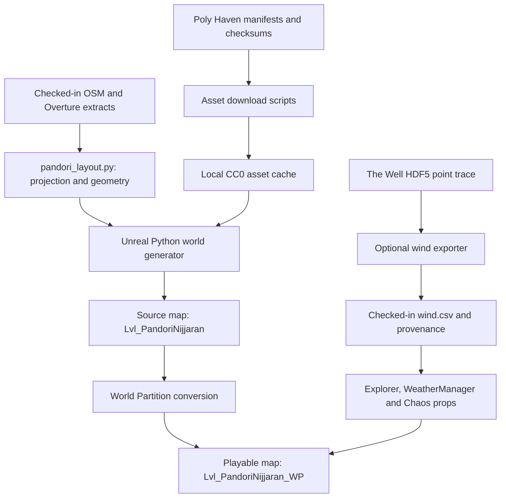

<a id="v1-maps-and-generated-content"></a>
#### Maps and generated content

| Unreal asset path | Role |
| --- | --- |
| `/Game/VillageMesh/Lvl_PandoriNijjaran` | Source map written by the geographic generator |
| `/Game/VillageMesh/Lvl_PandoriNijjaran_WP` | Converted World Partition map used for normal play |
| `/Game/VillageMesh/Lvl_OpenVillage` | Earlier fictional 20-home alternative generated by `build_open_world.py` |
| `/Game/Village/Lvl_Village` | Original local village, where its pre-existing assets are available |

Generated materials, meshes, and PCG assets live under `/Game/VillageMesh`. World Partition also creates external actor/object packages under Unreal's corresponding content directories.

Terrain, the current PCG biome, and core weather/physics actors stay loaded. Building/detail actors can stream. The overview control temporarily increases the runtime loading range and restores it when returning to walking. HLOD baking and sustained traversal profiling remain separate tasks.

<a id="v1-runtime-responsibilities"></a>
#### Runtime responsibilities

| Component | Responsibility |
| --- | --- |
| `AVillageExplorer` | Movement, view, interaction, yard/overview controls, and development smoke checks |
| `AVillageExplorerGameMode` / `AVillageExplorerHUD` | Portable pawn selection and controls/attribution overlay |
| `AWeatherManager` | Weather blending, daylight, wind playback, material parameters, rain, and lightning |
| `AVillagePhysicsProp` | Chaos body setup, drag forces, and optional plane-water buoyancy |
| Native PCG graph | Seeded tree/shrub placement with road/building exclusion supplied by the layout tools |

Original character, interaction, mini-game, villager, and animal classes remain in `Source/rural_pardeep`. Their existing blueprint/animation assets are not redistributed or wired into the portable first-person map. Automatic legacy asset generation requires the explicit `-VillageLegacyBootstrap` argument and its original local content.

<a id="v1-physics-weather-and-the-well"></a>
### Physics, weather, and The Well

<a id="v1-real-time-physics"></a>
#### Real-time physics

Chaos handles collision, gravity, friction, and rigid-body motion. The explorer uses a physics handle for grabbing. Throws scale the impulse by mass, while prop drag uses the relative air velocity.

CCD is enabled on the small moving props and marbles. Physics substeps target a maximum of 1/120 second, capped at eight steps per rendered frame. This bounds individual steps under normal conditions; it does not guarantee 120 Hz physics during long stalls.

The pond demonstration applies buoyancy only to explicitly designated props against a flat water plane. It does not solve a flowing water volume or couple the pond to a fluid simulation.

<a id="v1-weather-and-rendering"></a>
#### Weather and rendering

Weather profiles blend sunlight, fog, wind intensity, wetness, and rain amount. The weather material parameter collection supplies surface wetness and foliage wind. Rain uses a camera-following streak shell; a Niagara rain system can also be assigned to `WeatherManager`.

The generated map enables a daylight cycle. `WeatherManager` exposes time of day, day length, wind speed, automatic weather cycling, transition duration, and individual profiles for editing. F6/F7 provide immediate in-game demonstrations.

Software Lumen, virtual shadows, atmospheric sky, fog, and Substrate form the rendering configuration. Imported foliage uses Nanite area preservation. These features improve presentation, but do not make procedural buildings measured or photorealistic.

<a id="v1-what-the-well-contributes"></a>
#### What The Well contributes

[The Well](https://github.com/PolymathicAI/the_well) provides simulation datasets and research tooling. **Chaos remains the real-time physics engine.** This project uses a small derived wind signal from The Well rather than running a trained model or a real-time fluid solver.

| Trace setting | Checked-in value |
| --- | --- |
| Source submodule commit | `aac88c0b5eb9cbe4b7b2797eaaa550a43706fb44` |
| Dataset | Polymathic AI `shear_flow`, test split, Reynolds 1e4 / Schmidt 1e-1 file |
| Dataset revision | `1bca59aef4f2167f1d07d875ace6ea8c646d7cce` |
| Selection | Trajectory 0, spatial point `(128, 170)`, 48 sampled frames |
| Export | 49 rows including a matching loop endpoint; columns `time,x,y,z` |
| Transformation | Peak-normalized XY velocity, horizontal mapping, retimed to a 120-second loop |
| Runtime input | `Content/Well/wind.csv`, with attribution and checksum in `wind.source.json` |

Native weather code reads the CSV and uses it to drive wind for foliage and props. Procedural gusts provide the fallback when the trace is absent. This is art-directed playback of simulation data, not a local atmospheric forecast or a scientifically validated village-weather model.

The supplied CSV is sufficient for normal play. To regenerate it from the pinned public HDF5 source:

```powershell
python -m pip install -r requirements-tools.txt
python Scripts/export_well_wind.py --demo
```

The exporter uses HTTP range reads to extract selected points without downloading the entire source file. Transfer size depends on the HDF5 layout and remote service. The export replaces `wind.csv` and its provenance sidecar; review both together.

For a compatible local 2D Cartesian velocity dataset:

```powershell
python Scripts/export_well_wind.py --source 'D:\datasets\shear_flow.hdf5' --trajectory 0 --point 128 170 --frames 48 --duration 120
```

The local source must follow the supported Well field layout, `[sample, time, x, y, component]`, with two velocity components and the required metadata. Other datasets may need an adapter. Preserve the actual dataset's license and attribution when replacing the demonstration trace.

<a id="v1-rebuild-and-customize"></a>
### Rebuild and customize

Save your work and close the editor before commandlet generation or C++ rebuilds. Generation replaces the named generated maps and assets; preserve manual variants under separate names before rerunning it.

<a id="v1-rebuild-the-full-generated-world"></a>
#### Rebuild the full generated world

```powershell
.\Scripts\bootstrap.ps1 -EngineRoot 'E:\U.E\UE_5.8'
```

Existing valid downloads are reused. This rebuilds the portable geographic world and converts it again; it does not rebuild the original `/Game/Village` map.

<a id="v1-compile-only-c"></a>
#### Compile only C++

```powershell
$EngineRoot = 'E:\U.E\UE_5.8'
$ProjectPath = (Resolve-Path '.\rural_pardeep.uproject').Path
& "$EngineRoot\Engine\Build\BatchFiles\Build.bat" rural_pardeepEditor Win64 Development "-Project=$ProjectPath" -WaitMutex -NoHotReloadFromIDE
```

<a id="v1-regenerate-geometry-without-repeating-the-c-build"></a>
#### Regenerate geometry without repeating the C++ build

This assumes the editor module is already compiled and the CC0 downloads exist:

```powershell
$EngineRoot = 'E:\U.E\UE_5.8'
$ProjectPath = (Resolve-Path '.\rural_pardeep.uproject').Path
$GeneratorPath = (Resolve-Path '.\Scripts\build_pandori_world.py').Path
& "$EngineRoot\Engine\Binaries\Win64\UnrealEditor-Cmd.exe" $ProjectPath -run=pythonscript "-script=$GeneratorPath" -unattended -NullRHI -nosound
if ($LASTEXITCODE -ne 0) { throw 'World generation failed; inspect Saved\Logs.' }
.\Scripts\partition_world.ps1 -EngineRoot $EngineRoot
```

`polish_pandori.py` can be used in the same commandlet form for a material/detail pass without reimporting GIS geometry. It edits the source map; run `partition_world.ps1` afterward to refresh the playable copy. For the fictional alternative, use `build_open_world.py` and open `/Game/VillageMesh/Lvl_OpenVillage`; the supplied partition script specifically targets Pandori.

<a id="v1-where-to-make-changes"></a>
#### Where to make changes

| Desired change | Starting point |
| --- | --- |
| Projection, building heights, facade geometry, road geometry, placement exclusions | [Scripts/pandori_layout.py](Scripts/pandori_layout.py) |
| Flat datum and real-location generator entry point | [Scripts/build_pandori_world.py](Scripts/build_pandori_world.py) |
| Materials, lighting, spawn point, prop setup, world assembly | [Scripts/build_open_world.py](Scripts/build_open_world.py) |
| Roof tanks and shades | [Scripts/decorate_pandori.py](Scripts/decorate_pandori.py) |
| PCG graph and vegetation imports | [Scripts/build_pcg_biome.py](Scripts/build_pcg_biome.py), [Scripts/build_cc0_vegetation.py](Scripts/build_cc0_vegetation.py) |
| Player movement and interaction | [VillageExplorer.cpp](Source/rural_pardeep/Character/VillageExplorer.cpp) |
| Weather profiles and wind playback | [WeatherManager.cpp](Source/rural_pardeep/Environment/WeatherManager.cpp) |
| Prop forces and buoyancy | [VillagePhysicsProp.cpp](Source/rural_pardeep/Environment/VillagePhysicsProp.cpp) |
| Default maps, rendering, physics settings | [Config/DefaultEngine.ini](Config/DefaultEngine.ini) |

<a id="v1-toolkit-integration"></a>
### Toolkit integration

[TOOLKIT_STATUS.md](#toolkit-status) maps the supplied [UE5 open-world toolkit catalogue](#toolkit-catalogue) to concrete implementation status. Catalogue version, availability, price, and licensing claims are not treated as verification of installed functionality.

The checked-in project enables the authoring profile. It includes native PCG, procedural vegetation/terrain authoring tools, USD import, Water/Landmass, Niagara Fluids, NNE ORT, Learning Agents, MassAI, StateTree, SmartObjects, PoseSearch, and MCP editor toolsets where installed.

**Enabled plugins are available tools, not evidence that every feature is integrated.** The current map uses the systems described above; it contains no trained agent, ONNX model, scanned village, Cesium globe, or completed multiplayer backend. Several installed authoring plugins are marked experimental.

Inspect installed plugins without changing the project:

```powershell
python Scripts/configure_toolkit.py --engine-root 'E:\U.E\UE_5.8' --profile authoring
```

Apply a profile with the editor closed:

```powershell
python Scripts/configure_toolkit.py --engine-root 'E:\U.E\UE_5.8' --profile authoring --apply
```

The smaller `core` profile retains PCG and MCP editor toolsets and disables optional plugins managed by this script. It does not remove unrelated project plugins. Neither profile downloads missing plugins; a requested missing plugin causes an error.

Automatic installation of optional Python training dependencies is disabled. Install those dependencies only when using the corresponding tools. The MCP server uses manual startup, and no external AI account credentials are configured by this project.

<a id="v1-repository-layout"></a>
### Repository layout

```text
village_mesh/
|-- rural_pardeep.uproject       Unreal project and enabled plugins
|-- Source/rural_pardeep/       C++ explorer, environment, interactions, mini-games
|-- Config/                    Engine, input, editor, and game configuration
|-- Scripts/                   Download, generation, launch, audit, and export tools
|-- Tests/                     Standalone geometry and Well-data unit tests
|-- Assets/
|   |-- Geodata/               Checked-in geographic extracts and provenance
|   |-- textures.lock.json     Pinned PBR asset URLs and hashes
|   |-- models.lock.json       Pinned vegetation URLs and hashes
|   `-- Downloaded/            Local download cache; ignored by Git
|-- Content/
|   |-- Python/init_unreal.py  Startup hook with explicit legacy-generation opt-in
|   |-- Well/                  Small checked-in wind CSV and provenance
|   `-- VillageMesh/           Locally generated Unreal assets; ignored by Git
|-- ThirdParty/the_well/       Pinned source submodule
|-- Docs/                      Published engine captures and validation snapshots
|-- Saved/                     Local logs, generated reports, and captures; ignored
|-- VALIDATION.md              Recorded checks and unverified areas
|-- TOOLKIT_STATUS.md          Implemented, enabled, and pending integrations
`-- THIRD_PARTY_NOTICES.md     Source, asset, and data attribution
```

`Binaries`, `Intermediate`, `DerivedDataCache` and `Saved` remain excluded. Reviewed generated village and MetaHuman assets, World Partition actors and pinned CC0 downloads are included through Git LFS; [the manifest](Docs/LFS/assets.json) records the exact files and hashes. Unverified legacy imported art remains local. The saved-asset dependency audit confirms the published maps do not require excluded project assets.

<a id="v1-validation-guide"></a>
### Validation

The following results were recorded on **2026-10-23**, using Windows, Unreal Engine 5.8.3, MSVC 14.44, and an RTX 4050 Laptop GPU:

| Check | Recorded result |
| --- | --- |
| C++ editor build | Passed |
| Python script compilation | Passed |
| Python unit tests | 7 passed |
| Asset dependency audit | 1,026 packages traversed; no legacy `/Game/Village` or other out-of-scope game-content dependencies |
| Asset downloads | 15 PBR maps plus 17 vegetation files verified against manifests |
| World Partition conversion | Completed with source map preserved |
| Native wind playback | 49 validated samples loaded |
| Runtime smoke | Player grounded at 90.15 cm; 13 simulating props; buoyancy check passed; 146 instanced vegetation items |

Published machine-readable snapshots: [runtime_smoke.json](Docs/runtime_smoke.json), [portability.json](Docs/portability.json), and [toolkit_inventory.json](Docs/toolkit_inventory.json). They describe the recorded run and are not automatically refreshed by a local rebuild.

<a id="v1-run-the-python-tests"></a>
#### Run the Python tests

```powershell
python -m pip install -r requirements-tools.txt
python -m unittest discover -s Tests -v
```

Tests cover coordinate scale, roof-triangulation area preservation, road exclusion, geographic source hashes, terrain geometry, and Well sampling/normalization/provenance. They do not require Unreal to be running.

<a id="v1-run-the-engine-smoke-checks"></a>
#### Run the engine smoke checks

After building the map, close the interactive editor to avoid running duplicate heavy sessions:

```powershell
# Simulation checks without rendering; this does not validate visual output.
.\Scripts\play.ps1 -EngineRoot 'E:\U.E\UE_5.8' -Smoke -Headless

# Rendered street-level smoke and capture.
.\Scripts\play.ps1 -EngineRoot 'E:\U.E\UE_5.8' -Smoke

# Rendered overview smoke and capture.
.\Scripts\play.ps1 -EngineRoot 'E:\U.E\UE_5.8' -Smoke -Overview
```

In development builds, smoke mode checks ground contact, prop simulation/finite positions, the designated floating prop, and an instanced-vegetation threshold after 35 seconds of simulation. It requests a capture after 40 seconds and exits after 45 seconds, or exits with a nonzero status on check failure. Startup and slow frames can make wall-clock duration longer. Use `-Overview` with `-Smoke`; normal interactive play uses F9.

Reports are written to `Saved/VillageMeshGenerated/runtime_smoke.json`. Rendered captures use `playable.png` or `overview.png` in the same directory. A headless run supplies simulation evidence only.

<a id="v1-audit-generated-asset-dependencies"></a>
#### Audit generated asset dependencies

```powershell
$EngineRoot = 'E:\U.E\UE_5.8'
$ProjectPath = (Resolve-Path '.\rural_pardeep.uproject').Path
$AuditPath = (Resolve-Path '.\Scripts\validate_open_world.py').Path
& "$EngineRoot\Engine\Binaries\Win64\UnrealEditor-Cmd.exe" $ProjectPath -run=pythonscript "-script=$AuditPath" -unattended -NullRHI -nosound
```

The audit traverses the source/partitioned map dependencies and external actor packages, rejects game-content dependencies outside the generated namespace, and writes `Saved/VillageMeshGenerated/portability.json`. Engine/plugin dependencies are expected. See [VALIDATION.md](#v1-validation) for the full interpretation of these checks.

<a id="v1-troubleshooting"></a>
### Troubleshooting

| Symptom | What to check |
| --- | --- |
| Map missing after cloning | Run git lfs pull and verify the asset manifest. Bootstrap is available for V1 regeneration. |
| `EngineRoot` error | Supply the installation directory containing `Engine/Build/BatchFiles/Build.bat`. |
| Missing module or compile failure | Verify engine version, MSVC C++ toolchain, and Windows SDK; close the editor, then run the C++ build command and inspect its first error. |
| `unreal` cannot be imported in a shell | World-generation and audit scripts run through Unreal's Python commandlet, not standalone system Python. |
| Python tests cannot import NumPy or h5py | Install `requirements-tools.txt` into the same Python environment used to run tests. |
| CC0 download or checksum failure | Inspect the named URL/file and network access. Retry with the supplied downloader. Replace a corrupt cached file only after identifying it; retain the pinned hashes. |
| Empty distant buildings in an overview | Confirm the `_WP` map is running. Use in-game F9, which expands loading range, and allow streaming to settle. |
| Input does not reach the explorer | Focus the PIE viewport or use `play.ps1` for a separate game window. |
| Editor-only MCP/Python errors in game mode | Use `play.ps1`, which supplies `-DisablePython`. Keep Python enabled for generation commandlets and full editor authoring. |
| Slow imports or memory pressure | Avoid simultaneous editor/smoke sessions and allow asset/shader work to finish. Optional training dependencies are not required for normal play. |
| Plugin missing in a different engine installation | Inspect the toolkit inventory. Use the tested engine setup; `core` can reduce optional dependencies if its required plugins are available. |
| Editor-widget or HLOD-settings warnings in uncooked play | These remain documented in the recorded validation. HLOD baking is unfinished; investigate new errors separately. |

General engine logs are under `Saved/Logs`; the conversion wrapper writes `Saved/Logs/VillageMeshPartition.log`. Generated reports and intermediate geometry are under `Saved/VillageMeshGenerated`.

<a id="v1-current-limitations-and-next-work"></a>
### Current limitations and next work

The remaining work is substantial and explicit:

- **Site fidelity:** acquire suitable elevation data, measured building heights, street-facing references, and landmark dimensions before claiming a faithful architectural replica.
- **Architecture:** replace generic shells with reviewed local building types and add navigable interiors where supported by evidence and gameplay needs.
- **Landscape:** add measured terrain and land-cover inputs, improve agricultural fields and roadside detail, and review plant placement/species.
- **Streaming and performance:** bake HLODs, profile long traversals and memory use, and establish measured quality/performance presets.
- **Gameplay:** connect selected legacy mini-games, villagers, animals, animation, and audio using assets with verified redistribution rights.
- **Delivery:** validate an independent fresh-machine bootstrap and packaged builds. Multiplayer and shipping distribution have not been validated.
- **Advanced tooling:** integrate selected catalogue tools only when there is a concrete workflow; enabled plugins alone do not complete those integrations.

Current tests do not establish survey accuracy, scientific fluid accuracy, sustained frame rate, every control path, or long-duration stability. The visible world is a finite local reconstruction, not an entire globe or an unlimited world.

<a id="v1-licensing-and-attribution"></a>
### Licensing and attribution

The source code is open source, while engine, geographic data, and third-party content retain separate terms:

| Material | License / attribution |
| --- | --- |
| Original project code | [MIT](LICENSE) |
| Unreal Engine | [Epic's Unreal Engine terms](https://www.unrealengine.com/en-US/eula/unreal); engine binaries are not distributed here |
| The Well source submodule | BSD-3-Clause; see [its license](ThirdParty/the_well/LICENSE) |
| Derived shear-flow wind trace | CC BY 4.0; The Well / Polymathic AI, Rudy Morel, CCM, Flatiron Institute; transformations recorded beside the CSV |
| Poly Haven materials and vegetation | [CC0](https://polyhaven.com/license); source URLs and checksums retained in manifests |
| OpenStreetMap roads | Copyright OpenStreetMap contributors, [ODbL 1.0](https://www.openstreetmap.org/copyright) |
| Overture building database | ODbL 1.0, with retained Microsoft Global ML Building Footprints and Google Open Buildings source attribution; see [Overture attribution](https://docs.overturemaps.org/attribution/#buildings) |
| Google Open Buildings contribution | CC BY 4.0 attribution retained in geographic source metadata |
| Original imported local art | Excluded from publication pending verified redistribution rights |

The five downloaded PBR sets are `brown_mud_leaves_01`, `red_brick_03`, `rough_plaster_03`, `aerial_grass_rock`, and `asphalt_02`. Vegetation uses `tree_small_02` and `shrub_01`. Public village photos/videos are reference links, not redistributed assets.

Original-code MIT licensing does not replace data licenses. Geographic databases and adaptations retain their applicable terms and attribution. See [THIRD_PARTY_NOTICES.md](#third-party-notices) and [geodata provenance](#geodata) before redistributing derived material.

<a id="v1-contributing"></a>
### Contributing

Keep changes reproducible: edit source/generation rules, retain input provenance, and record whether results were checked in Python, inside Unreal, or in a packaged build. Run relevant geometry/data tests after changing those inputs, and repeat engine checks when runtime or generated-content behavior changes.

Commit source, manifests, small licensed inputs, and deliberately selected evidence. Keep credentials, private captures, engine binaries, unverified art, downloaded caches, and generated build output out of Git. For visual changes, include a new engine capture and explain which geographic or architectural details remain approximate.

<!-- END:v1 -->

</details>


<a id="v1-validation"></a>

## Recorded V1 validation

<details>
<summary>Expand this section</summary>

<!-- BEGIN:v1-validation -->

<a id="v1-validation-validation--2026-10-23"></a>

Local workstation: Windows, Unreal Engine 5.8.3, MSVC 14.44, RTX 4050 Laptop GPU.

This page records the V1 baseline. See the [V2 pilot checks](#v2) and [V2 acceptance register](Docs/V2_ACCEPTANCE.txt) for the separate upgraded street.

| Check | Result |
| --- | --- |
| C++ editor build | Passed after final controller and camera changes |
| Asset dependency audit | 1,026 packages checked across source and World Partition maps; no legacy art dependencies |
| Python compilation | Passed for project scripts and startup script |
| Unit tests | 7 passed: georeference/scale, all 821 roof triangulation areas, road vegetation exclusion, source hashes, terrain and Well data validation |
| The Well export | 49 bounded samples from the pinned public shear-flow HDF5 file; checksum verified |
| CC0 downloads | 15 PBR texture maps plus 17 vegetation files, source MD5 and pinned SHA256 verified |
| Pandori generation | 821 mapped building shells, 265 mesh chunks, 146 PCG instances configured, 13 physics props; 306 base actors |
| Detail pass | 399 procedural roof-tank / shade actors added, exit 0 |
| World Partition conversion | Passed, exit 0, source map preserved; runtime streaming generation initialized |
| GPU runtime smoke | Player grounded at 90.15 cm; 13 finite simulating bodies, designated buoyancy check passed; 146 instanced vegetation items |
| Native Well playback | Engine confirmed 49 validated samples |

The live smoke test checks actual engine simulation after 35 seconds and
captures at 40 seconds. It verifies ground contact, body simulation, finite
positions, designated pond flotation, and generated instanced vegetation.
It does not prove every control, long-duration stability, or scientific
accuracy of the wind and plane-buoyancy approximations.

The map outline projection and roof triangulation preserve the downloaded
geographic footprints. This is not a validation of their real-world accuracy:
ML footprints can be wrong, OSM is incomplete, heights and facades are
procedural, and terrain uses a flat datum.

Run checks:

```powershell
python -m unittest discover -s Tests -v
.\Scripts\play.ps1 -EngineRoot 'E:\U.E\UE_5.8' -Smoke -Headless
.\Scripts\play.ps1 -EngineRoot 'E:\U.E\UE_5.8' -Smoke -Overview
```

Uncooked game runs still log editor-widget and unbaked HLOD-settings warnings.
The final material pass removes Nanite/instancing fallback warnings. Cached
lighting pre-exposure is set to EV8, whose documented usable range extends
through EV16, to avoid the daylight clipping warning.

The game launcher disables Python because the experimental MCP editor tools'
startup scripts expect editor-only classes. Authoring commandlets and the full
editor keep Python enabled. Automatic installation of optional training
packages is disabled in project settings.

Evidence: `Saved/VillageMeshGenerated/` and `Saved/Logs/VillageMesh*.log`.
Published previews are actual engine captures; the reference map is plotted
from the checked-in geographic data.

Not verified: shipping package, multiplayer, HLOD baking, sustained frame
rate, streaming traversal throughout the world, independent fresh-machine
bootstrap, or scientific validation against a fluid solver.

<!-- END:v1-validation -->

</details>


<a id="legacy-wiring"></a>

## Legacy mini-game wiring reference

<details>
<summary>Expand this section</summary>

<!-- BEGIN:legacy-wiring -->

> Legacy village only. For the portable open world, use `Scripts/bootstrap.ps1`; see README.md.

<a id="legacy-wiring-village-mini-games--manual-wiring-checklist"></a>

Work through these in order. Steps 1–4 get the module compiled; 5–12 wire
assets; 13–16 place and verify. Placeholders you will swap for your Blender
assets are written as `<LIKE_THIS>`.

<a id="legacy-wiring-a-compile-one-time-setup"></a>
### A. Compile (one-time setup)

1. **Install the C++ toolchain** if it is not already present:
   Visual Studio 2022 Community → workload **"Game development with C++"**,
   which must include *MSVC v143*, *Windows 10/11 SDK*, and
   *.NET desktop development* (UnrealBuildTool needs it).
2. **Close the Unreal Editor** (it currently has the project open without the
   new module; it must restart to load it).
3. Right-click `rural_pardeep.uproject` → **Generate Visual Studio project files**.
   (If that menu entry is missing, run:
   `"E:\U.E\UE_5.8\Engine\Build\BatchFiles\Build.bat" -projectfiles -project="D:\rural_games\rural_pardeep\rural_pardeep.uproject" -game -engine`)
4. **Build** — either open `rural_pardeep.sln` in VS and build the
   `rural_pardeepEditor` target (Development Editor | Win64), or run:
   `"E:\U.E\UE_5.8\Engine\Build\BatchFiles\Build.bat" rural_pardeepEditor Win64 Development -project="D:\rural_games\rural_pardeep\rural_pardeep.uproject" -waitmutex`
   *Compile order is automatic — everything is one module. If you later add a
   class, just rebuild this same target. Prefer a full editor restart over
   Live Coding while iterating on these classes (they have constructors that
   Live Coding won't re-run).*
5. Reopen the project. Confirm **C++ Classes → rural_pardeep** shows
   `VillageCharacter`, the three zones, etc. in the Content Browser.

<a id="legacy-wiring-b-enhanced-input-assets"></a>
### B. Enhanced Input assets

6. In `Content/Input/Actions`, the template already has `IA_Move`, `IA_Look`,
   `IA_Jump`. **Create three more Input Actions** (right-click → Input →
   Input Action):
   - `IA_Sprint` — Value Type: **Digital (bool)**
   - `IA_Interact` — Value Type: **Digital (bool)**
   - `IA_Cancel` — Value Type: **Digital (bool)**
7. **Duplicate `IMC_Default` → `IMC_Village`** (keeps the template's WASD 2D
   composite and mouse-look wiring), then add these mappings:

   | Action      | Key                 | Notes                                   |
   |-------------|---------------------|-----------------------------------------|
   | IA_Move     | W/A/S/D, L-stick    | already present from IMC_Default        |
   | IA_Look     | Mouse XY, R-stick   | already present from IMC_Default        |
   | IA_Jump     | Space Bar, Gamepad A| already present from IMC_Default        |
   | IA_Sprint   | Left Shift          | no triggers needed (hold = Started/Completed) |
   | IA_Interact | E, Gamepad X        | hold-to-charge works off Started/Completed |
   | IA_Cancel   | Escape, Gamepad B   | Escape also ends PIE — bind **Q** too if that annoys you |

<a id="legacy-wiring-c-character-blueprint"></a>
### C. Character blueprint

8. Right-click `VillageCharacter` (C++ Classes) → **Create Blueprint child** →
   `BP_VillageCharacter` (put it in `Content/ThirdPerson/Blueprints`). On it:
   1. **Mesh** component → Skeletal Mesh = `<PLAYER_MESH_PLACEHOLDER>`
      (your Blender character, or `SKM_Quinn_Simple` from
      `/Game/Characters/Mannequins/Meshes/` to start); Anim Class =
      `ABP_Unarmed` (or your own ABP).
   2. Details → **Village|Input** → assign `IMC_Village`, `IA_Move`, `IA_Look`,
      `IA_Jump`, `IA_Sprint`, `IA_Interact`, `IA_Cancel`.
   3. **Village|Footsteps** → Footstep Dust System = `<DUST_NS_PLACEHOLDER>`
      (your Niagara dust puff; `NS_JumpPad` works as a stand-in).
   4. **Village|Animation** → assign `<ANIM_PLACEHOLDER>` montages when you
      have them: Dart Throw / Marble Flick / Kite Pull. (Safe to leave empty.)
   5. **Village|Interaction** (on the InteractionComponent) → HUD Widget
      Class = `WBP_GameHUD` (step 10).
9. Open `BP_ThirdPersonGameMode` → **Default Pawn Class = BP_VillageCharacter**.

<a id="legacy-wiring-d-hud-widget"></a>
### D. HUD widget

10. Right-click `GameHUDWidget` (C++ Classes) → Create Blueprint child →
    `WBP_GameHUD` in `Content/UI/`. Implement the events (Graph → Override):
    - `ShowInteractPrompt` / `HideInteractPrompt` — a centred bottom text
      block: `Press E to play {GameName}`.
    - `ShowGamePanel(PanelName)` / `HideGamePanel` — a Widget Switcher (or
      three Border panels) keyed by name: `Darts`, `Kancha`, `Kite`.
    - `UpdatePowerMeter(Power01, bVisible)` — a ProgressBar; also add a small
      **centre-screen crosshair** to the Darts panel (aim is screen-centre).
    - `UpdateDartsHUD(Score, DartsLeft, LastThrow)` — three text blocks.
    - `UpdateKanchaHUD(MarblesRemaining, MarblesWon)` — two text blocks.
    - `UpdateKiteHUD(AltitudeCm, StringLengthCm, KitesCut, Meter, bContest)`
      — divide the cm values by 100 for metres; show the contest meter
      ProgressBar only while `bContest` is true (0.5 = even tug).
    - `ShowStatusMessage(Message)` — a fading banner ("BUST!", "Bo kata!").

<a id="legacy-wiring-e-footstep-dust-notifies"></a>
### E. Footstep dust notifies

11. Physical material: the surface types **Dirt (SurfaceType1)** and
    **Dust (SurfaceType2)** are already registered in `DefaultEngine.ini`.
    Create `Content/Materials/PM_Dirt` (right-click → Physics → Physical
    Material), set its **Surface Type = Dirt**, and set it on your landscape
    layer / ground materials (Material → Phys Material slot).
12. Anim notifies: open your walk and run sequences → notify track →
    right-click at each foot-plant frame → **Add Notify → New Notify** named
    `Footstep`. Then in the ABP's Event Graph add **AnimNotify_Footstep**
    events → Cast owner to `VillageCharacter` → call **On Footstep**.
    (Two plants per walk loop, two per run loop.)
    *Until you author physical materials, the character's Dust Surface Types
    array can be emptied to puff on every surface — handy for testing.*

<a id="legacy-wiring-f-zone-art-placeholders"></a>
### F. Zone art placeholders

13. On the placed `MG_DartsZone` (or a `BP_DartsZone` child if you prefer):
    - `DartboardMesh` → `<DARTBOARD_MESH_PLACEHOLDER>` (your Blender board).
      Keep the scoring-face normal along the component's **up axis** (the
      placeholder is a flattened cylinder) or re-tune `ScoreRings` radii.
    - `PlayAreaDecal` / `ThrowLineDecal` → assign chalk-line decal materials.
    - Optional: point `DartClass` at a BP child of `DartProjectile` with your
      dart mesh.
14. Kancha zone: assign a chalk-ring decal material; marbles default to engine
    spheres — set a glass material on `MarbleActor`'s mesh (or a BP child via
    `MarbleClass`).
15. Kite zone: create `BP_Kite` (child of `KiteActor`), assign your patang
    mesh to `<KITE_MESH_PLACEHOLDER>`, set it as `PlayerKiteClass` /
    `RivalKiteClass`. The debug-line strings can be replaced with Cable
    Components later (enable the Cable Component plugin).

<a id="legacy-wiring-g-place-build-nav-play"></a>
### G. Place, build nav, play

16. Restarted editor with the compiled module? Then run the placement script
    in the Output Log's `Cmd` box:

    ```
    py "D:/rural_games/rural_pardeep/Scripts/place_minigame_zones.py"
    ```

    - With World Partition, **load the village region first** (World
      Partition minimap → drag-select → Load Region From Selection).
    - Check the Output Log summary; re-running cleans up `MG_*` and replaces.
17. Press **P** in the viewport — green NavMesh should cover the zones. If
    not (script warns if the volume spawned without brush geometry), drag a
    **NavMeshBoundsVolume** over the area and **Build → Build Paths**.
18. PCG foliage: add difference/exclusion volumes over the three zones and
    regenerate PCG so grass doesn't grow through the play areas.
19. **PIE test**: walk into each zone → `E` starts, `Esc` leaves.
    - Darts: mouse aims, hold-release E throws, 501 counts down (switch
      `GameMode` to Best-of-3 on the zone instance to compare).
    - Kancha: mouse orbits aim, hold-release E flicks; hits claim marbles.
    - Kite: climb the outside stair, E on the roof; WASD steers, Space lets
      out, Shift reels in, mash E during a pech.
    All tuning values are `EditAnywhere` on the zone instances — tweak live.

<!-- END:legacy-wiring -->

</details>
