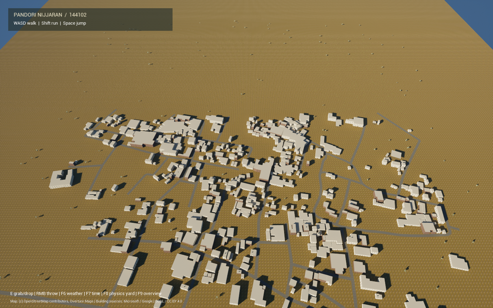

# village_mesh

A geographically sourced reconstruction of **Pandori Nijjaran, Adampur,
Punjab 144102**, built in Unreal Engine 5.8. OpenStreetMap roads and 821
Overture building outlines shape the village. CC0 vegetation, weather,
Nanite, PCG and interactive Chaos props provide an explorable environment. The original village gameplay source
(darts, kancha, kites, villagers and animals) is also preserved.



[Mapped source layout](Docs/pandori_map.png) ? [Street view](Docs/street.png)

The portable map is `/Game/VillageMesh/Lvl_PandoriNijjaran_WP`. It uses 2K CC0
ground, brick and plaster textures, Lumen lighting, virtual shadows,
volumetric fog and a configurable daylight/weather cycle. Software Lumen
is the default; hardware ray tracing and path tracing are disabled to keep
shader compilation and memory use manageable on laptops.

## Build and play

Install Unreal Engine **5.8**, Visual Studio 2022 C++ build tools with a
Windows SDK, Git and Python 3.10 or later. Allow roughly 200 MB for CC0
texture/model downloads, plus several GB of Unreal assets and shader caches.

```powershell
git clone --recurse-submodules https://github.com/martian3062/village_mesh.git
cd village_mesh
.\Scripts\bootstrap.ps1 -EngineRoot 'E:\U.E\UE_5.8' -OpenEditor
```

Replace `EngineRoot` with your installation path. The script downloads and
verifies the textures and vegetation models, compiles the C++ module, generates the map, converts a copy to World Partition, then
opens the editor. Press **Play**. For a standalone interactive session:

```powershell
.\Scripts\play.ps1 -EngineRoot 'E:\U.E\UE_5.8'
```

Run it again to rebuild only the portable
map and its assets. It does not rebuild the original `/Game/Village` map.

| Control | Action |
| --- | --- |
| WASD / mouse | Walk / look |
| Shift / Space | Run / jump |
| E | Grab or drop a physics object within 4 m, up to 40 kg |
| Right mouse | Throw the held object |
| F6 | Cycle clear, overcast, rain and storm profiles |
| F7 | Advance the sun by three hours |
| F8 | Visit the physics demonstration yard / return to village |
| F9 | Toggle aerial overview / return to walking |

## Physics and The Well

Chaos handles collision, gravity, friction, rigid bodies and the grab
constraint. CCD is enabled on small moving props and marbles. Physics
substeps target a maximum of 1/120 s, capped at eight per rendered frame;
this is not a guarantee of 120 Hz during long stalls.

Props use quadratic air drag, mass-aware throws and optional plane-water
buoyancy. The pond demonstration uses a flat water level; this is not a
full fluid simulation. Floating props are explicitly designated for that pond.

[The Well](https://github.com/PolymathicAI/the_well) is pinned under
`ThirdParty/the_well`. Its numerical simulation datasets are a separate
layer from the real-time physics engine. A 49-sample velocity trace from
its shear-flow dataset drives wind direction and strength at runtime.
The source file is read by HTTP ranges; the multi-gigabyte dataset is not
downloaded in full. Attribution and transformation details accompany the CSV.

The wind signal is normalized and retimed for visual use. No trained model,
scientifically validated weather, or real-time Navier–Stokes simulation is
claimed. Remove the CSV to use the procedural gust fallback.

To regenerate the trace or test the conversion:

```powershell
python -m pip install -r requirements-tools.txt
python Scripts/export_well_wind.py --demo
python -m unittest discover -s Tests -v
```

The exporter also accepts `--source path\to\file.hdf5 --point 128 170` for
local Cartesian 2D velocity fields in The Well's documented format.

## Existing village

On the original workstation, `/Game/Village/Lvl_Village` and all existing
art remain available. Legacy generation scripts are retained in `Scripts`.
Automatic legacy regeneration is disabled; it requires the explicit
`-VillageLegacyBootstrap` launch argument, because those scripts depend on
local template content and imported art.

The earlier fictional 20-home generator remains available as
`Scripts/build_open_world.py`. The real-location generator is
`Scripts/build_pandori_world.py`.

Fresh clones use the asset-independent first-person explorer. The original
third-person mini-games require their existing blueprint/animation assets
and are not wired into the portable map.

## Validation and limits

See [VALIDATION.md](VALIDATION.md) for measured checks. This is a generated
environment foundation, not a finished photorealistic game. The portable
map is a finite 1.28 km square with World Partition. Terrain and the current
PCG biome stay loaded; building/detail actors can stream. HLOD baking and
streaming traversal profiling remain unverified. Rain and storm drive wet-surface shading, fog, gusts and camera-following
rain streaks. Niagara particles can be supplied separately to `WeatherManager`. Performance depends on the GPU and quality
settings. Packaged builds and multiplayer are not yet validated.

## Licensing

The GIS outlines are sourced; facades, heights, road widths and vegetation are
approximations. Terrain uses a flat datum; no DEM, street scan or surveyed
interior is present. See [map provenance](Assets/Geodata/README.md), the
[toolkit status](TOOLKIT_STATUS.md), and the supplied [toolkit](ue5-open-world-toolkit.md).

Original code is MIT. Unreal Engine has its own license. The Well source
is BSD-3-Clause, its derived wind data is CC BY 4.0, and downloaded textures
and vegetation models are CC0. Map databases are ODbL with retained source
attribution, including Google Open Buildings CC BY 4.0. See [THIRD_PARTY_NOTICES.md](THIRD_PARTY_NOTICES.md). Unverified
imported art and engine caches are excluded from Git.

References: [Chaos substepping](https://dev.epicgames.com/documentation/unreal-engine/physics-sub-stepping-in-unreal-engine),
[The Well data format](https://github.com/PolymathicAI/the_well/blob/master/docs/data_format.md).
