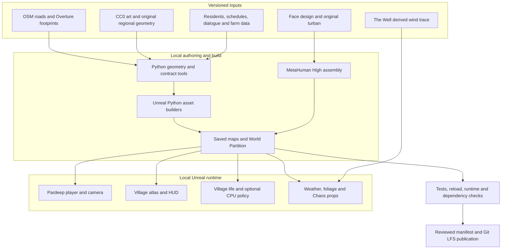

# Village Mesh

**An explorable Punjabi village in Unreal Engine, built from mapped streets and building footprints.**

Village Mesh recreates a **1.28 km × 1.28 km** area around **Pandori Nijjaran, Adampur, Punjab 144102**. It combines 821 mapped building outlines, varied regional homes, public destinations, farms, village life and a third-person Pardeep character. Source, generation tools and reviewed Unreal assets are published here; large assets use **Git LFS**.

This is a playable development project. Road centre lines and building footprints are sourced; facades, heights, terrain, public-site placement and agricultural parcels remain authored approximations. It is not a surveyed digital twin or a finished photorealistic game.

[Quick start](#quick-start) · [System architecture](#system-architecture) · [Controls](#controls) · [Validation](#validation-and-known-limits) · [Detailed architecture](Docs/ARCHITECTURE.md) · [Asset and licence guide](Docs/LFS/README.md)


*Actual Unreal runtime capture. [Face preview](Docs/PardeepPlayer/pardeep_portrait.png), [hand detail](Docs/PardeepPlayer/hand_detail.png), and [village destination gallery](Docs/V3/README.md#rendered-destination-gallery).*

## What you can explore

| System | Current implementation |
| --- | --- |
| Mapped village | 821 building outlines and 71 OSM road records within the finite map extract |
| Regional homes | Eight geometry styles: verandas, courtyard-inspired brick homes, haveli balconies, terraces, jali parapets, farmhouses, shop fronts and stepped family homes |
| Streets | 9 asphalt connectors, 35 tile lanes, 17 brick lanes and 10 dirt tracks; missing surface tags are filled with artistic choices |
| Public destinations | Mandir, gurdwara, school, sports ground, bazaar, dairy, water tower, telecom mast and agriculture centre; representative placement and architecture |
| Farms and animals | 41 authored agricultural parcels plus four earlier demonstration plots; 14 procedural cows/buffalo, goats and hens |
| Village life | Eight fictional adult residents, schedules, path reservations, jobs and draft Punjabi subtitle choices |
| Pardeep | Reference-guided MetaHuman, original black turban, beard, brown eyes, High-quality face/body skin, idle/walk/run locomotion and inspection views |
| Map and HUD | Live north-up minimap, full atlas, destination selection, visit controls, heading, speed and ground-surface readout |
| Environment | Software Lumen, virtual shadows, atmospheric lighting, wet surfaces, rain, wind and a day cycle |
| Physics | Chaos props, collision, grabbing/throwing, drag and a designated buoyancy demonstration |
| TinyAI | Optional 121,520-parameter CPU action policy; deterministic rules remain the default |

Most buildings are exterior shells. Sixteen pilot buildings retain their earlier detailed treatment, with selected pilot interiors. Residents and livestock still use procedural prototype art. Pardeep's exact likeness, Punjabi outfit and dedicated airborne animation remain unfinished.

## Quick start

The current development target is **Windows + Unreal Engine 5.8.4**, with Visual Studio 2022 C++ build tools and a Windows SDK. Install **MetaHuman Creator Core Data** in the engine's Epic Launcher Options. The project also expects its enabled engine plugins; see [MetaHuman setup](Docs/MetaHumanPilot/README.md#core-data-setup-for-another-machine) and [toolkit status](TOOLKIT_STATUS.md).

Git LFS is required for saved maps and assets. Python 3.10+ runs the manifest and standalone tools; the development workstation uses Python 3.12. Replace the engine path below with your installation directory containing `Engine`.

```powershell
git lfs install
git clone --recurse-submodules https://github.com/martian3062/village_mesh.git
cd village_mesh
git lfs pull
python Scripts/lfs_publication.py verify

$EngineRoot = 'E:\U.E\UE_5.8'
& "$EngineRoot\Engine\Build\BatchFiles\Build.bat" rural_pardeepEditor Win64 Development "-Project=$PWD\rural_pardeep.uproject" -WaitMutex -NoHotReloadFromIDE
if ($LASTEXITCODE -ne 0) { throw 'Editor build failed; inspect the first build error.' }
.\Scripts\pardeep_village.ps1 -EngineRoot $EngineRoot -Action Play
```

Use `-Action Editor` instead of `Play` to open the current world in Unreal Editor. The launch script selects `/Game/VillageMeshV3/Lvl_PandoriV3_Pardeep_WP` explicitly. `Play` opens an uncooked development game window; it does not build or package the project. Epic sign-in is needed when running the character rig/assembly workflow, not to clone the repository.

For an existing checkout: `git pull --ff-only`, `git submodule update --init --recursive`, `git lfs pull`, then verify and rebuild the editor module. Storage includes the [published asset snapshot](Docs/LFS/README.md), a local LFS object cache, build/shader caches, and the separate engine/Core Data installation. The tested RTX 4050 Laptop GPU is an observation, not a minimum specification or FPS guarantee.

## System architecture



The C++ module remains named `rural_pardeep`. Authoring scripts produce assets; native code runs movement, village life, weather and the atlas. Saved World Partition packages stream the scene. MetaHuman assembly uses Epic's installed tooling and rigging service when required. Kaggle is an optional offline training path; normal gameplay has no remote model service.

The [detailed architecture](Docs/ARCHITECTURE.md) includes **world-generation, gameplay, character, TinyAI, weather/physics and publication flowcharts**, plus source locations and data ownership.

### The Well and TinyAI

**Chaos supplies real-time physics.** The Well contributes a small, attributed shear-flow trace that is normalized and retimed into a 120-second wind loop. It drives visual wind and prop drag, with procedural gusts as fallback. It is not a live fluid solver or a village weather forecast. See the [wind provenance](Content/Well/wind.source.json) and [V1 physics guide](Docs/V1/README.md#what-the-well-contributes).

TinyAI uses fixed `[1,64] → [1,48]` ONNX inference through Unreal NNE/ORT CPU. Rules, validity masks, reservations and fallback logic remain authoritative. The [Kaggle experiment](Docs/Kaggle/README.md) trained a separate candidate on synthetic controller states; it has not replaced the deployed model. There is no deployed speech recognition, voice synthesis or Punjabi language model.

## Controls

| Control | Action |
| --- | --- |
| WASD / mouse | Move / look |
| Shift / Space | Run / jump |
| V / Q | First- or third-person view / change camera shoulder |
| P | Cycle face close-up, hand close-up and third-person view |
| M | Open or close the village atlas |
| Tab or map click / Enter | Select / visit a destination while the atlas is open |
| Mouse wheel | Change minimap scale |
| T / 1–5 | Talk / choose a draft subtitle response |
| E / right mouse | Use a supported door or grab/drop / throw a prop |
| F6 / F7 | Weather / time of day |
| F9 / F10 / F11 | Aerial overview / pilot rooms / demonstration farm plots |
| F5 | Toggle experimental learned action ranking |

The atlas visit action moves the player to an authored entrance; its displayed distance is straight-line distance, not a navigation route. Input requires focus in the game window or Play in Editor viewport.

## Project guide

| Guide | Purpose |
| --- | --- |
| [Architecture](Docs/ARCHITECTURE.md) | Components, data flow, runtime boundaries and publication pipeline |
| [Pardeep and streets](Docs/PardeepPlayer/README.md) | Current player, High skin assets, turban, controls and rebuild commands |
| [V3 village atlas](Docs/V3/README.md) | Varied architecture, public places, fields, animals and destination gallery |
| [V2.5 village life](Docs/V25/README.md) | Residents, local state, Punjabi draft dialogue, CPU policy and acceptance gates |
| [V2 street pilot](Docs/V2/README.md) | Detailed mapped street, pilot interiors and earlier world workflow |
| [V1 foundation](Docs/V1/README.md) | Earlier geography, Chaos, weather, The Well and bootstrap reference |
| [MetaHuman pilot](Docs/MetaHumanPilot/README.md) | Preserved Manpreet pilot and Creator Core Data requirements |
| [Kaggle](Docs/Kaggle/README.md) | Optional private numeric training job and candidate evaluation |
| [LFS publication](Docs/LFS/README.md) | Asset allowlist, hashes, engine dependencies and clone verification |

### Repository layout

```text
Source/rural_pardeep/   Native player, atlas, village life, environment and legacy gameplay
Scripts/               Geometry, Unreal authoring, launch, training and audit entry points
Assets/                Geographic inputs, world/NPC contracts, design files and source locks
Content/               Reviewed saved Unreal assets, external actors and runtime data
Config/                Engine, maps, rendering, physics, input and packaging configuration
Tests/                 Python geometry, schema, model-bundle and publication checks
Docs/                  Versioned guides, engine captures and selected validation evidence
ThirdParty/the_well/    Pinned research-source submodule
Saved/                 Local generated intermediates, logs, saves and packages; ignored
```

`Binaries`, `Intermediate` and `DerivedDataCache` are local build products. Private reference photos, credentials and unverified legacy imported art are excluded from publication. [assets.json](Docs/LFS/assets.json) lists the reviewed saved-asset snapshot exactly.

## Rebuild and validate

Save and close this project's editor before compiling or rebuilding assets. Generation replaces named generated outputs; keep manual variants under separate names. The published saved assets avoid a full world/character regeneration just to play.

```powershell
# Standalone geometry, schema and publication tests.
python -m pip install -r requirements-v3-tools.txt
python -m unittest discover -s Tests -v

# Current rendered movement and skin-inspection check.
.\Scripts\pardeep_village.ps1 -Action Check

# Reload every saved Pardeep asset in a fresh engine process.
.\Scripts\pardeep_appearance.ps1 -Action Verify

# Verify every published asset's size and SHA-256.
python Scripts/lfs_publication.py verify
```

| Change | Entry point |
| --- | --- |
| Current street surfaces and player map | `Scripts/pardeep_village.ps1 -Action Build` |
| Character face rig and High assembly | `Scripts/pardeep_appearance.ps1 -Action Character` |
| Eye, hair, skin and turban finish | `Scripts/pardeep_appearance.ps1 -Action Refine` |
| Regional homes, public sites and fields | `Scripts/v3.ps1 -Action Build` |
| Resident contracts and deployed policy import | `Scripts/v25.ps1 -Action Build` |
| Earlier geographic foundation | `Scripts/bootstrap.ps1` |

Follow the linked stage guides for dependencies and ordering. Asset-generating Python scripts import `unreal` and must run inside the engine; standalone system Python is used for data tools. The existing V3 packaging profile excludes the MetaHuman pilot and does **not** produce a validated Pardeep package.

## Validation and known limits

Evidence below was recorded on **24 October 2026**. These are separate checks, not a single release certification.

| Check | Recorded evidence |
| --- | --- |
| Python suite | 44 tests passed |
| Native editor module | UE 5.8.4 Win64 Development build passed |
| Pardeep saved assets | 338 assets reloaded successfully in a fresh engine process |
| Current rendered runtime | Walk/run, ground contact, reference-guided actor and attached turban passed; 26.71 m player travel |
| Skin close-ups | Face/body LOD 0 in the High export, 100% screen percentage, full-resolution subsurface scattering |
| Saved package references | 9,064 packages audited with no missing or excluded project dependencies |
| Earlier V3 package | Bounded destination/animal/overview checks passed on its own build; this does not validate the current Pardeep package |

See [runtime evidence](Docs/PardeepPlayer/runtime_check.json), [skin inventory](Docs/PardeepPlayer/skin_asset_audit.json), [actual render settings](Docs/PardeepPlayer/skin_runtime_quality.json), [asset reload](Docs/PardeepPlayer/saved_asset_check.json) and [V3 package evidence](Docs/V3/runtime_packaged.json).

The High assembly saved its assets but the editor exited with an access violation during shutdown. A fresh reload passed independently. One early rendered launch hit a GPU device-hung error; a retry and the final refined runtime check passed. These issues remain recorded in the [player guide](Docs/PardeepPlayer/README.md); long-session stability and a packaged Pardeep build remain unverified.

Other open work includes measured terrain/facades, custom Punjabi clothing, likeness review, realistic resident/animal art, reviewed Punjabi language and audio, HLOD/performance work, and broader navigation coverage. No multiplayer or shipping build is claimed. Enabled toolkit plugins do not imply every catalogue feature is integrated.

### Troubleshooting

| Symptom | Next step |
| --- | --- |
| Missing or unreadable `.uasset` / `.umap` | Run `git lfs pull`, then the manifest verifier; LFS pointers are not Unreal asset data |
| Missing MetaHuman animation or content | Check UE 5.8.4, Creator Core Data and the [pilot setup](Docs/MetaHumanPilot/README.md) |
| Wrong world on launch | Use `pardeep_village.ps1`; editor startup selects Pardeep, while the generic game default retains V1 |
| Missing native module | Close the editor and compile `rural_pardeepEditor` with the installed engine/toolchain |
| `unreal` import fails in normal Python | Run the authoring script through its Unreal wrapper |
| GPU pressure or slow rendering | Avoid duplicate Unreal sessions; try `-ScreenPercentage 67` with the play command and inspect `Saved/Logs` |
| Village state is not saved in Pardeep preview | This launcher deliberately supplies `-V25NoSave`; normal V3/V2.5 play uses its own local save |
| Plugin missing | Inspect [TOOLKIT_STATUS.md](TOOLKIT_STATUS.md); plugin availability and runtime integration are separate |

## Licensing and contribution

Original project code and original generated geometry are [MIT](LICENSE). Unreal Engine and generated MetaHuman content retain Epic's terms. MetaHuman assets are **not MIT**. Geographic data retains OSM/Overture attribution and applicable ODbL/CC BY terms; Poly Haven art is CC0, the Gurmukhi font is SIL OFL, The Well source is BSD-3-Clause and the derived wind trace is attributed CC BY 4.0 material. See [THIRD_PARTY_NOTICES.md](THIRD_PARTY_NOTICES.md) and the [publication scope](Docs/LFS/README.md) before redistribution.

Contribute through source and reproducible generation rules. Keep provenance, update the relevant checks and provide an engine capture for visible changes. Review the exact asset manifest and diff before staging. Commit selected evidence; keep private references, credentials, engine binaries, caches and packaged executables local.
